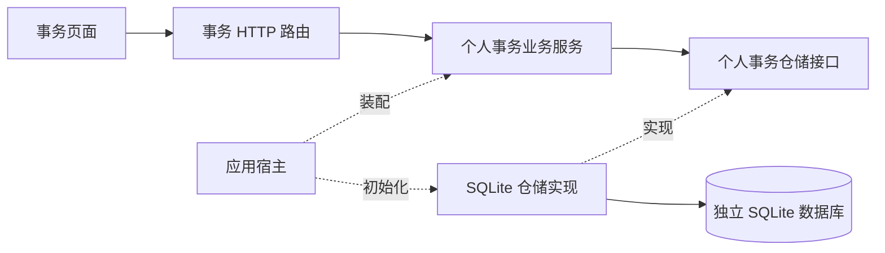

# PA-01 个人事务管理详细规格

状态：设计合同，尚未实现。与 [plan.md](plan.md) 配合使用；本文件是接口、数据及控制流程的唯一详细定义。类名后的中文为职责说明，代码标识使用英文原名。

## 1. 目标目录与架构

标记：`+` 新增，`~` 修改，`=` 保留。本 PR 无生产文件删除，无旧数据迁移。

```text
src/dotclaw/
  + personal_tasks/
      + __init__.py
      + models.py
      + repository.py
      + service.py
      + sqlite_repository.py
  ~ config/settings.py
  ~ config/__init__.py
  ~ bootstrap/application_host.py
  = bootstrap/runtime_factory.py
  = bootstrap/session_interaction.py
  = session/session.py
  = runtime/application/ports.py
  = runtime/adapters/run_repository.py
  = memory/storage.py
  = scheduler/reminder.py
  channel/web/
    ~ app.py
    ~ schemas.py
    + personal_task_schemas.py
    + personal_task_routes.py
frontend/src/
  ~ App.tsx
  ~ api.ts
  ~ types.ts
  ~ styles.css
  = Dialog.tsx
  = useSessionWorkspace.ts
  + PersonalTasks.tsx
  + PersonalTaskEditor.tsx
  + usePersonalTasks.ts
  + PersonalTasks.test.tsx
  ~ App.test.tsx
tests/
  + personal_tasks/test_service.py
  + personal_tasks/test_sqlite_repository.py
  + personal_tasks/test_config.py
  + channel/web/test_personal_tasks.py
  ~ runtime_v2/test_phase2_application_host.py
+ frontend/scripts/personal-tasks-acceptance.mjs
~ pyproject.toml
~ config.example.yaml
~ docker/config.example.yaml
~ README.md
~ docs/docker.md
+ docs/Development/personal-assistant/verification.md（实现验收后生成）
```



业务层不导入 Web、Session、Runtime、Memory；HTTP 不写 SQL；前端不决定状态迁移合法性。SQLite 保存当前权威实体，业务服务计算排序和逾期，前端只展示。仓储接口是本业务的存储边界，不是通用数据库接口。

## 2. 不变量与数据规则

### 2.1 权威字段

PersonalTask（个人事务）使用冻结 dataclass，字段如下：

| 字段 | Python 类型 | 规则 |
| --- | --- | --- |
| id | str | 服务生成 `str(uuid.uuid4())`，创建后不可变；没有业务去重含义 |
| title | str | 去除首尾空白后非空；同名合法 |
| description | str | 默认空串；保留原始换行与空白 |
| status | PersonalTaskStatus（事务状态枚举） | `pending / in_progress / completed / cancelled` |
| deadline | TaskDeadline（事务截止值）或 None | 无截止、仅日期、具体时刻三选一 |
| created_at | datetime | UTC aware，创建后不可变 |
| updated_at | datetime | UTC aware，每次成功修改更新 |
| completed_at | datetime 或 None | 当且仅当 completed 非空；完成后编辑保持原完成时间 |
| version | int | 创建为 1；每次成功编辑或状态变化加 1；不以时间戳代替版本 |

不设置未经确认的标题/说明长度上限。HTTP 拒绝未知字段、非法类型、空标题和非法日期；应用服务同样执行业务输入规范化，使未来 Agent 调用不绕过规则。内部可信对象不重复堆叠空值检查。

TaskDeadline（事务截止值）是冻结 dataclass：`kind: Literal['date','datetime']`、`value: date | datetime`。date 必须是纯 date（不能把 datetime 当作 date）；datetime 必须带时区并归一化为 UTC。没有截止用 None，不用 kind='none'。

### 2.2 时区、逾期与排序

应用级时区由配置给出，默认 `Asia/Shanghai`，不读取宿主操作系统或浏览器时区作为业务时区。数据库的时刻统一为带 Z 的 UTC ISO 字符串，固定微秒精度；日期为 `YYYY-MM-DD`。

- 日期型：`now.astimezone(app_zone).date() > deadline.value` 才逾期；截止当日全天不逾期。
- 时刻型：`now > deadline.value` 才逾期；刚好相等时不逾期。
- 仅 pending/in_progress 可显示逾期；completed/cancelled 永远不逾期。
- 列表按“有截止在前；截止排序时刻升序；created_at 升序；id 字典序”排序。日期型排序时刻取应用时区次日 00:00 对应 UTC；无截止项只按 created_at、id。
- 一次列表请求只取一次 now，保证同页判断一致。响应的 `as_of` 是该 now。
- 应用时区变更需重启；日期仍是原日历日期，判断/排序按新时区；具体时刻保持同一绝对时间点。这是配置变更的明确效果，不迁移日期值。
- 日期型次日边界涉及夏令时：用 ZoneInfo 构造次日 00:00、fold=0 后转换为 UTC，作为排序键；逾期始终以本地日期比较为准，不用固定 24 小时相加。排序键不是持久字段。

### 2.3 状态矩阵与并发

| 当前状态 | 允许目标 |
| --- | --- |
| pending | in_progress、completed、cancelled |
| in_progress | pending、completed、cancelled |
| completed | pending |
| cancelled | pending |

其他转换（包括同状态请求）报状态冲突，不写库。进入 completed 设置 completed_at=now；其他目标清空 completed_at。编辑只能改 title/description/deadline，不能隐式改状态。内容完全相同的编辑仍是一次保存，版本加 1。允许所有状态永久删除，必须携带版本；页面必须确认。

所有编辑、状态变化和删除都传 expected_version。先判断存在，再判断版本，再判断状态；存储提交时再次原子比较版本。两个使用相同版本的竞争写，最多一个成功；不能靠先读后写或进程内锁替代数据库条件更新。

## 3. 业务模块详细设计

### 3.1 `personal_tasks/models.py`

- PersonalTaskStatus（事务状态枚举）：StrEnum，取值见 §2。
- PersonalTaskFilter（列表筛选枚举）：StrEnum，`active/all/completed/cancelled`；active 对应 pending 与 in_progress。
- TaskDeadline（事务截止值）、PersonalTask（个人事务）：字段见 §2。
- PersonalTaskView（事务展示对象）：冻结 dataclass，`task: PersonalTask`、`is_overdue: bool`。
- PersonalTaskList（事务列表结果）：冻结 dataclass，`items: tuple[PersonalTaskView, ...]`、`timezone: str`、`as_of: datetime`。
- `deadline_sort_at(deadline: TaskDeadline, zone: ZoneInfo) -> datetime`：按 §2.2 返回 UTC 排序键。
- `is_overdue(task: PersonalTask, now: datetime, zone: ZoneInfo) -> bool`：按 §2.2 计算，不写实体。

两个函数同时由服务与测试调用，不建立通用日期工具类。字段序列化只在数据库适配器与 HTTP schema 边界实现，不把 HTTP 模型放入领域实体。

### 3.2 `personal_tasks/repository.py`

PersonalTaskRepository（个人事务仓储接口）采用 Protocol，全部公开操作 async：

```python
async def create(self, task: PersonalTask) -> PersonalTask: ...
async def get(self, task_id: str) -> PersonalTask | None: ...
async def list(self, statuses: tuple[PersonalTaskStatus, ...] | None) -> tuple[PersonalTask, ...]: ...
async def replace(self, task: PersonalTask, *, expected_version: int) -> PersonalTask: ...
async def delete(self, task_id: str, *, expected_version: int) -> None: ...
```

list 不承诺顺序，None 表示全部，服务不传空 tuple。replace 只能更新已有行，不允许 upsert，不修改 id/created_at；传入 task.version 必须是 expected_version+1（服务负责构造）。每次写操作的返回表示事务提交完成。get 缺失返回 None，写目标缺失抛下列异常。

定义异常：PersonalTaskNotFound（事务不存在，task_id）、PersonalTaskVersionConflict（版本冲突，task_id）、PersonalTaskStorageError（存储失败）。前两者不携带可被界面误用为已更新实体的快照；调用方需显式重新读取。存储失败保留原异常链。

不在协议中放 SQLite initialize/SQL/连接方法。初始化属于具体适配器和宿主职责。

### 3.3 `personal_tasks/service.py`

PersonalTaskService（个人事务业务服务）：

字段：`_repository: PersonalTaskRepository`、`_timezone: ZoneInfo`、`_clock: Callable[[], datetime]`。构造 `__init__(repository: PersonalTaskRepository, *, timezone: ZoneInfo, clock: Callable[[], datetime] | None = None) -> None`；默认 clock 使用 `datetime.now(UTC)`，测试注入固定 UTC 时间。不注入 ID 工厂，测试不依赖固定 ID。

```python
async def create(self, *, title: str, description: str = "", deadline: TaskDeadline | None = None) -> PersonalTaskView: ...
async def get(self, task_id: str) -> PersonalTaskView: ...
async def list(self, filter: PersonalTaskFilter = PersonalTaskFilter.ACTIVE) -> PersonalTaskList: ...
async def update(self, task_id: str, *, title: str, description: str, deadline: TaskDeadline | None, expected_version: int) -> PersonalTaskView: ...
async def change_status(self, task_id: str, *, status: PersonalTaskStatus, expected_version: int) -> PersonalTaskView: ...
async def delete(self, task_id: str, *, expected_version: int) -> None: ...
```

步骤固定：

1. create：规范化标题和截止值→取 now→生成 UUID、pending、version=1→仓储 create→以同一 now 生成展示对象。
2. get：仓储 get→缺失报错→取 now→展示对象。
3. list：映射筛选状态→仓储 list→取一次 now→计算排序键与逾期→返回结果含应用时区。
4. update：校验输入及 expected_version>=1→读取→缺失/版本检查→用 replace 构造新实体，保留状态/完成时间/创建时间→仓储条件 replace→返回。
5. change_status：读取→缺失/版本检查→矩阵检查→取 now，更新状态/完成时间/版本→仓储条件 replace→返回。
6. delete：直接调用仓储条件 delete；仓储在同一事务内区分不存在与版本冲突。

本文件定义 InvalidPersonalTaskInput（事务输入错误，message）与 InvalidPersonalTaskTransition（事务状态转换错误，task_id/current/target）。只捕获有明确映射目的的异常；不吞失败，不自动重试写入。时钟仅服务端权威，前端不提交创建/更新时间。

`__init__.py` 只提供包说明，不聚合所有内部类型或创建全局单例。

## 4. SQLite 模块详细设计

### 4.1 `personal_tasks/sqlite_repository.py`

SqlitePersonalTaskRepository（SQLite 个人事务仓储实现）字段只有 `_db_path: Path`。构造 `__init__(db_path: Path)` 不执行 IO。

公开 `async initialize() -> None` 和 §3.2 全部协议方法。每个公开方法 `await asyncio.to_thread(...)` 执行对应 `_initialize_sync/_create_sync/_get_sync/_list_sync/_replace_sync/_delete_sync`，私有方法参数、返回值与公开方法一致但同步。连接在执行它的工作线程创建和关闭，不跨线程传递连接。

内部方法：`_connect() -> sqlite3.Connection` 使用 `sqlite3.connect(path, timeout=5.0, isolation_level=None)`，row_factory=sqlite3.Row；`_row_to_task(row: sqlite3.Row) -> PersonalTask` 解析枚举/时间；`_task_values(task: PersonalTask) -> tuple[str | int | None, ...]` 按下表列顺序编码。每次操作 `try/finally` 关闭连接；写事务失败执行 rollback 后传播，捕获 sqlite3.Error 转存储异常并保留 cause；反序列化的 ValueError/TypeError 也转存储异常，不跳过损坏行。

### 4.2 数据库、表与版本

默认 `<project_root>/data/personal-assistant.sqlite3`。无会话 ID、外键或其他业务表。initialize 创建父目录，用一个事务完成建表与 `PRAGMA user_version=1`。新空数据库 user_version=0 才初始化；版本 1 验证表及列可查询，不清表；其他版本明确失败，不自动降级或覆盖。版本 0 但已经有用户表视为不兼容，不认领其他数据库。

表 `personal_tasks`：

| 列 | SQLite 类型与约束 |
| --- | --- |
| id | TEXT PRIMARY KEY NOT NULL |
| title | TEXT NOT NULL |
| description | TEXT NOT NULL |
| status | TEXT NOT NULL CHECK IN 四个状态 |
| deadline_kind | TEXT NULL，NULL/date/datetime |
| deadline_value | TEXT NULL；与 kind 同时空或同时非空 |
| created_at | TEXT NOT NULL，UTC 固定精度 ISO |
| updated_at | TEXT NOT NULL，UTC 固定精度 ISO |
| completed_at | TEXT NULL；CHECK completed 状态当且仅当非空 |
| version | INTEGER NOT NULL CHECK(version >= 1) |

deadline_kind 的 CHECK 和 NULL 配对 CHECK 必须显式表达，日期/时间合法性由边界解析负责。无标题唯一约束，无附加索引；当前单用户全量列表由服务排序。数据库使用默认 rollback journal，不切 WAL、不引入连接池；每连接设置 `PRAGMA synchronous=FULL`。初始化事务用 `BEGIN IMMEDIATE`，版本检查在取得写锁后进行，避免同时初始化竞争。

### 4.3 写入顺序与冲突

- create：BEGIN IMMEDIATE→参数化 INSERT 全部字段→COMMIT→返回输入实体；ID 冲突作为存储失败，不能按标题归并。
- replace：BEGIN IMMEDIATE→`UPDATE ... SET title=?,description=?,status=?,deadline_kind=?,deadline_value=?,updated_at=?,completed_at=?,version=? WHERE id=? AND version=?`→检查 rowcount。为 0 时在当前事务 SELECT id，缺失报 NotFound，否则 VersionConflict；失败 ROLLBACK；为 1 则 COMMIT→返回新实体。
- delete：BEGIN IMMEDIATE→`DELETE ... WHERE id=? AND version=?`→rowcount 为 0 同样区分缺失/冲突→COMMIT。
- get/list：一次 SELECT 取得结果，再解析；不跨多个查询拼装列表，不写入、不更新访问时间。list 的状态 IN 参数只由内部枚举产生，使用占位符。

连接忙超过 5 秒、只读文件、磁盘写失败均报存储失败；不额外循环重试、不切换内存。BEGIN 成功后才需要 rollback，不能让 rollback 的次生错误覆盖原异常；实现可使用明确事务上下文封装在本适配器内部，不新增通用事务框架。

### 4.4 进程中断恢复

COMMIT 是唯一成功提交点。提交前进程退出由 SQLite journal 恢复旧状态；提交后数据在下次打开时可读。无需应用层 checkpoint、后台补偿队列或运行恢复服务。数据库损坏时启动/读取明确失败，不删库重建。

COMMIT 已完成但响应丢失时，客户端无法从网络错误推断是否成功。写操作不自动重发；创建因没有幂等键可能在人工重试后产生同名新事务，这是已接受范围。页面提示先刷新核对。版本写的旧请求再次提交会冲突或不存在，不作为成功回执处理。

## 5. 配置与宿主

### 5.1 `config/settings.py`、`config/__init__.py`

新增 PersonalTaskConfig（个人事务配置）dataclass：`database_path: str = './data/personal-assistant.sqlite3'`、`timezone: str = 'Asia/Shanghai'`。Config（应用配置）新增 `personal_tasks: PersonalTaskConfig = field(default_factory=PersonalTaskConfig)`。_raw_to_config 从 `personal_tasks` 段读两个字段（load_config 继续通过它完成映射），缺失整个段使用默认；给定值必须是非空字符串，非法配置快速失败，不把 null/string 强转成默认。

config 包导出新类型。根示例与 Docker 示例增加同名段，Docker 路径 `/app/data/personal-assistant.sqlite3`。现有 data 挂载已覆盖，Compose 文件不改。

pyproject 增加 `tzdata` 运行依赖；当前仓库无 Python 锁文件，不新增锁文件；Windows 通常没有系统 IANA 库，不依赖开发机碰巧装有该包。不增加 ORM/aiosqlite。

### 5.2 `bootstrap/application_host.py`

ApplicationHost（应用宿主）新增 `_personal_task_service: PersonalTaskService | None = None`，公开只读 `personal_task_service -> PersonalTaskService`，未初始化时沿用现有属性风格抛 RuntimeError。

initialize 在现有关键模型配置验证之后、就绪日志之前装配：

1. 读 config.personal_tasks；相对路径基于 self._project_root，绝对路径保持；在本位置直接解析，不导出 runtime_factory 私有路径函数作为跨域工具。
2. `ZoneInfo(config.personal_tasks.timezone)`，未知时区终止启动。
3. 构造 SQLite 仓储并 await initialize。
4. 构造业务服务并赋值宿主属性；只有初始化成功才暴露服务。

仓储没有常驻连接，shutdown 不新增关闭协议或工作任务；现有资源回收不变。已有 Web lifespan 在正常关闭前等待请求收尾；中断仍按 SQLite 原子提交规则。现有 fake Config 调整为提供真实默认配置，不在生产代码加 getattr 兼容测试对象。

## 6. HTTP 模块

### 6.1 `personal_task_schemas.py`

使用 Pydantic，全部请求 `extra='forbid'`，业务数据类型拒绝隐式字符串/数值转换。日期严格 YYYY-MM-DD；具体时刻必须 RFC3339 且带 Z 或 ±HH:MM，不接收裸本地时间。datetime 统一转 UTC。

- TaskDeadlinePayload（截止时间载荷）：判别联合：`{kind:'date',value:'2026-11-20'}` 或 `{kind:'datetime',value:'2026-11-20T15:00:00+08:00'}`。实现 DateDeadlinePayload（日期载荷）与 DateTimeDeadlinePayload（时刻载荷）两个模型，用 kind 判别；其 value 字段分别为 date、aware datetime，序列化遵循 §2。
- CreatePersonalTaskRequest（创建请求）：title:str 必填、description:str=''、deadline:TaskDeadlinePayload|None=None。
- UpdatePersonalTaskRequest（完整编辑请求）：title、description、deadline 全部必填，deadline 可 null；expected_version:int>=1，拒绝 bool。采用完整 PUT，不引入 PATCH 的遗漏/null 双重语义。
- ChangePersonalTaskStatusRequest（状态请求）：status:PersonalTaskStatus、expected_version:int>=1。
- PersonalTaskResponse（事务响应）：展开 §2.1 全部字段，deadline 为上述载荷，附加 is_overdue:bool；无嵌套 task。
- PersonalTaskListResponse（列表响应）：items:list[PersonalTaskResponse]、timezone:str、as_of:UTC datetime。
- `to_task_response(view: PersonalTaskView) -> PersonalTaskResponse` 仅作映射，不重新算逾期。

### 6.2 `personal_task_routes.py`

模块级 APIRouter（事务路由器），前缀 `/api/v1/personal-tasks`。`_service(request: Request) -> PersonalTaskService` 从 `request.app.state.host.personal_task_service` 取得服务；不 import app.py，避免循环依赖。

| 路由函数与路径 | 入参、调用及结果 |
| --- | --- |
| `list_personal_tasks(request, filter=ACTIVE)` GET 空路径 | 查询参数 filter 四选一；service.list→200 列表 |
| `create_personal_task(request, body)` POST 空路径 | schema 转截止值→service.create→201 实体 |
| `get_personal_task(request, task_id)` GET `/{task_id}` | service.get→200 实体 |
| `update_personal_task(request, task_id, body)` PUT `/{task_id}` | service.update→200 实体 |
| `change_personal_task_status(request, task_id, body)` POST `/{task_id}/status` | service.change_status→200 实体 |
| `delete_personal_task(request, task_id, expected_version)` DELETE `/{task_id}?expected_version=N` | 正整数查询参数→service.delete→204 无正文 |

异步函数返回上述响应模型或 Response（空响应）；task_id 作为不透明字符串，不用文件路径，也不拼接 SQL。HTTP 路由不捕获一般 Exception。

### 6.3 `app.py`、`schemas.py`

create_app 注册 router，在静态前端挂载之前完成。为以下已知异常注册处理器，复用 `_error_response`，不修改已有请求校验处理器或错误信封：

| 错误 | HTTP/code | 处理 |
| --- | --- | --- |
| schema 或业务输入错误 | 422 / invalid_request | 返回可理解且不含输入敏感内容的提示 |
| 不存在 | 404 / personal_task_not_found | 不创建替代实体 |
| 版本冲突 | 409 / personal_task_version_conflict | 提示刷新，不自动覆盖 |
| 状态不合法 | 409 / personal_task_invalid_transition | 提示刷新状态后操作 |
| 仓储失败 | 500 / personal_task_storage_failed | 后端记录异常链，响应脱敏；不自动重试 |

WebErrorCode（Web 错误码枚举）追加上述四个 personal_task 值。没有一般异常兜底的新分支。现有错误信封 `{error:{code,message}}` 保持，前端 retryable 缺省 false。

## 7. 前端文件详细设计

### 7.1 `types.ts`、`api.ts`

新增 TypeScript 类型 PersonalTaskStatus（事务状态联合）、PersonalTaskFilter（列表筛选联合）、TaskDeadline（截止值判别联合）、PersonalTask（展开的 HTTP 响应）、PersonalTaskList（列表响应）、PersonalTaskInput（title/description/deadline）。严格镜像 §6，不复用会话或运行状态类型。

在 api.ts 内复用现有私有 requestJson/responseError；新增：

```typescript
listPersonalTasks(filter: PersonalTaskFilter, signal?: AbortSignal): Promise<PersonalTaskList>
getPersonalTask(id: string): Promise<PersonalTask>
createPersonalTask(input: PersonalTaskInput): Promise<PersonalTask>
updatePersonalTask(id: string, input: PersonalTaskInput, expectedVersion: number): Promise<PersonalTask>
changePersonalTaskStatus(id: string, status: PersonalTaskStatus, expectedVersion: number): Promise<PersonalTask>
deletePersonalTask(id: string, expectedVersion: number): Promise<void>
```

URL 中 id 用 encodeURIComponent，查询用 URLSearchParams。DELETE 按 deleteSession 已有模式处理 204，不调用 response.json。变更调用不设置自动重试。

### 7.2 `usePersonalTasks.ts`

`usePersonalTasks()` 返回 `{items, timezone, filter, loading, pending, error, setFilter, reload, create, update, changeStatus, remove}`。items 为服务器列表，不用 localStorage 存事务。pending 是本视图统一变更互斥状态，另用 ref 在 await 前同步占位以防同帧双击；mutation 成功返回服务器实体/void，失败原样抛给编辑器，同时保留页面可见错误。

字段：列表请求序号 ref、AbortController ref、mutationPending ref，state 对应返回字段。reload 取消旧列表并增加序号；响应只有序号匹配才可提交。变更开始时使在途旧列表失效；提交成功后 reload 权威列表，不在本地推导排序、完成时间或版本。刷新失败显示“操作已保存，列表刷新失败”，不得把已经确认成功的变更报为保存失败。提交失败保留原列表与草稿。

切换 filter、手工刷新、窗口重新获得焦点触发 reload；视图挂载期间每 60 秒刷新一次逾期展示，无变更/加载进行时才刷新。卸载清理 timer、listener 和列表请求；不通过 abort 自动撤销已发出的写请求。忽略 AbortError 只针对主动取消的 GET，不吞网络或服务错误。

版本冲突不更换编辑器持有的 expectedVersion。用户点“重新读取”后 get 最新实体，明确提示将替换当前草稿；确认后替换草稿及版本。不存在提示事务已删除，保留草稿直到用户关闭，不自动重新创建。网络失败提示“未能确认保存结果，请刷新核对后再操作”，不自动提交第二次。

### 7.3 `PersonalTasks.tsx`、`PersonalTaskEditor.tsx`

PersonalTasks（事务页面组件）props：`onOpenNavigation: () => void`。持有编辑目标和删除确认目标；调用 hook。头部“事务”、刷新、新建、应用时区说明；筛选 active/all/completed/cancelled，中文标签“未完成/全部/已完成/已取消”。列表展示标题、说明、状态、截止、逾期，操作按钮按 §2.3 矩阵；空数据与读取失败分别展示。删除使用现有 Dialog（通用对话框组件），展示标题与不可恢复提示，捕获打开确认时的版本，不能在后台刷新后悄悄换版本。

PersonalTaskEditor（事务编辑组件）props：`task: PersonalTask | null, timezone: string, pending: boolean, onSave: (input: PersonalTaskInput, expectedVersion?: number) => Promise<void>, onReload: () => Promise<void>, onClose: () => void`。create 时不传 expectedVersion；edit 固定传打开时版本。字段：title/description/deadlineKind/deadlineValue；无截止、日期、具体时刻三选一。标题 trim 后空禁用保存，说明保留换行。

日期用 date 输入。具体时刻使用明确带偏移的 ISO 文本输入，标签“截止时刻（含时区）”，示例 `2026-11-20T15:00:00+08:00`，旁边显示应用时区；输入 Z 或偏移均可，不能静默把浏览器本地时间当应用时区。编辑已有时刻用响应 UTC 字符串填充（Z 已明确），列表使用 Intl.DateTimeFormat(timeZone=timezone) 展示。此处选择最小、无歧义输入，不引入日期库或隐式夏令时猜测；未来日期选择器增强另行处理。日期值原样展示，不通过 new Date('YYYY-MM-DD') 改变日历日。

保存期间禁用字段、保存及关闭按钮；Dialog 的 onClose 在 pending 时不关闭。保存成功关闭编辑器；失败保留输入并展示错误。删除、状态操作同样只在服务确认后呈现成功。所有新增说明/注释中文。

### 7.4 `App.tsx`、`styles.css`

App（工作台根组件）新增 `activeWorkspace: 'chat' | 'tasks'` state，默认 chat；导航增加事务入口，两种桌面/移动导航共用现有 navigation 片段。选会话、搜索命中跳转或新对话时切换 chat；事务入口切换 tasks 并关闭移动导航。

保持 useSessionWorkspace（会话工作区 hook）在 App 顶层无条件调用；只切换 main 内容，不提前 return 或卸载 App。原聊天 header/conversation/composer 包为 chat 分支，tasks 分支渲染事务组件；全局设置、搜索、会话操作对话框留在原位置。禁止切换事务页调用 stop/abort/清空会话草稿；原有主题、侧栏行为保持。进入事务页不调用 getWorkspaceOptions 或创建会话。事务页样式加独立类名，复用按钮、Dialog、主题变量，不重写聊天布局。

## 8. 完整执行流程、兼容与禁止行为

### 8.1 启动和首次读取

配置默认补齐→原宿主启动→校验时区→事务库初始化或版本检查→服务装配→HTTP 就绪→用户进入事务页→GET active→仓储快照→服务排序/逾期→响应→页面展示。无表单写入就不创建任何事务。

### 8.2 创建和修改

表单输入→同步置 pending→HTTP schema→业务规范化→服务构造实体→SQLite BEGIN→INSERT/版本条件 UPDATE→COMMIT→实体响应→页面明确保存成功→刷新列表。编辑读取到提交之间有其他写入时，数据库版本条件拒绝覆盖。删除流程相同但执行条件 DELETE，返回 204。

### 8.3 完成和重新打开

页面携带旧版本与目标状态→服务读当前实体→版本检查→状态矩阵→更新完成时间与版本→仓储原子提交→列表重取。完成项从 active 消失，在 completed 可见；重新打开回到 pending，完成时间清空。不存在自动完成、自动取消或调用 Agent 的步骤。

### 8.4 故障、重启与兼容

数据库提交前失败：回滚、返回错误、页面保持草稿。提交后网络中断：页面只知道结果未确认，不自动重试，用户刷新查看。进程重启：重开同一路径数据库、SQLite 恢复 journal、读取现有记录，不重放业务操作。

旧配置缺少段使用默认；旧会话、运行和记忆文件不迁移。关闭/删除会话不访问事务数据库。旧客户端继续使用旧路由；新路由不改变现有 SSE 格式或错误字段。旧测试 fake 宿主只在新增路由被调用时需要 personal_task_service；生产不写兼容 fake 的兜底逻辑。

禁止：自动创建提醒；把提醒成功等同事务完成；让模型直接写库；标题唯一约束；无版本覆盖；错误时返回空列表/内存成功；隐藏数据损坏；顺带构建通用存储层；未实现即宣称验证通过。

## 9. 验收矩阵

| 范围 | 必须验证的行为 |
| --- | --- |
| 服务 | 四状态全部允许/禁止转换；完成时间在编辑后不变、重新打开清空；相同状态拒绝；同名可创建 |
| 时间 | 无截止、日期、偏移时刻；上海日期跨午夜；时刻等于/大于边界；完成与取消不逾期；日期与时刻混排；跨时区展示不改日期；应用时区更改后的语义 |
| 持久化 | 真实临时文件数据库重开；create/replace/delete 读回；两个独立仓储实例同版本竞争；编辑与删除竞争最多一个成功 |
| 原子性 | 子进程在 BEGIN 写入后未 COMMIT 退出，再打开无半写；COMMIT 后退出再打开保留；测试子进程使用 sys.executable，执行父测试前核对项目解释器 |
| 错误 | 模拟 sqlite3.OperationalError 后不返回成功；损坏行不静默略过；未知 schema 版本拒绝；已删除 404，旧版本 409 |
| 配置宿主 | 缺省段、指定路径、非法时区；启动初始化失败不就绪；实际测试库在 tmp_path，不污染 data；既有宿主测试继续通过 |
| HTTP | §6 全部成功与错误路径；严格请求类型；PUT 缺字段拒绝；禁止改系统字段；DELETE 204；所有事务请求模型调用计数为零 |
| 前端 | 筛选/空态/错误/创建编辑删除；双击一请求；409 草稿保留、明确重新读取；已提交后刷新失败提示准确；旧 GET 不覆盖新列表；无截止和日期型正确序列化 |
| 真实浏览器 | 创建→编辑→服务重启→完成→重新打开→取消/删除；两页面版本冲突；取消删除确认无写入；任务页切换回聊天不取消既有运行；窄屏导航与键盘对话框可用 |

测试命令、阶段门槛见 plan §4—§5。验收材料只记录实际运行结果；当前文档本身不是上述能力的实现或测试证据。
