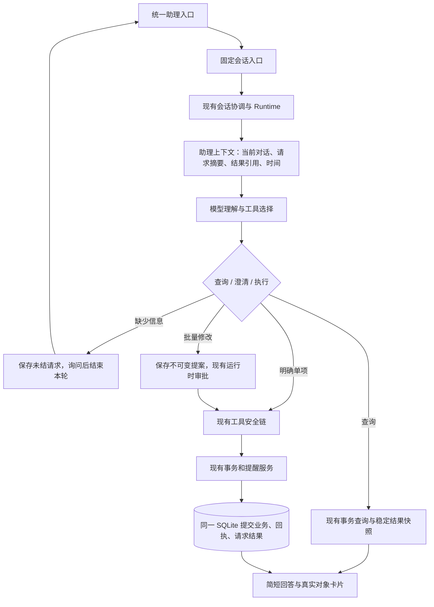

# PA-03 开发计划：自然语言事务管理与个人助理入口

2026-11-24 用户确认新增事件记录与对话式计划，见 [planning-extension.md](planning-extension.md)。该增量覆盖旧批量必须人工审批、数据库版本和规划范围约束。此前动态修复已提交为 `2a1999f`，下文“不提交”描述当时修复阶段历史。

**一个 PR，7 个有依赖的实施阶段，每阶段一个主 commit。**本文件按“总体设计 → 分阶段实施”组织；接口、状态、持久化和异常契约由 [spec.md](spec.md) 唯一定义，实现者按契约落实，不再自行选择产品语义。

设计基线：2026-11-23，初始 `feat/assistant` HEAD `87902de`，#64 及本次已确认讨论。本计划覆盖 #64；#65 不合并，#56 的长期方向不作为本期验收要求。

**首次实施状态（2026-11-23）：**T1—T6已分阶段验收并提交，当前代码基线为 `9c328f9`。T7仅完成部署身份打包、示例配置和文档/静态证据收口。用户明确禁止动态测试、应用/项目代码运行、Docker运行、build及浏览器验证；纯源码AST静态检查和TypeScript `tsc --noEmit` 属允许检查，T1—T5阶段记录有项目解释器AST证据，T6记录有tsc证据。本次没有新增一次性测试，也没有将未运行项记为通过。A1—A9状态以 `verification.md` 的实现静态证据和未验证项为准。

**后续动态修复：**用户已授权动态测试并要求本轮不提交；此前动态禁令仅描述首次实施历史。当前修复和实际验证结果见 [verification.md](verification.md) 末节。

# 第一部分：总体设计

## 1. 为什么做、做什么

现有系统能确定性管理事务与提醒，但用户仍要通过事务页面填写字段。#64 使用户通过一个助理入口表达、澄清和调整事项，并在真实保存后得到可核对的反馈。

### 必做与非目标

| 分类 | 内容 |
| --- | --- |
| 必做 | 固定助理入口与专用身份；事务创建/查询/修改/完成/取消；事件与安排持久化；明确要求的一次性及已有周期提醒管理；跨轮澄清及对话式规划草案；最小请求记录板；批量提案与执行回执；真实结果定位；幂等恢复与权限接入 |
| 本期可选 | 无。避免实现人员以“可选增强”为由扩范围；视觉微调仅限新增组件可用性 |
| 非目标 | #65 的主动跟进/默认提醒、跨历史会话召回、多会话编排、后台委派、通用研究项目看板、周期任务实例、永久删除工具、新通知渠道、多进程部署 |

原有硬性规则保留：正式事务独立于会话；对象/时间关键歧义先澄清；仅服务保存成功才报成功；截止和提醒分开；版本冲突不覆盖；批量逐项成功而非整体原子；正常完成不啰嗦解释内部联动；通知仍受现有网页存活、权限和调度条件限制。

### 输入、输出与可检查目标

输入：用户自然语言、当前助理对话、未结请求、有界查询结果、服务端消息时间及事务时区。输出只有三类：可核对的查询结果、必要问题/明确批量确认、已持久化的业务结果或明确失败。

核心故事：
1. “记一下买打印纸”直接保存无截止事务，页面可查。
2. “提醒我交材料”先确定是否已有事项及提醒时间，不创建半份正式事务。
3. “第二个改到周五”使用当时展示的稳定对象引用；歧义或并发变更先处理。
4. 澄清未完成时插入另一话题，之后可以继续；重启/压缩不丢未结请求。
5. 批量变更展示具体目标及差异，批准后逐项执行；失败和成功分开反馈。
6. 调用已提交但回执丢失后恢复不重复写入；数据库与页面仍同源。

完整验收分组见 spec §10（A1—A9），每一组必须有实现证据和验证结果。

## 2. 已有事实、缺口与改造理由

| 代码事实 | 缺口与必要改造 |
| --- | --- |
| README：本地单进程；Runtime 状态机、Port、会话协调已有边界 | 助理沿用同一运行链，不新增运行状态机或调度平台 |
| bootstrap/session_interaction.py 按身份创建、提交会话；协调器保证同会话串行 | 增加固定会话取得、管理保护与普通工作台过滤 |
| context/defaults.py、provider.py 已有对话/摘要/工具/运行消息组装及冻结重放 | 增加助理专用有界上下文；不把摘要当作正式事务或可靠候选索引 |
| personal_tasks/service.py 提供 query/get_detail/create/update/change_status；reminder_service.py 提供提醒管理 | 新增模型工具适配与局部字段合并，复用原业务服务 |
| sqlite_repository.py 的各入口独立开连接并提交，数据库v2 | 必须新增受限借用连接路径，使业务结果、去重回执和请求关闭同事务 |
| tools/executor.py 已做参数校验、权限、审批和恢复契约 | 当前档案无助理业务资源；增加业务档案，不伪装任意文件写 |
| runtime/adapters/tool_executor_adapter.py 已传稳定幂等键，但不透传额外metadata | 明确可信approved与输入来源字段；结果展示改读业务回执，不扩散修改Runtime结果序列化 |
| frontend/App.tsx 已有chat/tasks/notifications，RunActivityPanel已有审批/恢复 | 新助理入口复用聊天视图与运行控制，追加真实结果卡片与批量预览 |

本次属于“新增能力＋必要局部改造”，不进行旧事务服务替换、Runtime 重构或全仓清理。

## 3. 目标架构与职责

职责按调用链分配：
- 模型：理解表达、查询和澄清；没有SQL或批准能力。
- 助理应用服务：请求板、参数转换、局部修改、批量提案与事务协调。
- 原业务服务：领域规则及状态变更唯一入口。
- 原工具执行器与Runtime：权限、可信批准、串行执行、恢复、取消。
- 前端：展示和提交具体批准，不从模型文本判断业务已经成功。

## 4. 核心设计决定

### 4.1 一入口、一固定会话，保留未来边界

固定身份和会话ID均为personal-assistant，服务端锁内取得或创建；不用另一个绑定表。普通工作台不能创建/归档/删除该保留会话；助理可继续使用现有模型切换、停止和恢复。固定文件损坏或丢失且已有业务工作记录时明确失败，不悄悄重建。

### 4.2 请求板与事务分离

未确定的“交材料提醒”先保存为请求，不等于正式事务。请求只含已知参数、缺失信息、候选与来源、批量提案和结果引用。状态固定为awaiting_input/awaiting_confirmation/resolved/abandoned；技术运行状态不复制。纯查询不建请求，但保存有序结果快照供后续“第二个”使用。

### 4.3 业务与去重同一次提交

采用同库v3助理表与v4事务安排列，借用连接复用现有仓储。每个单项操作：查稳定key回执→校验参数hash及版本→调用现有服务→保存结果及请求状态→COMMIT→返回。失败与取消规则见spec §5，不允许实现成“先提交业务，再写去重记录”。

### 4.4 批量复用运行时执行与回执

prepare保存完整命令和前后差异；apply仅接收请求ID/版本/hash，内部业务工具默认自动执行。每项单独提交且有子key，恢复跳过已完成项；提案变化需重新prepare。仅用户显式配置ASK时复用通用运行时审批。规划建议使用独立的plans.save/apply，通过自然对话接受保存版本，不与工具权限审批混用。

### 4.5 结果展示不依赖模型编造

工具output使用版本化JSON供模型和运行事实使用；前端通过助理结果只读API读取SQLite快照/回执。用户看到的有序卡片与跨轮候选相同，点击使用真实ID。原ToolResult metadata不作为展示依赖。

### 4.6 有界上下文和正确时间基准

默认最多10条未结摘要、3组最近结果摘要，每组最多20项；显示total/has_more，详情按需查。相对时间使用原用户消息时间与事务时区，实际执行再次检查未来时刻；不因跨日补答自动顺延。现有冻结上下文重放规则不变。

## 5. 演进与兼容

- 复用：全部事务/提醒领域规则、Web事务页面API、会话协调器、模型循环、工具执行链、运行账本、审批与恢复。
- 修改：仓储受限连接边界、工具业务权限档案及可信上下文、Host装配顺序、助理上下文槽、固定会话保护、聊天视图复用。
- 新增：assistant请求/回执/结果仓储和应用服务，助理工具、身份配置、入口与只读结果API、前端结果卡片。
- 删除：无旧业务路径删除；只清理本次提取后重复的聊天展示代码，不删除现有工具/服务/API。
- 数据：SQLite v0/v1/v2/v3逐级升级到v4，同事务迁移及设置版本；无静默降级。回退二进制前恢复备份，不能旧程序直写v4。
- 打包：新身份配置随源码/Docker分发；挂载旧配置目录时单独补该文件，不能覆盖用户其他配置。
- README硬性约束保持；新增结果不意味着通知实际送达或自然语言理解永远正确。

# 第二部分：分阶段实施

以下T1—T7是2026-11-23首版实施记录，保留原提交设计用于追溯，不再作为当前批量审批、工具数量或数据库版本的实施要求；当前增量及验证以planning-extension.md与verification.md为准。

顺序固定：T1 → T2 → T3 → T4 → T5 → T6 → T7。默认当前开发分支上实施，一个PR；每阶段验收通过后提交，不推迟到末尾一次性排错。阶段未通过不进入依赖阶段。

## T1 / P0：领域契约、v3迁移与共享提交基础

**Commit：** `feat(assistant): define request records and atomic storage contracts`
**依赖：** spec §1—§5；无前置实现。

1. 新增 `src/dotclaw/assistant/{__init__.py,models.py,schemas.py,sqlite_repository.py}`。实现spec表内的请求、来源、回执、结果快照模型及动作判别联合；字段、状态、大小限制不得改成松散dict。
2. `SqliteAssistantRepository（助理SQLite仓储）` 方法固定为spec §4.1列出的请求、回执、结果查询/写入方法及has_session_data/list_recent_result_sets；写方法接收事务连接，请求修改带expected_version，读取按session隔离，列表排序updated_at降序再id升序。
3. `SqliteAssistantTransaction（助理事务上下文）` 按spec §5实现连接生命周期；迁移函数建三表及索引。修改事务仓储initialize为连续升级；迁移失败回滚。
4. 修改 `SqlitePersonalTaskRepository（事务SQLite仓储）` 构造参数connection及_connection_scope，仅覆盖spec列出的11个方法；SQL和领域联动复用，借用连接不得自行提交。原调用方不传connection，行为保持。
5. 异常：CAS失败为请求冲突；损坏JSON、未知schema、迁移错误为明确存储错误；连接关闭不得吞掉未完成事务。没有清理旧数据的分支。

**测试与门槛：**新增 `tests/assistant/test_models.py,test_repository.py,test_transaction.py`；将tests/assistant加入pyproject.toml.testpaths。验证v0/v1/v2迁移、失败回滚、复合事务回滚、借用连接不会提前提交、CAS竞争、会话隔离和损坏数据。运行原tests/personal_tasks受影响用例，确保旧服务正常。

## T2 / P0：助理应用服务与确定性幂等执行

**Commit：** `feat(assistant): implement durable requests and idempotent task actions`
**依赖：** T1；spec §3—§5。

1. 新增 `assistant/service.py` 的 `AssistantService（助理应用服务）`。公开方法对应spec工具表：query_tasks/get_task/create_task/update_task/change_task_status/create_reminder/update_reminder/change_reminder_status/list_requests/get_request/save_request/abandon_request/prepare_batch/apply_batch/get_result_set/get_run_results/reconcile_controls。
2. `AssistantService(db_path, *, timezone, repository, clock=None)` 接收数据库路径、时区、助理仓储和可选时钟；运行仓储通过明确的 `bind_run_repository` 装配一次，绑定前禁止reconcile，不允许从模型参数获取依赖。每次业务操作在助理SQLite事务内，用同一借用连接构造普通事务/提醒仓储与服务，不把普通业务服务作为AssistantService构造依赖。
3. 单项写路径使用 `_execute_once(operation_key,tool_name,arguments,context,action)`：先查回执→hash→SAVEPOINT→借用连接服务执行→保存回执/展示引用/可选请求resolved→提交。action只在这个文件内由固定命令分发，不暴露通用脚本能力。
4. patch仅变更给定字段；request关联必须同时提供expected_request_version。请求来源通过run_repository.load_messages核验用户角色、会话归属和时间。缺少可选截止不强迫澄清。
5. batch prepare保存前后展示快照及不可变命令；apply使用子key及最终汇总key，逐项提交。领域失败保存失败结果后继续；数据库错误停止；取消等待事务收尾。
6. reconcile_controls只根据实际账本与运行终态推进请求；拒绝/放弃返awaiting_input，recoverable保留；SQLite回执优先，不能反转已成功结果。

**测试与门槛：**新增 `tests/assistant/test_service.py,test_batch.py,test_recovery.py`。覆盖缺少信息不写正式事务、局部更新/清空、版本冲突、同key重放、异参key冲突、原子请求关闭、批量部分成功/中断恢复、审批拒绝同步和跨会话拒绝。注入提交前/后故障，查真实SQLite结果，不只mock返回值。

## T3 / P0：工具、权限及可信运行上下文

**Commit：** `feat(tools): expose assistant actions with scoped approval and replay`
**依赖：** T1、T2；spec §4—§6。

1. 新增 `tools/assistant_tools.py`：`AssistantToolHandler（助理工具适配器）` 实现现有ToolHandler接口，构造service、name、args_model及固定调用函数；definition/execute/args_model按现有约定，不复制ToolExecutor。register_assistant_tools(registry,service)注册spec全部工具，包括results.get。
2. tools/decorator.py增加两种ToolPolicy（权限档案）；capability.py增加业务ResourceKind（资源类型）、resource_id/operation_hash及Broker分支；policy.py默认规则增加两项ALLOW。业务字段形成资源摘要，绝不转成文件路径。
3. tools/base.py的ToolExecutionContext（工具上下文）增加approved/input_message_id/input_created_at默认字段；runtime/application/execution.py的RunExecutionView（运行视图）从request投影来源；runtime/adapters/tool_executor_adapter.py和tools/executor.py透传，模型不能覆写。历史来源时间严格读取已验证 `USER_INPUT` RunMessage `metadata['created_at']`；缺失、格式错误或无时区明确报来源错误，不回退到run启动时间。两个USER_INPUT持久化点写入用户消息时间。
4. executor._approval_operation_keys支持业务操作hash；_is_unattended_allow不豁免助理显式批准；describe_recovery把服务端数据库路径/session加入助理执行作用域。注册期注入路径元数据，scope改变不能跨库重放。
5. batch.apply needs_approval=True，handler再次检查可信approved；普通写默认无需批准，用户全局ASK/DENY仍有效。每工具恢复声明及错误证据按spec；非助理身份/会话调用明确拒绝。
6. tools executor已有执行链顺序保持；不改Runtime状态枚举、transition或通用工具重试策略。

**测试与门槛：**新增 `tests/tools/test_assistant_tools.py`；扩展test_tools_capability、test_tools_policy、test_tools_executor_security及runtime_v2/test_tool_executor_adapter。覆盖无context/伪造参数、全局deny、unattended不能绕过批量、operation_key随内容改变、可信来源透传、scope变化拒绝恢复、普通工具回归。

## T4 / P0：固定入口、身份与有界上下文

**Commit：** `feat(assistant): wire the dedicated session and bounded context`
**依赖：** T1—T3；spec §2、§7、§9。

1. 新增 `assistant/entry_service.py,context.py`，实现AssistantEntryService（固定入口服务）、AssistantContextReader（上下文读取器）。固定ID串行ensure，来源时间、摘要数量及分页提示按spec。
2. 修改session/session.py的SessionManager.create可接显式ID并拒绝覆盖；session_interaction.py新增ensure_assistant_session，普通create/update/delete保护保留身份/会话；旧会话路径不变。
3. 新增身份YAML及AssistantContextSlot（上下文槽）；修改context/{ports,defaults,slots,provider}.py，仅在启用slot时读取。Runtime factory注入读取依赖，active context重放优先级不变。
4. 修改bootstrap/application_host.py/_host_components.py/runtime_factory.py：数据库初始化提前→工具注册→原Runtime装配→bind_run_repository→原恢复与请求同步→交互入口→调度最后启动。明确初始化失败传播，不把业务工具缺失作为可忽略降级。
5. 不建立常驻助理worker或新队列；ensure发现固定文件丢失但数据库有记录时报错；首建多标签只一个会话。状态同步不触发后台业务执行。
6. 助理工具全局注册后，普通身份的 `allowed_tools` 为空时仍排除 `builtin.assistant.*`；personal-assistant显式白名单照常使用，普通身份即使显式写入该工具仍由handler身份校验拒绝。RUN/NONE上下文槽按请求读取，不缓存实例或保留binding/signal订阅；冻结active context replay优先规则不变。

**测试与门槛：**新增 `tests/assistant/test_entry.py,test_context.py`；扩展runtime_v2/test_context_plan_bootstrap、test_phase2_application_host、test_session_deletion。验证固定ID并发/恢复/损坏、普通身份隔离、上下文上限与可继续查询、历史压缩后请求保持、冻结快照重放、不因切页终止运行。

## T5 / P0：Web入口、服务端结果与批准预览

**Commit：** `feat(web): add assistant entry and authoritative result views`
**依赖：** T4；spec §8。

1. 新增 `channel/web/assistant_routes.py` 实现三个端点并由create_app挂载；直接复用 `SessionDetailResponse` 及 `assistant.models` 中的严格结果/提案响应模型，不新增仅作转导出的 `assistant_schemas.py`，沿用现有错误信封和host。
2. app.py普通sessions列表/search/options过滤固定助理；直接detail/messages/activity仍可使用。消息提交前仅针对固定会话调用before_submit；原approval/abandon端点返回后调用reconcile_controls，不改变控制动作本身。
3. 结果API从SQLite回执读实际提交数据，按run归属验证；proposal端点比对version/hash后返回保存的before/after，不从当前值重建已批准内容。
4. 保留普通事务/提醒HTTP接口；不增加聊天文本直接授权端点，不把审批交给LLM。错误映射严格使用spec。

**测试与门槛：**新增 `tests/channel/web/test_assistant.py`。真实SQLite+注入Host验证入口、结果、跨session404、proposal409、固定会话管理409、审批后请求同步、仍能使用原消息/运行控制。运行现有personal_tasks/reminders_notifications Web回归。

## T6 / P1：统一入口体验、结果卡片与批量确认

**Commit：** `feat(gui): deliver the assistant workspace and verified task results`
**依赖：** T5；spec §8。

1. 从frontend/src/App.tsx提取ChatWorkspace.tsx（共用聊天视图），保留现有消息/输入/RunActivityPanel调用语义；新增AssistantWorkspace.tsx，入口自动ensure，无会话选择/新建/删除菜单。
2. App.activeWorkspace增加assistant；普通聊天与助理各保持一个长驻useSessionWorkspace实例，避免切页取消流或混用草稿。共享展示，不共享当前选中会话状态。
3. api.ts/types.ts添加三个接口及schema_version响应类型；新增useAssistantResults.ts，按run和请求序号避免迟到覆盖，工具/控制状态变化及聚焦重新读取。
4. 新增AssistantResults.tsx有序卡片、AssistantBatchPreview.tsx前后差异；RunActivityPanel对batch.apply使用服务端预览，加载失败/版本不符禁止批准，仍调用原approval ID。
5. 成功操作触发事务列表重读，点击复用focusTaskId；已删除与加载失败分开显示。结果中的“已保存”不伪装成已送达；浏览器权限继续使用原状态UI。
6. 不新增请求板独立页面、主动提醒视图或#65快捷录入。

**测试与门槛：**新增对应组件及hook测试，扩展App/RunActivityPanel/RunObservation测试。覆盖切页仍运行、刷新恢复、草稿隔离、有序“第二项”、真实ID定位、过期审批禁用、错误重试和迟到响应。运行前端测试与build，保留已有功能。

## T7 / P0：端到端验收、部署与文档收口

**Commit：** `docs(assistant): document delivery and package the assistant identity`
**依赖：** T1—T6；spec §10全部门槛。

1. 不新增一次性集成测试文件：用户禁止本次执行动态测试，T7不通过新增未运行的测试文件形成虚假的验收信号。
2. 新增 `docs/Development/personal-assistant/pa3-NaturalLanguageAssistant/verification.md`：记录已提交代码基线、T1—T6提交、A1—A9逐项实现静态依据、静态命令结果、全部运行未验证项及限制。不得声称真实模型、SQLite、审批、取消、迁移、重启、通知或浏览器流程通过。
3. 只静态核对Docker身份白名单、COPY和Compose已有挂载；不启动容器、不操作数据库、不进行对话。记录镜像文件可读与旧挂载补齐说明。
4. 修改.dockerignore精确放行新身份YAML、Dockerfile只COPY该文件，核对compose.yml/compose.dev.yml持久配置挂载；README和docs/docker.md增量说明本期能力、请求板边界、v3迁移、固定会话限制及通知条件；更新config.example.yaml/docker/config.example.yaml的两项助理策略示例，不改用户配置。
5. 检查权限没有扩大到任意文件/进程，旧入口仍有效，spec与实现一致；差异必须修订文档并明确理由，禁止仅在PR描述补一条未落档的新规则。

**本次执行约束与完成门槛：**
- 用户禁止动态测试、应用或项目代码运行、项目脚本、npm测试/build、Docker/Compose、真实模型和浏览器；不得为一次性验证新增测试文件。纯源码AST静态检查可使用 `.venv\Scripts\python.exe`，TypeScript可使用 `tsc --noEmit`。
- T1—T5的项目解释器AST检查及T6的TypeScript静态检查按阶段记录如实引用；T7仅执行文档/白名单/Compose挂载文本核对、`git diff --check` 和必要静态扫描。`verification.md` 对A1—A9逐项列实现位置，运行验证统一标为“未执行”。
- 交付门槛是文档与精确身份配置打包完成、示例策略形状与真实 `tools.policy.rules` 配置一致、规格差异已同步、静态命令结果可复查；这不代表A1—A9运行验收通过。

## 6. 最终交付与风险控制

交付：一个PR、T1—T6实现提交、T7文档/身份配置提交，两份设计文档和如实标记未验证的verification记录。无需新建GitHub Tickets；T1—T7是本PR内部可验收工作单元。

主要风险及控制：
- **共享提交改造影响旧调用**：仅改指定仓储方法，旧服务调用回归与故障注入先通过。
- **模型理解不稳定**：真实对话轨迹验收，明确单模型/用例边界；不建立“全部意图都能识别”的承诺。
- **审批/恢复跨存储投影不一致**：运行批准仍以原账本为准，业务回执同库原子；请求投影可从权威记录重建，不双写批准。
- **当前方案范围膨胀**：请求板只服务事务管理，保持#65、跨会话和后台委派排除项。
- **升级与配置挂载**：v3不降级直写，新身份单独分发；保留原数据，升级前备份，不覆盖用户配置。

正式设计无悬置的产品分支；开发人员只需实现指定接口和验证契约。若现有代码发生变化，先复核受影响事实并修订plan/spec，再实施变更。
