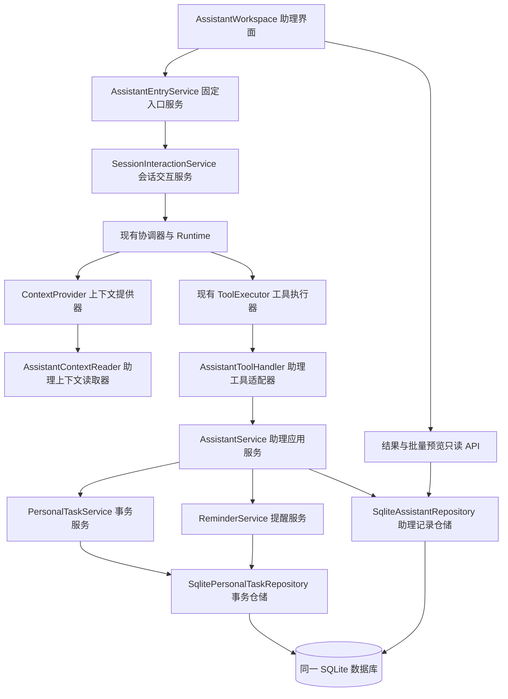
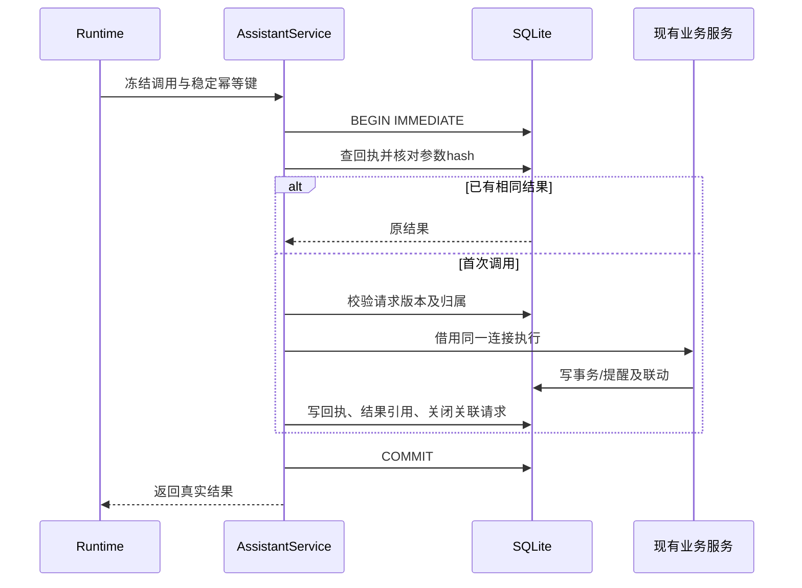

# PA-03 技术规格：自然语言事务管理与个人助理入口

2026-11-24 计划增量的详细字段与交互见 [planning-extension.md](planning-extension.md)。本文已同步内部工具默认自动执行、数据库v4及规划工具边界；通用运行时审批不变。T1—T7首版实施历史保留在plan.md，前轮动态修复已提交 `2a1999f`。

设计基线：2026-11-23。T1—T6已实现并分阶段提交，T7交付与本次验证边界见 [plan.md](plan.md) 和 [verification.md](verification.md)。首次实施仅做静态验证；用户随后授权动态修复并要求本轮不提交。最新动态结果及未覆盖边界见verification.md末节，不能把未执行的第10节项目记为通过。契约冲突时先修订设计，不允许实现者自行选择替代语义。范围为 #64，一个 PR。以下类名均为现有类型或本次指定的拟新增类型。

## 1. 架构与不可变规则

- 模型理解意图、选择查询和澄清，不直接访问数据库。业务规则继续由现有事务/提醒服务持有。
- Runtime 状态机是运行控制唯一来源；请求板只表示业务沟通进度，不复制 running/suspended/recoverable 状态。
- 会话历史用于理解，事务数据库用于判断实际状态；请求中的候选不等于选中对象。
- 正式事务生命周期独立于会话；请求记录归属固定助理会话。不实现跨会话召回、主动跟进、自动派发。
- SQLite 同一数据目录仍限一个应用进程；不同标签页共享服务端会话，不引入多进程锁或分布式队列。
- 新注释中文；边界校验在工具/API/存储反序列化处，业务内部不重复校验已保证的类型。

## 2. 入口、会话与部署

新增 `assistant/entry_service.py`：

`AssistantEntryService（固定助理入口服务）` 常量 `AGENT_ID="personal-assistant"`、`SESSION_ID="personal-assistant"`；持有会话交互服务、会话管理器、助理服务、一个 `asyncio.Lock`。不持有第二个 Runtime。

- `ensure_session() -> Session（会话）`：锁内读取固定 ID；存在则校验身份、未归档及模型；不存在则使用当前首选 chat 模型创建固定 ID 会话。文件保存成功后返回。不建 SQLite 绑定表：固定 ID 本身就是绑定，避免文件与数据库双写。
- `before_submit() -> None`：同步本会话请求的审批终态投影，然后沿用原消息入口提交；不是新运行队列。

修改 `SessionManager（会话管理器）.create(..., *, session_id: str | None = None)`：默认仍生成随机 ID；显式 ID 经过现有路径校验，已存在则报冲突，不覆盖文件。固定 ID 创建仅由入口服务调用。保留原原子保存方式。绑定文件损坏报存储错误，不自动重建；固定文件不存在但助理 SQLite 已有该会话数据时报 `assistant_session_missing`，避免默默丢失对话历史。

修改 `SessionInteractionService（会话交互服务）`：
- 普通 `create_session` 拒绝保留的助理身份，抛 `ReservedAssistantSessionError（保留助理会话错误）`；入口使用新增 `ensure_assistant_session()` 经相同身份/模型检查调用固定 ID 创建。
- `update_session` 不允许固定会话归档/重命名，`delete_session` 不允许删除；切换模型继续走现有接口与运行锁。
- 普通会话列表、搜索、可创建身份选项过滤该固定会话/身份；通过 ID 加载、发送、运行观察、停止、审批和恢复继续工作。
- 模型未配置、模型不可用、身份缺失分别显示现有配置错误，不自动换身份/模型。当前 Host 已在无 chat 模型时拒绝启动，前端按既有服务不可用行为展示，不为此重写启动机制。
- 同会话忙碌继续使用协调器现有拒绝/控制结果；不排队，不因换页停止运行。

新增身份 YAML `.dotclaw/agentConfig/personal-assistant.yaml`，显式列出17个助理工具（含plans.save/apply）；不开放 exec、任意文件、委派、MCP 或记忆写入工具。Docker上下文仅放行此文件及所需父目录，Dockerfile只复制该身份文件；Compose既有只读目录挂载会遮住镜像内置文件，旧挂载源需单独补该文件且不覆盖其他身份。上下文仅启用身份、工具、当前对话、历史摘要、运行消息及本次助理上下文。助理专用快照不加载无关全局 Agent 目录、知识库和记忆；普通身份空白工具白名单不暴露 `builtin.assistant.*`，personal-assistant显式白名单保留，handler仍校验身份；正常身份的其他行为不变。

## 3. 数据模型与数据库 v4

唯一迁移入口仍为 `SqlitePersonalTaskRepository（事务 SQLite 仓储）._initialize_sync`。0→1→2→3→4 连续执行；v3通过 `assistant/sqlite_repository.py:migrate_assistant_schema(connection)` 创建助理表，v4在原事务表增加planning_json，默认普通任务和空安排。版本更新与迁移在同一事务，旧表和旧行保留；拒绝 >4，迁移中断整体回滚。旧二进制不能写v4，回退需要恢复升级前备份。planning结构见planning-extension.md。

### 3.1 类型与表

| 类型/表 | 精确字段与约束 |
| --- | --- |
| `AssistantRequest（助理未结请求）` / `assistant_requests` | id TEXT PK；session_id TEXT；kind=create_task/update_task/change_status/reminder/batch；summary TEXT；status=awaiting_input/awaiting_confirmation/resolved/abandoned；payload_json TEXT；source_refs_json TEXT；proposal_json TEXT NULL；proposal_hash TEXT NULL；proposal_run_id TEXT NULL；result_refs_json TEXT（默认 []）；version INTEGER≥1；created_at/updated_at UTC TEXT |
| `AssistantOperation（已完成操作回执）` / `assistant_operations` | operation_key TEXT PK；session_id、run_id、call_id、tool_name、arguments_hash TEXT；request_id TEXT NULL；result_json TEXT；created_at UTC TEXT。只保存终结的单项结果，不存 running 标志 |
| `AssistantResultSet（展示引用快照）` / `assistant_result_sets` | id TEXT PK；session_id、run_id、call_id TEXT；items_json TEXT；created_at UTC TEXT；UNIQUE(session_id,run_id,call_id) |
| `AssistantInputRef（用户输入来源）` | run_id、message_id、created_at；仅指向服务端实际用户消息，不保存第二份聊天全文 |
| `AssistantOperationResult（业务操作结果）` | schema_version=1；operation；outcome=succeeded/failed/partial；data（按operation判别的查询页/详情/请求数据，可空）；task_refs[]；reminder_refs[]；changes[]；error=NULL或{code,message}；result_set_id可空；request_id可空；items[]仅批量 |

表内除明确标注NULL的字段外均为NOT NULL；状态、kind和version设置CHECK；JSON空集合显式写入而非NULL。索引：requests(session_id,status,updated_at,id)、operations(session_id,run_id,created_at,operation_key)、result_sets(session_id,created_at,id)。JSON 通过严格模型解码，未知 schema_version/损坏数据明确报错，禁止默认空数组吞掉损坏。

跨文件 session/run ID 不建伪外键；所有读取验证 session 归属。事务引用也不建级联删除外键：正式事务被用户删除后仍保留历史回执，定位返回已删除，不能指向同名对象。记录板与回执随该数据库保留，首版不提供清理接口、不自动 TTL 清除幂等键。

`payload_json` 的类型为 `AssistantRequestPayload（请求草案）`：
- intent_args：对应第 4 节动作的部分字段，允许未齐全；不是可直接执行的命令。
- missing_fields：有限字段路径列表；candidate_task_ids：有序去重 ID；selected_task_ids：明确选中的 ID。
- temporal_values：{field,original_text,source_ref,resolved_value,timezone}[]。消息时间来自服务端；模型不能提供来源时间。
- last_error 可空，记录最后一个需要用户处理的问题，不复制 Runtime 错误账本。

长度限制：summary≤200 字，单请求 payload 序列化≤16 KiB、缺失字段≤20、候选≤50、来源≤20；查询页≤50、批量≤20 个已有对象。超限返回明确错误要求缩小范围，不能截断写操作。

### 3.2 请求状态迁移

| 来源 | 触发与写入者 | 目标/结果 |
| --- | --- | --- |
| 不存在 | request.save 保存需要追问的草案 | awaiting_input；id由服务生成 |
| awaiting_input | request.save 携带 expected_version 更新 | awaiting_input；版本+1，保留来源，替换本次草案 |
| awaiting_input或不存在 | batch.prepare 保存完整且不可变 proposal | awaiting_confirmation；版本+1或新建；proposal_hash及来源 run 固定 |
| awaiting_input | 关联单项操作成功，与业务提交同事务 | resolved；真实 result_refs，版本+1 |
| awaiting_confirmation | 批量全部单项成功 | resolved；最后一项提交时更新 |
| awaiting_confirmation | 批量部分失败，或对应显式ASK审批拒绝 | awaiting_input；保存失败及已成功引用，清除可执行 proposal；重新修改必须 prepare |
| awaiting_input/awaiting_confirmation | request.abandon，当前没有活跃审批执行 | abandoned；不取消正式事务 |
| resolved/abandoned | 再次修改/执行草案 | 拒绝；新意图创建新请求 |

模型不能直接设置 resolved 或批准标志。运行暂时 recoverable 或仍等待审批时保持请求，不清除 proposal；用户通过现有控制面先恢复/拒绝/放弃运行。纯查询和直接完成的单项操作无需请求记录。

`AssistantService.reconcile_controls(session_id)` 保留显式ASK策略及历史挂起批量的拒绝投影：枚举awaiting_confirmation请求，根据proposal_run_id读取原运行账本，匹配batch.apply的request_id/version/hash，只在已明确拒绝时CAS退回awaiting_input；默认自动执行的准备运行结束不撤销提案。批量回执优先，已成功项不回退。入口、启动及原控制面收尾继续调用；重复调用幂等，CAS冲突重读而不覆盖。

## 4. 接口：模型只表达业务参数

新增 `assistant/schemas.py`：工具输入使用严格 Pydantic 模型、extra=forbid；日期/时刻转换为现有领域类型；提醒规则沿用现有规则校验，不引用 Web 请求模型。使用显式判别联合，禁止任意 action 字符串及无结构字典。

所有工具名以前缀 `builtin.assistant.` 注册。模型不可传 session/run/call ID、数据库路径、幂等键、批准标志。通过运行上下文注入。

| 工具及输入模型 | 方法与输出 |
| --- | --- |
| tasks.query：`TaskQueryInput（查询入参）`，filter、plan_filter、keyword、deadline_from/until、overdue_only、offset=0、limit=20（1..50） | `AssistantService.query_tasks(input, context)` → 现有 query 的页结果＋持久 result_set_id；保留当时顺序 |
| tasks.get：`TaskGetInput（详情入参）`，task_id | `get_task` → 事务、版本、全部提醒、时间时区；保存可定位快照 |
| tasks.create：`TaskCreateInput（创建入参）`，title、description=""、deadline可空、planning可选、reminders=[]、普通请求引用可选成对 | `create_task` → 原子保存事务及初始提醒、回执、普通请求 resolved；不关联规划请求 |
| tasks.update：`TaskUpdateInput（局部修改入参）`，task_id、expected_version、patch、普通请求引用可选 | `update_task` → 允许 title/description/deadline/planning；用 model_fields_set 区分未提供与清空；至少一项；合并当前值后调现有 update；不关闭规划请求 |
| tasks.status：`TaskStatusInput（状态入参）`，task_id、expected_version、status=completed/cancelled、可选请求引用 | `change_task_status` → 现有 change_status；不新增 reopen/进度管理工具 |
| reminders.create/update/status：`ReminderCreateInput / ReminderUpdateInput / ReminderStatusInput（提醒操作入参）` | 使用现有 service 同名方法；create含task_id/rule/expected_task_version，update再含reminder_id/expected_version，status以action=pause/resume/cancel替代rule；可选请求引用同上 |
| requests.list/get：`RequestListInput / RequestGetInput（请求查询入参）` | list(keyword="",offset=0,limit=20) 返回当前会话未结页及total；get(id)返回完整草案和来源 |
| results.get：`ResultSetGetInput（结果快照入参）`，result_set_id | `get_result_set`返回当前会话对应快照完整有序页，不重新查询排序 |
| requests.save：`RequestSaveInput（草案入参）` | 新建 id为空；修改 id+expected_version；输入kind/summary/payload/source_refs；时间由服务查得，当前输入自动加入；仅 awaiting_input，检查来源在当前会话；不得创建或覆盖规划草案 |
| requests.abandon：`RequestAbandonInput（放弃草案入参）`，id/expected_version | 仅放弃未结请求；有当前活跃审批时返回需先处理审批 |
| batch.prepare：`BatchPrepareInput（批量提案入参）` | 可选请求引用、summary、items[2..20]；每项只允许update/status/reminder update或status，含读取版本；相同事务只允许一项，避免批内相互改变版本；查详情保存展示前后差异、完整命令和hash；不写业务 |
| batch.apply：`BatchApplyInput（执行批量入参）` | request_id/expected_version/proposal_hash；默认自动执行；读取已保存命令，不接收新的items；逐项执行并返回全部结果 |
| plans.save：`PlanSaveInput（计划草案入参）` | 保存阶段、缺失信息、关联事件和结构化任务安排，不写正式任务；更新使用request_id/expected_version；精确字段与约束见planning-extension.md |
| plans.apply：`PlanApplyInput（接受计划入参）` | 对话明确接受后，以request_id/expected_version执行保存的proposed版本；同事务创建全部任务与提醒、写回执并关闭请求 |

多个新建事项由模型逐项调用 create，不伪称原子批量。新建时不强制搜索所有现有事务；存在上下文引用或重复疑问时先查询。批量意图识别及调用正确工具属于模型验收项，不能声称程序能从任意语言证明模型没有拆成多个单项调用。

所有工具返回 `ToolResult（工具结果）.output` 中的规范 JSON（schema_version=1）；不依赖 metadata 透传。成功以 COMMIT 后结果为准。领域错误映射为现有 INVALID_ARGUMENTS/EXECUTION_ERROR，output.error.code 保留 not_found/version_conflict/invalid_transition/invalid_time/request_conflict/key_conflict；存储错误不吞掉，工具层转可见执行错误。错误不伪造成功 task_refs。

### 4.1 公开方法签名与调用约定

所有模型工具对应应用方法统一为 `async method(input: 对应Input类型, context: ToolExecutionContext) -> AssistantOperationResult`；每个method按上表固定绑定，不能由输入指定方法名。read结果的data为结构化对象：事务页含items/total/offset/limit/timezone/as_of；详情含task/reminders；请求页含items/total/offset/limit；草案详情为完整请求。

事务引用字段固定为{id,title,status,version}，提醒引用为{id,task_id,status,version,next_fire_at}；changes复用现有提醒联动结果。结果快照items保存事务引用及页面显示需要的deadline/reminder_summary，不保存可作为最新状态使用的副本。

非模型方法固定为：`bind_run_repository(repository) -> None`（只允许Host装配）、`async reconcile_controls(session_id: str) -> None`、`async get_run_results(session_id: str, run_id: str) -> AssistantRunResults（助理运行展示结果）`、`async get_proposal(session_id: str, request_id: str, version: int, proposal_hash: str) -> AssistantProposalPreview（助理提案预览）`。后两者提供Web只读查询，先核对会话与run归属。

仓储接口均为async：`get_request(session_id,id,*,connection=None)`；`list_requests(session_id,*,keyword,offset,limit,statuses,connection=None)`；`save_request(request,*,expected_version,connection)`（新建expected_version=None）；`get_operation(key,*,connection=None)`；`insert_operation(operation,*,connection)`；`save_result_set(result_set,*,connection)`；`get_result_set(session_id,id,*,connection=None)`；`list_run_results(session_id,run_id)`；`has_session_data(session_id)`；`list_recent_result_sets(session_id,limit)`。查询单值返回对象或None；服务决定404；分页返回items/total。所有写入都要求外层连接；没有隐式提交。状态同步也自行开启事务并调用CAS，借用现有行version。

工具查询要保存快照时，同一次事务中调用借用连接的query/get_detail并写快照、回执，保证结果与卡片一致。requests.list/get和results.get只读，不写回执，使用SAFE_RETRY；其他工具均走带key的持久化契约。

## 5. 业务提交、幂等与取消

### 5.1 明确的事务复用方案

现有仓储每方法独立开连接、BEGIN/COMMIT，不能直接串接成原子操作。本 PR 仅为实际调用的下列方法加入“借用连接”路径：

`get/get_detail/read_task_snapshot/list_reminders/get_reminder/create/create_with_reminders/replace/replace_with_effects/create_reminder/replace_reminder`。

`SqlitePersonalTaskRepository.__init__(db_path, timezone, *, connection=None)` 新增内部借用连接；提取 `_connection_scope(write: bool)`：
- 自有连接：原行为，write用BEGIN IMMEDIATE，读快照用BEGIN，成功提交，异常回滚，最后关闭。
- 借用连接：不得BEGIN/COMMIT/ROLLBACK/close；SQL及已有联动逻辑复用同一方法，错误向外传播。
- 其他调度、通知、删除入口仍使用原自有连接，不顺带改造。
- public async 方法仍通过 to_thread 执行；借用连接只供一次助理操作串行调用。

新增 `SqliteAssistantTransaction（助理事务上下文）`，在 `assistant/sqlite_repository.py`：
`async __aenter__/__aexit__` 创建 isolation_level=None、check_same_thread=False 的专属连接并BEGIN IMMEDIATE；FULL同步与外键设置同现有仓储；只允许串行await，不并行使用连接。提交、回滚和关闭也在线程中执行。连接不放全局、不被其他请求共享。

事务内临时构造同类事务/提醒服务，仓储为借用连接实例，时区不变，clock为本操作捕获的UTC时间。业务服务无网络调用；没有模型调用或等待用户发生在SQLite事务内。外层整个事务 coroutine 用现有 `_await_io_completion` 保护，超时/取消必须等COMMIT或ROLLBACK及close真实完成后再传播，不能让工作线程在返回取消后继续写入。

### 5.2 单项写入顺序

规范 JSON hash：sort_keys=True、separators=(",",":")、ensure_ascii=False；解析时间统一UTC，显式保留字段是否提供的语义。hash包含工具名、业务参数、会话、可选请求版本，不包含attempt/当前时间。operation_key使用runtime注入idempotency_key，不由模型指定；缺失时报配置错误，不生成随机替代键。

收到已有key时先检查hash，再做任何新版本/未来时间校验；相同返回原回执（即使事务后来改动/删除），不同报 key_conflict。无回执时使用 SAVEPOINT effect：确定性领域失败回滚该savepoint，保存失败回执后提交；存储错误回滚整个事务，不保存不确定结果。提交响应丢失可按原key读取；提交未发生则重新校验并执行。

所有持久助理工具（包括查询结果快照、草案写入）声明 KEYED_IDEMPOTENT、side_effect=PRESENT、contract_version="assistant-v1"、recovery_max_retries=1；模型重新发起新调用不等于同key恢复。纯 requests.list/get 可声明 SAFE_RETRY、side_effect=NONE，返回当前数据。

`ToolExecutor.describe_recovery` 的 execution_scope 对助理工具额外包含 definition.metadata 中服务端注入的绝对数据库路径和固定session ID；数据库配置变化不能把旧调用恢复到新库。元数据只来自注册期，工具schema不暴露路径。

### 5.3 批量与请求完成

- prepare 成功的 proposal 不原地编辑；要改内容先退回awaiting_input，再prepare生成新version/hash。
- prepare及apply可跨run，读取保存的session/request version/hash，不因准备运行结束而撤销提案。proposal_run_id保留来源追踪和历史显式审批投影用途，不作为默认apply的同run门槛。
- 预览before/after只表示用户要求的直接字段变化；相对提醒联动以规则摘要说明，实际时间由提交时服务计算并返回，不把prepare时的预测当作最终事实。
- apply 首先验证session、request version/hash；逐项取命令。子操作键固定为 `batch:{request_id}:{proposal_hash}:{index}`，防同一提案被新tool call重复执行。
- 每项是独立BEGIN IMMEDIATE，验证版本、调用同一业务服务、写子回执。领域失败记录后继续；存储错误立即终止剩余项并交Runtime恢复。
- 最后一项同事务汇总子回执，全成功resolved；否则awaiting_input并清除proposal可执行状态，保留结果引用及失败内容。另保存以request_id/hash唯一的批量汇总回执，后续apply先查它，再检查已变化的请求状态。
- 中途取消保留已提交项；运行恢复按子键跳过已提交项。运行放弃不撤销成功项，也不自动继续执行；未结提案由后续显式执行或放弃收尾。
- apply完成后、Runtime记账前崩溃：批量汇总已持久化，恢复返回原汇总。聚合回执与最后一项提交必须同事务。
- request.save/abandon本身也使用运行时key，CAS更新和回执同事务。

## 6. 工具权限：默认自动执行，复用通用控制面

修改 `ToolPolicy（工具权限档案）` 新增 ASSISTANT_READ="assistant.read"、ASSISTANT_WRITE="assistant.write"；`ResourceKind（资源类型）` 同名新增；`CapabilityRequest（能力请求）` 新增 resource_id、operation_hash可选字段。

`CapabilityBroker.resolve` 对两个档案形成业务资源请求，不访问数据库：读取工具的已验证参数，resource_id取任务/请求ID或固定"collection"，operation_hash为工具名+完整规范参数hash；describe返回有限业务摘要，不显示数据库路径。

默认两档案ALLOW，仅对显式助理工具生效。现有policy merge仍允许用户改为ASK/DENY，Agent只能收窄。handler验证agent_id与固定session_id，不因其他身份allowed_tools为空就允许访问助理服务；直接无context调用拒绝。不扩大文件写、进程或网络权限。

普通身份的 `allowed_tools` 为空代表其他已注册工具可用，但助理工具全局注册后必须从该默认集合中排除 `builtin.assistant.*`；personal-assistant显式白名单正常保留。普通身份即使显式列出助理工具，handler仍按身份和固定会话校验并拒绝调用。

助理工具包括batch.apply默认不声明强制人工审批；两种assistant档案默认ALLOW。用户显式配置ASK/DENY时继续使用通用工具权限与运行时控制，不改造主干审批状态机。

`ToolExecutionContext（工具执行上下文）` 的approved仍由通用运行时审批传递，不由模型提供。内部助理batch handler不再把该值作为默认执行门槛；身份、会话、请求版本及proposal_hash仍在业务边界校验。

`_approval_operation_keys` 为assistant资源追加规范化的资源+operation_hash键，保留原文件键规则。使用现有运行账本冻结call.arguments、审批ID和decision，不增加另一套approve端点。

默认批量流程为prepare→apply→真实结果回执，不要求用户点击批准。只有显式ASK策略或旧挂起运行仍走既有审批端点及提案预览；预览不匹配时不能批准。普通聊天不替代通用权限审批；用户通过对话接受规划则由plans.apply处理具体草案，二者语义独立。

## 7. 来源、上下文和结果引用

新增 `RunExecutionView（运行只读视图）` 字段 input_message_id、input_created_at（默认空，view()从request.user_message填充）；同名字段加到工具上下文，适配器和_build_context透传。新助理调用要求有效值；历史普通运行默认值保持兼容。不新增持久控制字段，来源已有RunRequest恢复。

新增 `AssistantContextReader（助理上下文读取器）.read(session_id,input_ref) -> str`，返回版本化JSON文本：
- 当前UTC时间、业务时区、当前用户输入时间。
- 最近更新的10条未结请求摘要（每项≤200字），总数与has_more；当前明确指向的请求详细信息仍由get工具读取。
- 最近3个展示快照的ID、每个前20项的有序ID/标题/版本；如原页超过20明确has_more，可通过 `results.get(result_set_id)` 取完整页（≤50）。
- scheduler.enabled仅为配置事实；不把浏览器是否可见伪装成后端已知。渠道权限由前端现有状态展示。

新增 `AssistantContextSlot（助理上下文槽）`，RUN owner、cache_scope=NONE，注册在defaults。普通重建每次读取最新请求；审批/恢复沿用现有冻结active context，再通过工具取最新数据，不破坏上下文重放。ContextDependencies新增assistant_context_reader可选依赖；只在身份启用该slot时调用，不给所有身份增加读库开销。

`ContextSlotManager` 对cache_scope=NONE按请求创建实例，不缓存实例、binding或signal订阅；不改变其他缓存范围的生命周期或active context重放优先级。

时间解析：模型根据输入来源时间解释相对日期，保存原文和基准；服务校验类型、未来提醒和来源归属，不伪称确定性校验能证明任意自然语言解释正确。来源必须是当前助理会话中已验证的 `USER_INPUT` RunMessage；输入时间使用消息 `metadata['created_at']`。当前输入使用冻结请求时间，历史输入严格读取其持久化metadata；缺失、格式错误或缺少时区均明确报来源错误，绝不退回Run启动时间。Engine在两个用户输入持久化点将来源时间写入metadata。跨午夜及“下午/上午”属于模型验收用例。

结果顺序：tasks.query的快照由服务按查询输出生成；前端直接渲染该有序卡片列表，模型提示不得重新编号重排。后续“第二个”按用户指向快照读取，不以新查询顺序代替；多页/多组不明确则澄清。snapshot ID采用服务端run_id/call_id确定性生成；绑定运行工具结果，不依赖最终回答成功投影到会话。

快照和操作回执在助理右侧“事务结果”中按需展示，默认不在主对话内渲染，新工具查询不自动打开侧栏。每轮执行记录、来源及原运行控制仍随对应回复展示，详情默认折叠，失败与暂停保留原提示；侧栏不汇总运行记录或重复正文，普通聊天保持原展示。

工具output持久化于现有工具消息；额外的展示结构由SQLite回执/结果表提供只读API。不修改所有Runtime ToolResult序列化链，也不从模型Markdown抽取事务ID。

## 8. Web、前端与错误契约

新增 `channel/web/assistant_routes.py`，复用现有错误信封和严格响应模型，不新增仅转导出的 `assistant_schemas.py`：
- POST /api/v1/assistant/session → 200 SessionDetailResponse（会话详情响应）；确保入口并同步审批终态。
- GET /api/v1/assistant/results?run_id=... → {schema_version:1,run_id,result_sets:[],operations:[]}。校验run存在且属于固定会话；返回全部已提交工具回执，可在流中查询；不存在404，跨会话404。
- GET /api/v1/assistant/requests/{id}/proposal?version=...&hash=... → {request_id,version,hash,items:[{target,before,after}]}；只读匹配快照，版本变化409。
- 不增加业务写REST入口；事务页面原API不变。消息、审批、停止、恢复沿用现有端点。
- reserved_assistant_session、assistant_session_missing、request_conflict→409；输入错误422；找不到404；存储失败500；实际运行忙碌沿用原错误语义。

前端新增 `AssistantWorkspace（助理工作区组件）`、`AssistantResults（业务结果组件）`、`AssistantBatchPreview（批量预览组件）`、`useAssistantResults（结果读取 Hook）`。从App提取现有聊天内容为 `ChatWorkspace（共用聊天视图组件）`，只移动消息/输入/运行控制展示，不重构会话业务。普通聊天和助理各持有长驻的useSessionWorkspace实例，切换工作区不丢流、草稿和审批。

App.activeWorkspace增加assistant；固定入口无新会话/删除菜单。结果hook在工具完成、审批状态变化、终态及重连/页面聚焦后取results；在途按run_id和请求序号隔离，错误保留旧结果并显示重试。结果卡片依据服务端ID调用App现有focusTaskId定位；已删除显示不可用。操作成功后触发现有事务列表重新读取，不本地推算提醒联动。

RunActivityPanel的批量审批使用现有按钮，summary区域替换为服务端preview；只有该工具启用，其他工具展示不变。确认始终绑定原approval_id；预览不可用不能批准。读取失败不影响查看已成功的事务结果。

## 9. 组合根与兼容顺序

ApplicationHost.initialize：
1. 沿用配置、会话、模型初始化；提前创建并迁移事务库，构造普通事务/提醒/通知服务与助理仓储/服务。
2. _build_tools接收assistant_service，在同一registry注册业务handler；沿用原MCP初始化。
3. 读取身份，build_runtime_services传入assistant_context_reader，构建原Runtime；把run_repository绑定给请求控制同步服务，不形成Runtime对业务反向依赖。
4. 执行原恢复流程，再reconcile_controls；构造会话交互和助理入口；调度器最后启动。
5. shutdown沿用调度先停、运行收尾和资源关闭；助理没有常驻数据库连接、没有后台worker。

保护固定会话的校验在交互服务，不只在前端隐藏。原API/旧服务调用签名保持兼容；借用连接仅是仓储内部新增参数。配置默认不修改用户现有文件，只通过默认档案与示例文档提供能力。

Docker/源码部署必须携带新身份YAML。当前.dockerignore默认排除.dotclaw：只增加父目录及`.dotclaw/agentConfig/personal-assistant.yaml`的精确白名单；Dockerfile在创建目标目录后COPY这一文件到`/app/.dotclaw/agentConfig/`并赋予现有运行用户读取权限，禁止COPY整个私人配置目录。核对compose.yml/compose.dev.yml现有挂载：既有持久化agentConfig挂载不会自动出现新文件，缺失时给出明确缺失身份错误并记录需复制的文件路径，不静默回退到default。部署步骤复制该单个新配置，不覆盖其他用户身份配置；不自动改写只读挂载。

## 10. 验收矩阵与完成界限

- A1：固定入口并发首次创建、刷新、重启、误删保护；原聊天/搜索/模型切换/审批保持。
- A2：创建、查询、局部修改、完成、取消与页面同源；日期截止不被自动改为提醒。
- A3：一次性及每日/每周/月/年既有规则；多提醒消歧、暂停/恢复条件、提醒与事务原子新建、通知实际限制。
- A4：未结草案无正式事务副作用；插入话题、补答、放弃、跨午夜、压缩/重启后继续；来源与session隔离。
- A5：查询结果稳定顺序、多页和同名选择、删除/并发变化；展示链接来自实际回执。
- A6：批准/拒绝、过期proposal、无批准调用、全局deny、unattended配置、拒绝后恢复、批量部分成功。
- A7：提交前故障全回滚；提交后回执丢失同key返回；key不同参数拒绝；请求关闭与业务一致；批量中止恢复跳过已提交项；取消线程真正收尾。
- A8：v0/v1/v2迁移保留数据，故障回滚；新库初始化；不支持版本明确拒绝。
- A9：有界上下文与额外查询可达；当前模型/配置下保存真实对话、工具轨迹与失败用例，不用脚本模型证明自然语言泛化能力。

不声称所有自然语言都能正确理解、不承诺跨会话任意召回、外部通知必达或整批原子提交。无待定产品决策；实现如遇现有接口与本规格不符，先报告具体冲突修订规格。
