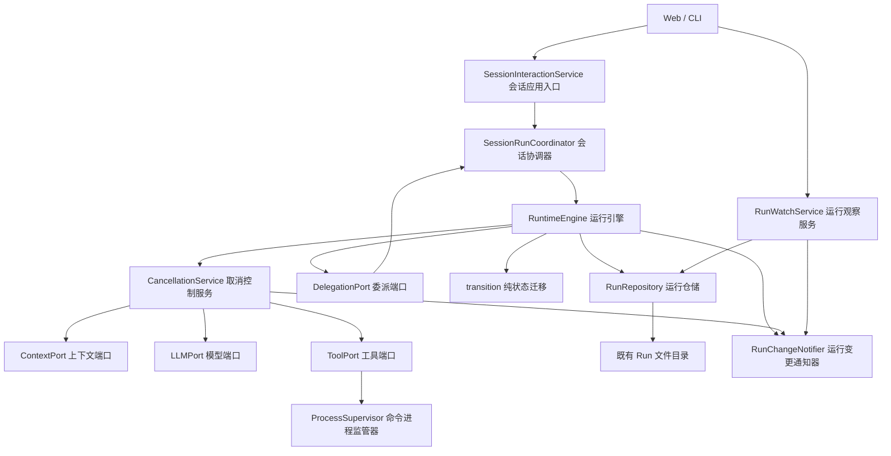
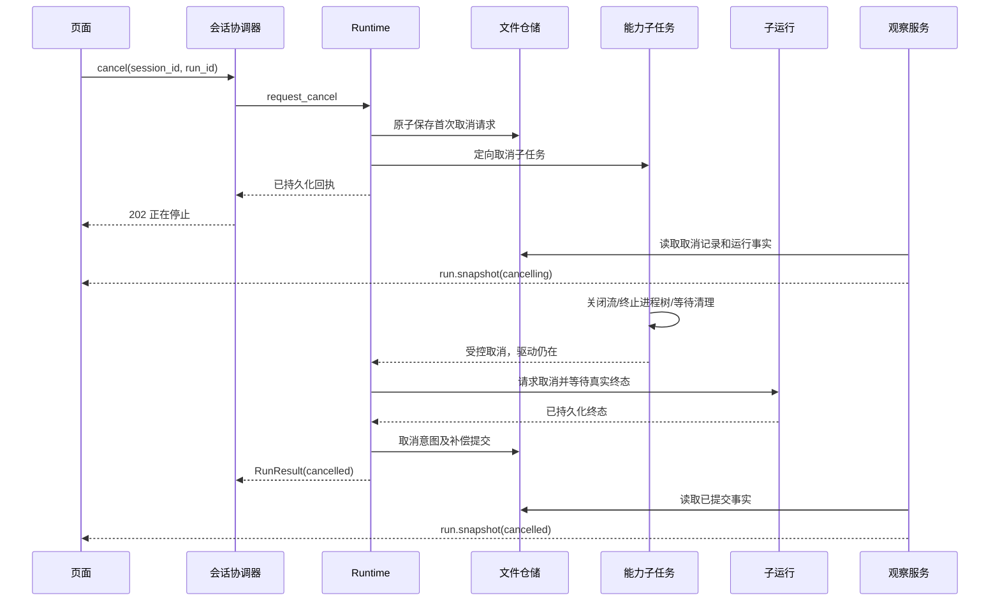

# 运行取消、资源收尾与状态同步：总体设计

日期：2026-11-06。代码基线：`479e3cbc8659ac45b4df38b62e006e022744589d`。

版本：**3，开发契约基线**。用户已授权按修订设计分阶段开发；实现与验证进度记录在 [tasks.yaml](contract/tasks.yaml)，不能把本设计当成已实现事实。本文与[开发计划](开发计划.md)定义唯一接口语义，主代理负责修改模型、职责与调用关系，子代理只实施指定阶段。

## 1. 结论与范围

采用一条统一链路：**持久化取消请求 → 停止启动新动作 → 取消当前能力子任务 → 等待本地资源与子运行收尾 → 提交取消终态 → 推送已提交事实**。

核心选择：Runtime 持有可取消的能力子任务，模型、工具各自清理资源；用户取消不再取消承载 Runtime 的驱动协程。沿用四种领域状态，不新增第五种 `Cancelling`。页面的 `cancelling` 来自持久化的取消请求与未终态运行的组合。

包括：模型流、工具与本地命令进程树、上下文准备阶段的取消边界、审批、同进程多 Agent 委派、取消持久化及恢复、Web/CLI 入口、运行状态 SSE 与前端降级同步。

不包括：远程服务事务回滚、任意 Python 线程强杀、分布式调度、多进程共享文件仓储、任务队列产品能力、历史正文流重放、重做 Trace/Eval、接入尚未进入主链的 Scheduler/Journal。后续模块通过本文接口接入，不提前实现这些模块。

### 1.1 本轮讨论确认的架构决定

完整范围不因文件数多而缩减。架构是否清晰以唯一所有权、执行链路和旧路径删除为标准，不以类数量或补丁大小判断。

- Runtime 本来就决定工具调用。本次补的是在途能力任务的生命周期管理，不重新设计工具调度。
- 参数校验、资源请求解析、权限策略、审批和工具处理器仍按原链路执行；独立任务包住这一调用，不插入第二条安全链。
- `CancellationService`（取消控制服务）是唯一能力任务所有者；新增方法 `run_operation` 即可，不新建 RunOperationRunner，不再增加 Engine 的纯转发包装方法。
- `RuntimeEngine`（运行引擎）是取消受理业务校验、领域迁移和审计事实的唯一编排者；取消服务不依赖仓储，不直接写运行状态或事件。
- `SessionRunCoordinator`（会话协调器）仅持有补收尾作业，不持有第二份能力任务注册表；补收尾作业不能取消驱动者来抢执行权。
- 持久化补偿、多 Agent 收尾和 SSE 均保留为本目标的阶段；未来并行工具、分布式执行只定义扩展边界，不提前实现。

唯一任务调用链：`RuntimeEngine → CancellationService.run_operation(factory) → 原 Port/Adapter → 原能力实现 → RuntimeEngine 收尾`。包装仅用于隔离取消，不改变业务调用方向。

## 2. 源码事实与问题边界

以下路径均相对仓库根目录；方法名是稳定定位点。

| 已确认的源码事实 | 位置 | 必须解决的问题 |
|---|---|---|
| 模型适配器把 `asyncio.current_task()` 存入 `_active_calls`，取消时调用其 `cancel()` | `runtime/adapters/llm_proxy_adapter.py`，`complete/cancel` | 当前被打断的是上层驱动任务；取消异常向外传播，普通异常处理不能保证终态落盘 |
| 工具适配器取消只清理 `_waiting_calls` | `runtime/adapters/tool_executor_adapter.py`，`cancel` | 无法打断在途工具 |
| 命令工具收到取消会 kill 当前 shell，并存在内外两层取消清理 | `tools/builtin/exec_tool.py`，`execute` | 需要单一幂等清理出口，并验证后代进程与创建窗口 |
| 取消终态依次执行写 run、删 checkpoint、追加事件 | `runtime/application/engine.py`，`_finish_cancelled` | 多文件操作不是事务，进程中断会留下不一致事实 |
| 成功提交已经有意图日志和补偿路径 | `runtime/adapters/run_repository.py`，`commit_success` | 取消应复用同类恢复模式，并与成功竞争互斥 |
| 子运行用 `create_task` 启动，`sleep(0)` 后返回；父运行之后才登记关联 | `orchestration/runtime_delegation_adapter.py`，`submit`；Engine 的 `_handoff_target_action` | `sleep(0)` 不是注册完成确认，存在取消传播窗口 |
| 委派取消先把 Task 写成取消，再通知子 Run | 同适配器 `cancel`；`orchestration/dispatcher.py`，`cancel_task` | 业务任务状态可能提前宣称执行已停止 |
| `result()` 直接 await 子任务，捕获取消异常后构造取消结果 | 同适配器 `result` | 等待方取消可能传播到子任务；不能以异常代替持久化终态 |
| 运行事件序号由 Engine 传入，仓储要求严格连续 | `run_repository.py`，`_append_event_sync` | HTTP 取消入口不可并发追加事件，抢占驱动器序号 |
| Web 执行任务与订阅分离，断连不取消运行；生产者只捕获普通异常 | `channel/web/app.py`，`_run_stream` | 保留断连语义，取消结果必须经过正常结果出口 |
| 前端每 800ms 读取 activity；页面 `stopping` 主要来自本地状态 | `frontend/src/useSessionWorkspace.ts` | 刷新、重连及其他页面缺少权威“正在停止”信息 |

以上是静态检查结果。具体延迟、进程树清理效果、MCP 服务端取消能力均需开发阶段验证，不能据此宣称已经复现或修复。

## 3. 术语与不可破坏的约束

| 术语 | 精确定义 |
|---|---|
| 请求已接收 | 取消请求已原子写入文件；可返回 HTTP 202 |
| 正在停止 | 请求存在且 Run 尚未终态；不代表资源已经退出 |
| 本地停止完成 | 本 Run 管理的能力子任务已退出，本地命令资源已回收，直接子 Run 已收尾；远程效果另行记录 |
| 已取消 | 本地停止完成，取消提交日志已完成补偿，领域终态与终态事件已持久化 |
| 远程效果未知 | 本地已断开调用，但供应商或 MCP 服务端是否继续执行没有确认；不承诺撤销计费、写入或其他副作用 |
| 清理阻塞 | 已知本地资源仍未退出或清理失败；Run 保持未终态，不能释放会话占用或提供恢复执行按钮 |

必须满足：

1. `AgentRunState`（运行领域状态）仍是生命周期唯一真相；取消记录只表达控制意图、清理证据，不另存业务 outcome。
2. 同一 Session 仍只允许一个非终态 Run；取消请求不等待该 Session 的执行锁。
3. 请求接受后，本 Run 不再启动新的模型、工具、上下文或委派动作。已经不可逆完成的副作用不回滚。
4. 模型、工具、MCP 不写 Run 状态、不追加 Run 事件、不知道 Web SSE。
5. 取消不投影成功 Conversation，不覆盖已提交成功；已取消运行不可 resume。
6. 超时、用户取消、宿主关闭是不同原因；不把所有 `CancelledError`（异步任务取消异常）转换成用户取消。
7. 不取消共享模型连接池、MCP server 或同 Agent 的其他 Run；隔离单位为 `run_id`，工具证据另有 `call_id`。
8. 事件、状态和终态通知不能先于其承诺的持久化提交。断开观察连接不影响运行。

## 4. 模块与依赖



图中的委派到协调器是已有组合根绑定的 Port/Adapter 回调，不允许 Runtime 直接导入 orchestration 实现。

| 模块 | 修改责任 | 禁止承担的责任 |
|---|---|---|
| Runtime application | 接收控制、动作隔离、竞争裁决、收尾和提交顺序 | 杀进程、处理 HTTP 协议 |
| Runtime domain | 取消记录数据、纯迁移、审计语义 | asyncio 对象和文件访问 |
| Runtime adapters | 文件读写及补偿；模型、工具协议转换 | 自行宣布整个 Run 已取消 |
| tools/process | 清理当前命令及后代；报告清理失败 | 取消整个 Runtime 协程 |
| orchestration | 子运行准备/启动、结果投影 | 用 Task 取消状态冒充子 Run 已停 |
| bootstrap | 装配唯一服务实例、启动恢复、关闭顺序 | 普通运行的业务编排 |
| Web / frontend | 请求、观察、显示已提交状态 | 以按钮响应或超时推断取消成功 |
| Trace / Eval | 兼容新审计结果与端口替身 | 参与运行控制决策 |

## 5. 数据模型

### 5.1 取消数据：新增 `runtime/domain/cancellation.py`

所有数据类不可变、可 JSON 序列化；枚举使用字符串值；新增代码注释使用中文。

| 类型 | 字段及约束 |
|---|---|
| `CancellationOrigin`（取消来源枚举） | `USER=user`、`PARENT=parent`、`HOST_SHUTDOWN=host_shutdown`；不加入 timeout |
| `CancellationRequest`（首次取消请求） | `request_id: str`，服务端生成 UUID；`run_id: str`；`reason: str`，非空且最多 500 字符；`origin: CancellationOrigin`；`requested_at: str`，UTC ISO；`parent_request_id: str | None`，父取消的因果引用 |
| `CancellationPhase`（取消收尾进度枚举） | `REQUESTED=requested`、`DRAINING=draining`、`BLOCKED=blocked`、`SETTLED=settled`；只表述收尾进度 |
| `CancellationEffect`（外部效果确认枚举） | `LOCAL_ONLY=local_only`、`REMOTE_UNKNOWN=remote_unknown`；不把远端请求发送成功当作停止确认 |
| `CancellationRecord`（持久化取消记录） | `version: int=1`；`request: CancellationRequest`；`revision: int`，从 1 单调递增；`phase: CancellationPhase`；`pending_operation_ids: tuple[str,...]`；`pending_child_run_ids: tuple[str,...]`；`effect: CancellationEffect`；`diagnostic_code: str | None`；`updated_at: str`；`settled_at: str | None`。仅 `SETTLED` 可有 settled_at |
| `CancellationDisposition`（取消受理结果枚举） | `ACCEPTED`、`ALREADY_REQUESTED`、`ALREADY_ENDED`、`COMMITTING_SUCCESS`、`NOT_FOUND` |
| `CancellationReceipt`（取消受理回执） | `run_id: str`；`disposition: CancellationDisposition`；`request_id: str | None`；`control_revision: int`；`outcome: RunOutcome | None`（已有终态结果枚举）；`requested_at: str | None` |
| `CancellationCommitIntent`（取消提交意图） | `version: int=1`；`request_id: str`；`run: AgentRun`（拟提交运行摘要）；`events: tuple[RunEvent,...]`（带固定序号的待提交事实）；`approval_ids: tuple[str,...]`；`settled_record: CancellationRecord` |

重复请求返回首次记录，不覆盖首次 reason/time/source，不重复递增 revision。phase、pending 集合或诊断真正变化才增加 revision。`SETTLED` 记录保留用于审计，不是恢复入口。

`CancellationToken`（内存取消令牌，现有）保留 `cancelled/reason`，新增 `request_id: str | None`；`request(request)` 首次生效，重复调用幂等。它是持久化请求的内存投影，不能直接作为 HTTP 202 的依据，不把任务句柄或锁序列化进 checkpoint。

### 5.2 能力动作：新增 `runtime/application/operation.py`（仅值对象与异常）

| 类型 | 字段/职责 |
|---|---|
| `RunOperationKind`（能力动作类型枚举） | `CONTEXT`、`LLM`、`TOOL`。委派准备/启动是受保护控制步骤，不包装成可随意打断的能力动作 |
| `RunOperationHandle`（在途能力任务句柄） | `operation_id: str`；`run_id: str`；`kind: RunOperationKind`；`call_id: str | None`；`task: asyncio.Task`；`cancel_sent: bool=False`；`started_monotonic: float`；`cleanup_error: str | None=None`。只在内存存在，唯一所有者为取消服务 |
| `RunOperationCancelled`（受控能力取消异常） | `run_id: str`、`operation_id: str`、`request_id: str`；继承普通 Exception，由 Engine 在明确的动作边界捕获 |
| `RunOperationCleanupError`（能力资源清理失败异常） | `operation_id: str`、`diagnostic_code: str`、安全错误摘要；不得转成“已取消” |

当前 Run 串行动作，注册表仍按 `(run_id, operation_id)` 管理，避免未来并行工具共享一个可覆盖句柄。本次不开发并行工具调度。

### 5.3 观察数据：新增 `runtime/application/run_watch_service.py`

| 类型 | 字段/含义 |
|---|---|
| `RunWatchCursor`（运行观察游标） | `event_sequence: int`、`control_revision: int`；均非负，固定属于一个 run_id。SSE id 编码 `e{sequence}-c{revision}` |
| `RunObservation`（运行一致性快照） | `run: AgentRun`、`events: tuple[RunEvent,...]`、`messages: tuple[RunMessage,...]`、`cancellation: CancellationRecord | None`、`cursor: RunWatchCursor`、`executing: bool`、`generation: str`（本宿主启动 UUID） |

保留现有 Run 文件格式 v4。`AgentRun`（运行实体）和 `RunRequest`（冻结运行请求）各新增可选 `delegation_task_id: str | None = None`，只用于重建子 Run 到业务 Task 的绑定；来源身份和 Session 从 parent_run_id 指向的父 Run 读取。该字段贯穿准备、启动、后续 checkpoint 和恢复，不依赖短命内存字典。取消元数据单独存储，避免 Engine 持有的旧 run 对象覆盖并发取消请求。

## 6. 类、方法与字段设计

### 6.1 应用入口与协调器

`SessionInteractionService`（会话交互服务，修改）：

- `cancel(run_id, reason, *, origin=USER, parent_request_id=None) -> CancellationReceipt`：转交协调器。
- `cancel_session(session_id, reason, *, expected_run_id: str | None=None) -> CancellationReceipt | None`：Web 必须传当前 run_id；校验归属，防止旧页面取消下一轮任务。省略参数仅保留既有 CLI 按唯一活动运行取消语义。
- `watch_run(session_id, run_id, cursor) -> AsyncIterator[RunObservation]`：调用观察服务；不直接读 Runtime 私有字典。

`SessionRunCoordinator`（会话运行协调器，修改）：

- 字段新增 `_cancellation_jobs: dict[str, asyncio.Task[None]]`、`_accepting_submissions: bool`。
- `cancel(...) -> CancellationReceipt`：先 `engine.request_cancel()`；受理或已受理时幂等调度 `_drain_cancelled_run(run_id)`，立即返回回执，不等待 Session 锁或资源退出。
- `_drain_cancelled_run(run_id)`：获取目标 Session 执行锁后重读 Run；若原驱动已收尾直接退出，否则调用 `engine.complete_cancellation()`。任务由协调器强引用、记录异常并在完成后移除。
- `prepare_run(request) -> str`、`start_prepared(run_id) -> RunResult`：为委派提供两阶段入口，各自遵守 Session 锁；准备期间不调用外部能力。
- `wait_terminal(run_id) -> RunResult`：先登记变更通知再读取仓储，非终态时等待通知并重读；不获取目标 Session 锁，不 await 或 cancel 子驱动 Task。取消这个等待者只撤销观察。
- `shutdown(grace_seconds)`：拒绝新提交，对活动 Run 以 HOST_SHUTDOWN 请求取消，等待驱动与取消作业；到期限保留未完成记录及诊断，再交 Host 关闭资源，不伪造终态。

取消作业可以等待执行锁，**取消 HTTP 请求不可等待执行锁**。当前驱动者负责先退出；作业作为挂起、无驱动和异常退出场景的补收尾者。异常作业保留取消记录，重复取消允许重新调度；不后台无限重试持久化失败。

### 6.2 Runtime 核心

`RuntimeEngine`（运行引擎，修改）：

| 方法 | 输入输出与修改 |
|---|---|
| `request_cancel(run_id, reason, origin, parent_request_id) -> CancellationReceipt` | Engine 在取消服务提供的 gate 内验证目标、成功提交意图和现有取消记录；经仓储保存请求后调用取消服务 signal，发布变更提示 |
| `complete_cancellation(run_id) -> RunResult` | 已持 Session 锁；读取最新事实和取消记录，等待能力/子 Run 收尾，关闭未完成审计 span，调用统一取消提交 |
| 动作方法直接调用 `cancellation_service.run_operation(...)` | 只包装外部能力 await；不再增加纯转发方法。不包裹仓储写入、状态迁移、成功/取消提交 |
| `_prepare_context` | 外部 build/count/compact 阶段受控；候选与上下文版本写盘仍在 Runtime 控制步骤执行。取消不提交候选为成功历史 |
| `_invoke_llm_action` / `_execute_tools_action` | 受控取消在异常映射为 unavailable/tool failure 之前捕获；已有部分输出保留为审计，不启动下一动作 |
| `_finish_cancelled` | 只在本地资源已收尾后执行；从最新持久化非终态应用一次 CancelRequested，不重复迁移；委托 `commit_cancellation` |
| `_finalize_action` / `_fail` / `abandon_run` | 与取消共享终态 gate。最终持久化决策前检查取消请求；成功尚未保留提交权时取消优先。放弃不得绕过取消清理 |
| `prepare_run(request) -> str` | 提取 execute 中创建阶段：冻结策略、创建 Created 运行、保存输入和准备 checkpoint；不调用模型/工具 |
| `start_prepared(run_id, output_port=None) -> RunResult` | 读取准备记录、注册驱动、检查取消，经 RunStarted 开始；重复启动不得运行第二份驱动 |
| `execute(request, output_port=None)` | 复用 prepare + start，普通入口行为不变 |
| `resolve_approval` / `resume_run` / `resume_delegation` | 注册驱动和读取取消记录受同一 gate 保护；有取消请求时只进入收尾，绝不执行批准后的工具或下一轮模型 |

准备 checkpoint 使用已有容器，`action=INVOKE_LLM`，`pending.prepared_request` 保存可恢复的冻结请求，`active_context_version=None`。仅 `Created` 模式允许走该分支；已有 Running 恢复仍执行原上下文版本校验。准备后首次启动清除 prepared_request，避免形成第二份长期上下文事实。

`CancellationService`（取消控制服务，扩展既有类）：

- 字段：`_tokens: dict[str, CancellationToken]`；`_requests: dict[str, CancellationRequest]`（仅持久请求内存投影）；`_operations: dict[tuple[str,str], RunOperationHandle]`；`_gates: dict[str, asyncio.Lock]`；`_drivers: set[str]`。不依赖仓储、SSE、ToolExecutor 或模型具体实现。
- `gate(run_id) -> AsyncContextManager[None]`：控制请求受理、动作注册、终态提交、审批接管的短临界区；不在其中等待外部能力/子运行。
- `register_driver(run_id, token, request: CancellationRequest | None) -> None` / `unregister_driver(run_id) -> None`：调用者在 gate 内从仓储加载请求后登记；同 Run 重复驱动拒绝。注销不丢弃未清理资源或取消请求。
- `_register_operation(handle)` / `_unregister_operation(handle)`：私有方法，必须按对象身份删除，不能删除后来登记的同名动作。
- `signal(request: CancellationRequest) -> None`：仅接受已持久请求，保存首次内存投影；同步更新令牌，对所有在途任务最多发一次 task.cancel；不等待任务退出。调用者持 gate，重复信号不打断 finally。
- `pending_operations(run_id) -> tuple[RunOperationHandle, ...]`：返回只读集合快照；只有任务结束且清理成功才能移除阻塞证据。调用方不直接修改句柄。
- `clear_settled(run_id) -> None`：终态提交后清理令牌/请求/已结束动作；若仍有在途动作或清理失败则拒绝，不能隐藏残留。
- 删除 `_delegated_runs` 作为唯一关联来源的做法；关联从已准备子 Run 的 `parent_run_id` 查询，内存缓存仅可加速。
- gate 不是进程间锁；生命周期随 Host，移除条目须确认无驱动、无任务、无等待者。首版可保留 gate 到 Host 关闭，不为省字典条目引入锁替换竞争。

`CancellationService.run_operation`（同一个取消控制服务内的执行方法）：

- `async run_operation[T](run_id: str, kind: RunOperationKind, factory: Callable[[], Awaitable[T]], *, call_id: str | None=None) -> T`。
- 在 gate 内检查取消、创建且登记子任务，之后释放 gate 再 await。传 factory，避免被拒绝时产生未 await 协程。
- 父驱动通过 `shield(task)` 等待，取消信号定向发给子任务。若子任务正常返回，返回真实结果给 Engine，先记录已完成能力的事实，再检查取消，禁止推进下一动作或提交成功；不能把已完成工具的副作用改写成“没有执行”。
- 子任务抛出取消异常且本 Run 有取消请求、父驱动自身未被取消：转换为 `RunOperationCancelled`。
- 父驱动自身被宿主/上层取消：通知子任务清理，保留系统中断语义后重新抛出；不能冒充用户取消。
- 子任务无请求却自行抛取消：记录操作异常，按明确失败路径处理；不返回假取消结果。
- 清理超过 5 秒：取消服务仍保留动作句柄；协调器的补收尾作业在获取 Session 锁之前调用 Engine.refresh_cancellation_progress(run_id)，由 Engine 读取句柄快照并写 BLOCKED。该作业先启动独立的锁等待任务，使用带期限的等待同时观察它；不得因超时反复取消锁等待或能力任务。拿到锁后停止进度检查并调用 complete_cancellation。5 秒是告警阈值，不是强制终态期限。
- `RunOperationCleanupError` 需要保留阻塞证据，即使协程已经退出也不能按 task.done() 宣称资源消失。

### 6.3 模型与工具

`LLMPort`（模型调用端口）与 `ToolPort`（工具调用端口）：保留 `complete/execute`，统一删除运行级 `cancel` 方法。取消能力由受控 await 的任务边界表达，资源清理由实现的异常/finally 负责。`DelegationPort`（委派端口）仍保留取消，因为其拥有独立子 Run 生命周期。

`LLMProxyAdapter`（模型代理适配器）：删除 `_active_calls`、current_task 登记及 `cancel`；明确关闭当前 response 异步生成器，继续透传取消，不转成服务不可用、不触发供应商回退或重试。底层 HTTP 流关闭，不关闭全局 client。需要验证 proxy 和驱动器每一层的 finally 及计数释放。

`ToolExecutorAdapter`（工具执行适配器）：删除无效 `cancel`，保留 `clear_run`；取消沿 await 传到 `execute_approved`。`ToolExecutor`（工具执行器）与 `ToolHandler`（工具处理器）约束：取消异常不映射成普通业务失败，资源清理失败保留专用异常；审批、策略、路径检查顺序保持不变。

新增 `common/resource_errors.py` 的 `ResourceCleanupError`（底层资源清理失败异常），字段为 `resource_kind: str`、`diagnostic_code: str`、安全摘要；不依赖 Runtime。进程监管器和必要的模型资源清理层抛此异常，`FunctionToolHandler`（函数工具处理器）、工具执行器和模型代理在普通 Exception 归一化之前显式透传；Runtime 适配边界将其转换为带 operation_id 的 RunOperationCleanupError。禁止 tools 反向导入 Runtime 的异常定义。

现有 FunctionToolHandler.execute 直接调用同步函数后才判断返回值是否可 await。此类函数可能阻塞事件循环；同步不可中断逻辑不能标称即时取消。本次必须盘点内置函数，短小计算保留，长 I/O 使用受监管异步实现；不通过简单套 to_thread 宣称线程已能强制取消。

`ProcessSupervisor`（命令进程监管器，新增于 `tools/process_supervisor.py`）：

- `run(command: str, timeout_seconds: float) -> str`；`_spawn_owned`、`_terminate_owned`、`_wait_owned` 为内部方法。
- 每次调用独立实例或独立局部拥有对象；不得以模块全局变量保存“当前进程”。构造字段 `terminate_grace_seconds: float=1.0`；总执行超时仍来自工具上下文，不另造配置服务。
- 私有 `_OwnedProcess`（受监管进程资源）字段：`pid: int`、`process: asyncio.subprocess.Process | None`（POSIX路径）、`job_handle: int | None`、`process_handle: int | None`、`stdout_handle: int | None`（Windows路径）、`closed: bool=False`。平台实现不得使用无类型字典传递这些所有权句柄；如需创建线程句柄仅作为创建函数局部变量，恢复线程后立即关闭。
- `_spawn_owned(command: str) -> _OwnedProcess` 只负责建立所有权；`_communicate(owned) -> bytes` 读取输出并等待主进程；`_terminate_owned(owned) -> None` 清理整个归属范围；`_close_owned(owned) -> None` 幂等关闭句柄/管道。资源异常必须走 ResourceCleanupError，不能把失败清理伪装成命令字符串输出。
- 唯一持有命令进程、管道和 OS 所有权句柄；`execute` 工具只调用它。停止、超时和异常共用一次幂等清理，清理后重新抛出取消。
- POSIX：独立 session/process group，先 terminate，短宽限后 kill 整个 group；等待主进程并关闭输出管道。不得误杀宿主进程组。
- Windows：独立 Job Object（进程作业对象），启用关闭句柄时终止成员；创建时暂停，加入 Job 后才恢复，避免在登记前生成失控子进程。标准库 ctypes 封装留在本模块；不以仅 kill shell 通过验收。
- 创建阶段必须保留受监管的创建任务直到获得资源句柄并完成清理；不得取消 await 后遗失正在创建的进程。读取管道及等待进程的阻塞工作不得阻塞事件循环。
- 明确本次支持的是不主动逃逸监管的本地命令树；禁止 breakaway 配置。无法获得所有权时在运行用户命令前失败。
- 此模块是必要的命令清理边界，不发展成通用进程调度框架。

`McpToolAdapter`（MCP 工具适配器）和 `McpClient`（MCP 客户端）：取消当前调用等待，不关闭共享 session/server，不增加全局 send_cancel 猜测。已有 `_send_cancel` 无请求 ID 的路径需核对并移除不安全的整连接取消。只使用安装版本 SDK 已验证的请求级机制；无法确认服务端终止时记录 REMOTE_UNKNOWN。本次不以“发送取消通知”作为远端停止证明。

### 6.4 多 Agent 的准备与启动

`DelegationPort`（委派端口，修改）：

- 用 `prepare(request) -> DelegationSubmission` 和 `start(child_run_id) -> None` 替换 `submit`。
- `cancel(child_run_id, reason, parent_request_id) -> CancellationReceipt` 只请求停止。
- `wait_terminal(child_run_id) -> DelegationResult` 等待持久化终态；不能把等待者的取消传播成子运行结果。
- `result(child_run_id)` 改为快照查询；活跃时返回 None，终态以仓储为准，内存缓存可清空重建。

`RuntimeDelegationAdapter`（运行委派适配器，修改）：

1. Engine 在父 gate 内检查取消后调用 prepare；只做本地创建：目标 Session、业务 Task、Created 子 Run。`parent_run_id/root_run_id` 在子 Run 创建时即持久化。
2. 将 task_id 写入子请求和子 Run 的 delegation_task_id，供重启恢复业务 Task 投影；来源 Agent/Session 从持久父 Run 读取，不只保存在 `_task_bindings`。
3. 父 Engine 持久化 DELEGATION_SUBMITTED、关联 checkpoint 和 Suspended 状态后释放 gate。这里是“关联已登记”点，子 Run 尚未启动外部能力。
4. `start` 在父 gate 中重查取消；无请求才安排 `coordinator.start_prepared`。有请求则取消未启动子 Run。调度后子 Run 在首次能力动作前再次检查自身及父取消记录。
5. 删除 `sleep(0)` 注册假设。准备/关联阶段只含本地控制 I/O，不作为能力任务取消；中断后由 parent_run_id 与准备 checkpoint 找回，不能猜测并重复创建子 Run。
6. 取消父运行查询所有 `list_child_runs(parent_run_id)`，分别请求取消，再等待其终态。等待过程中不得持父 gate；可持父 Session 执行锁。递归由子 Runtime 完成。
7. `wait_terminal` 不调用父恢复入口；子完成回调不可等待父 Session 锁，否则形成父等子、子等父的死锁。
8. 子 Run 已成功时保留成功事实；父仍可取消。只取消子 Run 时，父按既有子结果策略处理，不隐式取消兄弟或祖先。
9. prepare 中途失败：尚未创建子 Run 的 Task/Session 做幂等补偿并记录失败，不留可启动任务；子 Run 已创建则保留该稳定关联，进入失败/取消收尾，禁止重试时重复 prepare。创建顺序的每个故障点列入 D 阶段测试。

`AgentDispatcher`（业务任务调度器）：新增 `settle_v2_delegation(task_id, target_run_id, outcome, output) -> Task`，按真实 RunOutcome 映射成功/失败/取消；替换仅有 succeeded 布尔的内部调用。Task 的取消终态只在子 Run 收尾后写入。恢复时按绑定重试投影，若 Task 已相同终态幂等返回，冲突明确报错。

当前 `TaskMessageBroker`（业务任务消息代理）的任务存储是内存，单有 delegation_task_id 不会让旧对象跨重启存在。新增 `AgentDispatcher.restore_v2_delegation(task_id, source_agent_id, source_session_id, parent_run_id, target_agent_id, target_session_id, input_message) -> Task`：从父/子 Run 和子输入重建仅用于本条委派的端点与任务契约，以固定 task_id 幂等登记，再根据真实子终态结算。不得伪造已丢失的历史进度消息，不能修改已存在且端点不匹配的 Task。该恢复投影不重新启动子运行、不扩展成通用消息持久化系统。适配器在调用 settle 前确保该投影存在。

## 7. 持久化、竞争与恢复

### 7.1 容器与仓储接口

物理位置沿用 `<session>/agent_runs/<run>/`：

| 文件 | 内容/写入者/生命周期 |
|---|---|
| `run.json`、`messages.json`、`events.jsonl`、`checkpoint.json` | 沿用现有事实；Engine 唯一业务写入者；仓储执行 I/O |
| `cancellation.json`（新增） | 取消记录；取消服务通过仓储更新，revision 幂等；终态后保留，随 Session 删除 |
| `cancel_commit.json`（新增） | 取消提交意图；Engine 委托仓储创建，恢复完成后删除 |
| `success_commit.json` | 保留原成功协议，与取消意图互斥 |

`RunRepository`（运行仓储端口）新增：

```text
load_cancellation(session_id, run_id) -> CancellationRecord | None
save_cancellation(session_id: str, record: CancellationRecord, *, expected_revision: int) -> None
list_child_runs(parent_run_id) -> tuple[AgentRun, ...]
has_pending_success_commit(session_id, run_id) -> bool
commit_cancellation(intent: CancellationCommitIntent) -> None
recover_pending_cancellation_commits() -> None
has_pending_cancellation_commit(session_id: str, run_id: str) -> bool
recover_cancellation_commit(session_id: str, run_id: str) -> None
list_pending_cancellations() -> tuple[CancellationRecord, ...]
```

`load_cancellation` 和 `save_cancellation` 均校验 session/run 归属。首次写入 expected_revision=0、record.revision=1；后续恰好加一，否则抛 ValueError。同内容重复请求由 Engine 返回既有回执，不调用 save。取消进度的写者只有 Engine；仓储恢复可按已存在的提交意图幂等补偿 settled 记录。

版本3补全：运行时重试 complete_cancellation 先查询并恢复该 Run 的冻结取消意图，不重新分配事件时间/序号；单 Run gate 内不得调用全仓库恢复。单 Run 恢复没有意图时幂等返回，有意图严格校验所属 Session/Run。全局恢复只供 Host 开放入口前调用。观察层用相同意图查询屏蔽未提交终态。

进度方法签名：`RuntimeEngine.refresh_cancellation_progress(run_id: str) -> CancellationRecord | None`；短 gate 内重读记录与任务快照，更新 pending_operation_ids、pending_child_run_ids、phase、diagnostic_code，持久化后通知；无变化不写盘。资源超时/失败与观察层无关，不在前端推断。

文件和内存仓储均实现。文件适配器通过原子替换写记录；expected_revision 校验在同一进程 gate 内进行，不宣传跨进程 CAS。新增文件自身 version=1；不改既有 v4 容器含义。所有路径段使用既有校验。

取消提交的审批失效由仓储适配器注入的 `ApprovalRepository`（审批仓储端口）执行 `consume`；只处理 intent 中归属已校验的 approval_ids，已消费/已移除幂等。内存实现注入相同语义的替身；不得在文件仓储复制审批目录布局。资源已收尾但此步失败时保留提交意图并补偿。

`InMemoryRunRepository`（内存运行仓储）新增可选 `checkpoint_repository: CheckpointRepository | None` 构造参数以清理独立内存 checkpoint。若 intent.run.latest_checkpoint_id 非空但依赖未注入，在写意图/事件前报错；无引用且未注入才可无操作。注入后调用幂等 delete。文件实现沿用已有 checkpoint 文件路径删除，不重复引入同一存储依赖。审批依赖缺失但 intent 含 approval_ids 同样在写入前报错。

### 7.2 终态竞争的线性化规则

每个 Run 的 gate 同时保护取消受理与终态提交，所有成功/失败/审批/放弃/恢复入口遵守：

- **取消请求先落盘**：之后的响应不得提交成功；即使响应已回到内存，也进入取消收尾。
- **成功意图先落盘**：成功已经保留提交权；返回 COMMITTING_SUCCESS 或最终已结束，不再接受取消覆盖它。
- 已终态：返回 ALREADY_ENDED；重复取消不追加终态事件。
- 提交失败：保留意图，恢复完成该决定，不因重试换 outcome。
- 无取消请求的普通失败保持既有行为；与取消竞争时最终提交点重新检查，不能用旧 run 对象绕过裁决。

gate 内允许本地事实写入，禁止模型/工具/子运行 await、SSE 向客户端发送。成功提交过程可持 gate 完成磁盘补偿，不取消持久化子任务。宿主退出如必须中断，也必须等待已经启动的文件线程写入完成或由意图日志接管，不能把 `to_thread` 的 await 取消误认成实际写入停止。

锁约定：正常驱动/恢复/补收尾先取 Session 执行锁，再短时取 run gate；HTTP request_cancel 只取 gate。持有 gate 的方法不得再调用获取同 gate 的公开方法：终态判断和提交需要共用代码时使用私有 `_..._locked` 方法，写明“调用方已持锁”，不另建事务服务。子 Run 等待绝不在 gate 内发生；委派 prepare 中创建的新 Session 不可被其他提交占用。事件序号仍由唯一驱动/补收尾者分配，进度更新只写 cancellation.json，不抢 events 序号。

### 7.3 取消提交协议

资源和子运行已经收尾，且当前驱动/取消作业拥有唯一执行权后：

1. 重读 Run、取消记录和事件尾序号；取消 endpoint 不写 events，避免序号竞争。
2. 对原持久化非终态应用一次 `CancelRequested`（取消领域事件），得到 Ended(CANCELLED)。状态机不承担资源等待。
3. 补齐真实启动但未完成的 LLM/Tool span：工具已有 CANCELLED；模型新增 `LLMCompletionKind.CANCELLED`（模型完成类别中的取消值）。不能为未启动工具伪造执行完成。
4. 构建固定事件序号的 `CancellationCommitIntent`，包含末尾唯一 RUN_CANCELLED。可在此追加 CANCEL_REQUESTED 审计事件，occurred_at 使用原请求时间；实时请求展示仍读取 cancellation.json。
5. 原子写 cancel_commit.json；幂等 ensure events（取消意图的完整事件尾批用同目录临时文件、flush/fsync、os.replace 原子替换，不能复用可能留下半行的普通追加）；撤销/消费关联待审批记录；删 checkpoint；写 run.json 终态；写 SETTLED 取消记录；删意图文件。
6. 清理短期缓存，发布变更提示，返回 RunResult，再由入口发送终态。

仓储恢复按同一顺序重放，重复事件必须同时匹配 sequence/type/data，不能仅看到相同序号就跳过。未完成提交对观察者仍表现为 cancelling；不得提前输出日志尾部已经追加但尚未完整提交的 RUN_CANCELLED。`load_observation` 需识别提交意图并屏蔽其未提交终态边界。

取消事件原子替换先严格校验既有完整前缀和意图尾批；写临时文件中途失败保留原事件文件，下一次恢复重新生成尾批。不得为修复本次协议而猜测截断历史损坏日志，不改变普通非取消事件和既有成功提交的写入路径。测试必须注入文件写入中途、replace前、replace后故障。

### 7.4 重启

Host 接受请求前：恢复成功意图 → 恢复取消意图 → 查找未完成取消请求及其子运行，注册补收尾作业和阻塞标记 → 开放入口。可证明资源已清理的作业继续收尾；不能等待未知资源退出才开放观察接口，相关 Session 仍保持占用。业务新提交需服从非终态占用检查。

- 请求落盘、未发信号即崩溃：重启后仍是待取消，不恢复执行原业务。
- Created 子 Run：可直接取消，禁止因重启自动启动；父关联缺失时从 child.parent_run_id 补查，不重复提交。
- 原进程的 HTTP/MCP 等待已不存在：本地控制可结束，外部副作用标记 REMOTE_UNKNOWN。
- 启动检查必须结合取消记录与最后未闭合的 TOOL_STARTED/LLM_STARTED 事实辨别资源类型。信息不足或第三方工具清理语义未知按 BLOCKED 处理，不能仅凭内存任务消失认定资源已清理。清理证明的诊断与人工确认写入审计事件。
- 命令进程需要死亡证据：Windows 作业句柄关闭可作为机制证据并测试；POSIX 宿主被硬杀后进程组可能仍存活。首版不能用旧 PID 直接 kill（存在复用）；无可信资源身份则 BLOCKED，不自动重放命令、不宣称停止。容器整体退出或人工检查后才允许确认清理。
- 新增 `confirm_cancellation_cleanup(run_id, reason) -> RunResult` 应用维护方法，仅用于无驱动、取消 BLOCKED 的孤立资源记录；记录人工确认审计后收尾。首版不提供普通聊天工具或自动调用入口。

## 8. 状态观察、SSE 与前端

### 8.1 后端契约

`RunChangeNotifier`（运行变更通知器，新增于 `runtime/application/run_change_notifier.py`）：`notify(run_id)`、`version(run_id)`、`wait(run_id, after_version, timeout)`；按 run_id 保存递增内存版本和可清理等待者，只发“有变化”的提示，不保存事实、不阻塞生产者、不建无界事件队列。观察服务直接复用阶段A实现，不创建另一个通知器。

`RunWatchService`（运行观察服务，新增）：

- `snapshot(session_id, run_id) -> RunObservation`：在 gate 下读取一致事实；拒绝错误归属；屏蔽未完成提交的终态。
- `watch(session_id, run_id, cursor) -> AsyncIterator[RunObservation]`：先登记通知版本，再读取快照，再等待版本变化，避免先读后订阅漏事件；每次唤醒重新读持久化事实。
- 首次/重连总发完整快照。游标只用于去重和补读审计事件，不用于恢复模型正文；未来游标或非法游标返回明确错误/重置快照，不能无限等待不存在的序号。
- 每 15 秒 heartbeat 唤醒并重查快照，弥补通知遗漏；这是低频保障，不是原 800ms 全量轮询。

新增 `GET /api/v1/sessions/{session_id}/runs/{run_id}/events`，支持 Last-Event-ID；事件 `run.snapshot` 的 data 为扩展 activity，id 为双游标。服务端读既有 RunEvent 构造真实工具/模型步骤；首版传快照而非新增第二套前端事件归约器。已终态快照发出后关闭连接。

`RunActivityResponse`（运行活动响应，修改）新增 `control_revision`、`cancellation`（请求时间、进度、待清理计数、效果范围、安全诊断）、`generation`。`status` 优先级：已提交终态 > 未完成取消请求（cancelling）> 审批/委派 > 当前执行/可恢复。

保留原提交 POST SSE 传模型增量与结果；观察 GET SSE 用于状态与步骤、刷新后接管。两者重复终态按 run_id 幂等，状态以持久化快照为准。`SSEOutputAdapter`（现有输出适配器）不改成全局事件总线。

取消 API 保留现有 Session 路径，payload 新增 `run_id`，响应包含回执：accepted/already_requested 返回 202；already_ended 返回 200 及真实结果；committing_success 返回 409 和稳定错误码；目标不存在 404；归属不符拒绝。前端不得把 202 显示成已停止。

### 8.2 前端

- `api.ts`：`cancelSession(sessionId, runId) -> CancelReceipt`；新增 `watchRunActivity` 流读取函数，复用已有 fetch/SSE 解析能力。
- `useSessionWorkspace.ts`：每个被观察 run 至多一个观察连接；切换/卸载关闭观察，不停止任务；`phaseFor` 支持 cancelling → stopping。
- 首次 accepted 后连观察流；刷新先获取快照再订阅；停止按钮立即显示请求中，202 后等待权威 cancelling/终态。
- 两维游标均不得倒退；generation 改变时接受完整初始快照并更新本地基线。相同游标但新的连接初始快照可更新 executing/recoverable，不据旧内存推断后台仍活着。
- 同一连接按序处理；HTTP 响应以连接代次和 run_id 丢弃过期结果；已提交终态不可被旧 running 覆盖。
- 正常观察期间停用 800ms interval；断流后立即 GET 对账，然后 1/2/4/8 秒指数退避（上限 8 秒，含抖动），连接恢复后停止降级轮询。终态关闭连接和计时器；待审批等静态状态无需高频轮询。
- 清理阻塞显示“停止尚未完成”及具体待清理对象；远程未知显示“本地已停止，远端执行结果未确认”。取消期间禁用恢复/审批执行按钮。

## 9. 简化调用流与竞争分支



| 竞争/异常 | 确定行为 |
|---|---|
| 取消与模型最终响应同时到达 | 由首次持久化的取消请求/成功意图决定，不看 HTTP 返回先后 |
| 工具返回时刚收到取消 | 保留工具实际完成证据，不假称其副作用被撤销；停止下一动作，Run 取消 |
| 重复点击取消 | 同 request_id、首次 reason/time，无重复 kill、无重复终态 |
| 审批批准与取消并发 | 在 gate 注册恢复驱动并检查请求；取消先受理则不执行工具 |
| 父取消撞上子准备/启动 | gate 内先登记持久关联；启动再次校验；Prepared 子也纳入取消 |
| 清理抛异常或不退出 | BLOCKED，保留占用；提供观察和人工确认维护路径，不伪终态 |
| 写盘失败 | 请求写盘失败不返回 202；终态写盘失败保留意图，既有请求仍有效，重试/重启补偿 |
| 浏览器断连 | 仅撤销订阅；后台执行及取消收尾继续 |
| 观察者慢/丢通知 | 合并提示后重读快照，借双游标去重，不拖慢 Runtime |

## 10. 演进边界与收益

| 后续改进 | 本次保留的接口边界 | 本次不提前开发 |
|---|---|---|
| 新检索、压缩或网络工具 | 可取消能力任务 + 资源清理契约 | 不要求它们写状态机/取消仓储 |
| 并行工具 | operation_id 注册表已能表达多个句柄；取消遍历全部 | 不实现并行调度及批次合并 |
| 多子 Agent | 持久 parent/root 关联、两阶段启动、逐子收尾 | 不新增 DAG 调度器或分布式消息总线 |
| Trace/Eval 展示与量化 | 请求时间、资源收尾、终态事件和已提交快照 | 不重构评估框架 |
| 其他 UI/CLI | 同一回执与观察接口 | 不依赖 React 状态推断取消 |
| 分布式执行 | Port 隔离能力调用，文件协议限制写明 | 当前 gate 与文件仓储不能直接充当分布式锁/事务 |

收益目标是可验证的：停止不会越过资源收尾提前完成、重启不会恢复已请求取消的业务、取消一个 Run 不误伤其他 Run、正常状态同步不再依赖高频轮询。延迟和请求量改进须按开发计划测量后报告；本设计不声称已经达到性能提升。

### C阶段实施裁决：MCP SDK连接兼容

当前安装MCP SDK 2.0，旧连接路径引用不存在的Transport类。为完成真实取消验收，McpClient（MCP客户端）内部增加连接保活任务、ready/stop事件与同任务进入退出的AsyncExitStack（异步资源栈），使用实际stdio_client/streamable_http_client。公开签名不变；保活任务只拥有共享连接，不进入Run能力任务注册表。Run取消只传播到该请求；shutdown幂等关闭保活资源，启动失败释放部分资源。必须验证真实stdio并发取消隔离；HTTP未实测不得声称通过。

C阶段效果字段裁决：Engine.request_cancel依据在途能力记录选择effect；LLM和CONTEXT保守REMOTE_UNKNOWN，工具按持久化call_id/工具名识别，MCP、网络、未知第三方默认REMOTE_UNKNOWN。明确本地实现才可LOCAL_ONLY；该值仅描述清理证据范围，不证明命令没有远端副作用。进度和settled不得将REMOTE_UNKNOWN降级。

### D阶段调度接口裁决

SessionRunCoordinator（会话协调器）新增同步schedule_prepared(run_id)->None，唯一创建并强引用子运行驱动任务，按run_id去重。异步start_prepared(run_id)->RunResult复用该调度并通过shield等待同一任务；DelegationPort.start只调用schedule后返回，不自行create_task，不返回无人消费的shield Future。完成回调收集异常与通知观察者；等待者取消不传播到驱动。父gate内只检查与安排，不等待子运行。

### D阶段集成接口补全

- RunRepository（运行仓储）与Engine公开list_runs，稳定按started_at/run_id读取事实；find_run纯定位，不触发全库成功补偿。全局补偿只在Host启动，观察读取不能成为跨Run写者。
- Engine.get_run_result返回已提交Run/messages结果投影；目标gate下屏蔽待提交成功/取消意图。Coordinator必需注入同一RunChangeNotifier，不访问Engine私有字段；wait_terminal先登记通知版本再读结果。
- RuntimeDelegationAdapter必需keyword-only注入run_repository，直接读取父子及输入事实，不增加转发层。
- Broker.restore_task/settle_task原子维护唯一Task状态；Dispatcher.restore_v2_delegation/settle_v2_delegation封装恢复和结算。相同ID校验端点及不可变任务契约，终态冲突拒绝，不伪造旧消息。
- Dispatcher.fail_v2_preparation记录尚未创建Run的准备失败。child_run_id由父Run/source_call稳定生成，重复prepare校验目标及输入；只删除本次新建且未启动Session，已创建Run保留关联并取消。
- CancellationService.confirm_cleanup仅gate内无驱动且全部任务结束才清除失败证据。Engine维护入口要求已有取消请求及BLOCKED，先追加CANCELLATION_CLEANUP_CONFIRMED事件（request_id/manual/reason），再清证据并取消提交；不向普通Agent暴露。
- 准备checkpoint的prepared_request为Created冻结输入例外，校验run/session归属，启动后移除；不放开普通运行完整上下文存储限制。
### E阶段接口裁决

RunRepository.load_run_snapshot(session_id,run_id)->AgentRun|None严格校验路径和归属，只读不补偿。RunObservation新增committing:bool=False，保留原始领域事实；普通activity、POST结果与GET观察都必须屏蔽未完整提交的终态及终态事件。RunWatchService注入仓储、取消服务、共享notifier与启动generation；executing通过公开has_driver读取。SessionInteractionService提供snapshot_run/watch_run；cancel_session强制expected_run_id，旧目标已终态只返回其结果，不能取消当前新Run。CLI若使用按会话取消，先定位明确目标再调用。

用户已授权阶段验收后Git提交。A-D累计真实变更合并提交ca887f7；不为历史拆分新增过渡源码，E验收后另提交。