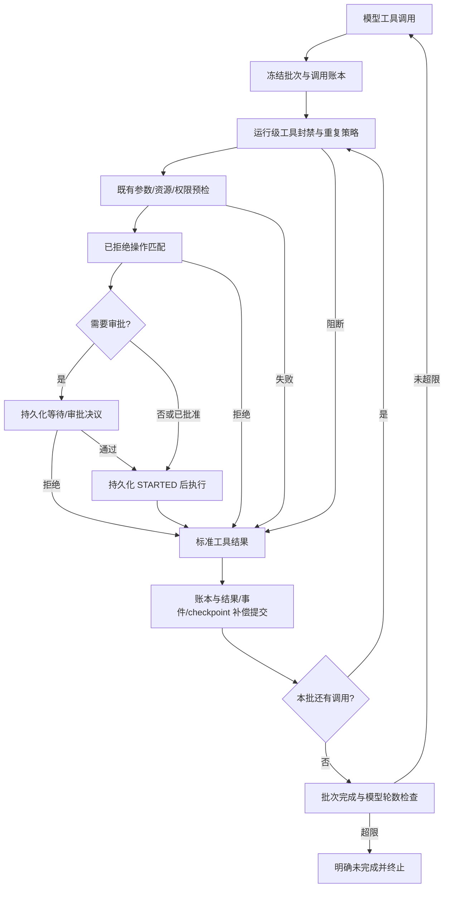

# 工具失败回灌纠错：开发计划

状态：五阶段实现已交付，静态验收通过；按用户后续授权未新增或运行动态测试，原动态验收矩阵保留为未验证项。日期：2026-11-16。
代码基线：`feat/toolCorrection`，`0749b78e65529d656445705d981a7067c28e9400`。
交付方式：一个 PR，五个依赖有序的实现 commit；本文与 [spec.md](spec.md) 一起作为开发契约。本文负责目标、范围、代码事实和实施顺序；字段、算法、状态和提交顺序以 spec 为唯一详细定义，不在两处维护不同版本。

## 一、总体设计

### 1. 目标与范围

唯一目标：一次普通工具调用在查找、参数验证、资源策略、审批或执行阶段失败后，形成可靠、可解释的结果回灌模型；模型可以调整方案继续任务，运行时执行审批拒绝、重复失败和未知副作用限制。

必做：

1. 所有已判定普通工具失败统一回灌；同批其他工具继续，整批结果齐备后进入下一轮模型。
2. 拒绝单次审批不取消任务；本任务内禁止相同操作重复审批或执行，匹配范围见 spec §3.3、§3.4。
3. 可替换重复调用策略，首个实现按同工具＋规范化参数连续失败计数；默认阈值 3，第 4 次匹配调用被阻断。
4. 总模型循环上限实际生效；沿用默认 10，`max_loop_steps: 0` 关闭，正整数调整；恢复不重置。
5. 有副作用或副作用声明未知的工具结果未知时，封禁本任务中的工具名，持久化未知结果并继续其他工具；不得结束整个任务或关闭模型工具入口。
6. 账本、审批、消息、事件和检查点一致提交，崩溃恢复不丢限制、不重复计数；Web/Trace 正确呈现失败和未知结果。

可选功能：本 PR 无。总预算的关闭是必做配置能力，不是可选开发项。

非目标：外部副作用查询/解除封禁（后续 Issue #52）、通用下游幂等保证、异步并行调度（#53）、语义识别任意绕过方式、跨 Run 共享黑名单、纠错专用 Agent、策略注册中心、预算设置 UI。关闭总预算不承诺自动终止所有换参数循环。

用户已确认：限制仅当前 Run 生效、恢复保留；按组合独立计数，成功清零；审批等待/取消/运行时规则拦截不累加执行失败；预算耗尽直接报告未完成，不额外调用模型。本文具体阈值、配置编码和接口属于本次架构设计决定，不冒充现有实现。

### 2. 输入、输出与硬规则

输入：已有模型工具调用、Agent Identity 配置、审批决定、已有调用账本与检查点。外部请求/审批 API 保持签名。

输出：每个已处理调用的一条稳定工具结果；对应审计事件；更新后的调用账本与恢复检查点；任务最终回答或明确的预算/链路失败。

保留 README 硬规则：运行状态只有 `AgentRun.state`（运行实体的状态）一份权威值；状态迁移经过 `transition()`；Runtime 通过 Port 调能力；MCP 仍走普通工具链；同 Session 串行；单宿主文件持久化；取消和资源收尾优先；观察层只读；成功投影仍用现有补偿提交。

### 3. 现状与差距（基于源码）

| 已有事实及位置（相对仓库根） | 本次演进 |
| --- | --- |
| `tools/executor.py::_run_chain` 已按查找→验证→资源解析→策略→审批→执行处理；`preflight_for_runtime` 已存在 | 复用校验顺序；增加审批操作键输出，不重建执行器 |
| `runtime/adapters/tool_executor_adapter.py::{execute,preflight}` 已保留 `tool_error_code/type` | 修正旧讨论“具体错误码丢失”的判断；只补必要字段、失败正文和预检错误对象 |
| `runtime/application/engine.py::_execute_one_tool` 对预检失败也先 `begin_attempt` | 改为未启动失败直接提交，不能伪造执行次数和启动事件 |
| `_resume_tool_batch` 的 FAILED 复用/新结果均进入 `_after_tool_failure` | 删除普通失败终止逻辑，继续批次 |
| `ToolRecoveryService`（工具恢复服务）的 `complete_batch` 要求全 SUCCEEDED | 改为所有调用已有可回灌结果即可完成，取消/等待/未启动仍不满足 |
| `resolve_approval` 和恢复入口把拒绝转取消；`decide_approval` 只保存拒绝事实 | 拒绝结果与状态恢复一次提交，删除两处隐式取消 |
| `block_uncertain` 写 UNCERTAIN、RUN_FAILED 并删除检查点 | 保留调用未知事实，但新语义只阻断工具名，保留运行和检查点 |
| `max_loop_steps` 默认 10，经 `AgentPolicySnapshot`（运行策略快照）进入 `RunBudget`（运行预算），没有总轮数拦截 | `0` 表示关闭，正数按现有 iteration 判断 |
| 调用账本 v1＋pending projection 已实现跨文件补偿 | 复用写入机制，账本 v2 承载新增字段及未知结果语义；读取 v1、写 v2 |
| Web 已有 uncertain 状态，Trace 对无启动事件的结束仍可能报缺配对 | 调整结果投影，不伪造启动事件来满足观察层 |

以上 `tools/`、`runtime/` 均位于 `src/dotclaw/`。旧可靠恢复实验报告已记录受控验证，本次不重复声称“可靠恢复完全未验证”，也不把旧报告作为本次纠错验证结果。

### 4. 目标架构与主流程



架构分工：Engine（执行引擎）编排，不存跨 Run 可变限制；恢复服务提交权威事实；策略接口只读判断，不执行、不持久化；执行器拥有资源语义；组合根装配默认策略；Web/Trace 只投影结果。

限制状态从账本派生，不新增 `guards.json`。明确失败和“执行结果未知”分别表达，避免把未知当成业务失败已回滚。审批拒绝匹配和未知工具名封禁是强制规则，不可被可替换重复策略放行。

### 5. 改造映射与影响

复用：工具注册、安全策略、参数验证、取消短锁、稳定结果 ID、账本 CAS/投影、上下文构建、模型调用、成功提交、委派生命周期。

修改：普通工具结果、账本序列化与结果终态判定、审批拒绝迁移、Engine 批次/恢复流、轮数校验、Trace/Web 对无执行及未知结果的解释。

新增：一个重复策略模块及纯数据模型；审批资源键字段；结果来源字段；预算耗尽事件/错误码。没有新服务进程、依赖、数据库或设置页面。

删除：普通失败自动结束 Run 的分支和仅为其存在的 `_after_tool_failure`；审批拒绝自动请求取消的两处逻辑。旧工具执行兼容支路在导入路径测试证明可统一后随本 PR 移除，保留旧数据导入器，详见 spec §3.6、§5。

行为影响：工具失败、审批拒绝、工具未知不再必然使任务失败；真正取消仍取消任务。默认轮数 10 从无实际拦截变为有效，README 必须明确长任务使用 `0` 或更大正数。子任务仍独立 Run，不传播封禁，未新增跨委派绕过识别保证。

## 二、分阶段实施

### T1 / P0 / Commit 1：结果、策略与持久化契约

依赖：无。目标：先建立后续链路的唯一数据定义，不改变主循环。

文件、类、方法：

- `src/dotclaw/runtime/domain/tool_recovery.py`：扩展 `ToolOutcomeSnapshot`（工具结果快照）、`ToolCallRecord`（工具调用记录）、`ToolCallLedger`（工具调用账本）的字段/序列化/约束；增加未知结果类型和 v2 读写规则，见 spec §3.1、§3.2。
- 新增 `src/dotclaw/runtime/application/tool_correction.py`：实现 `ToolRepeatPolicy`（重复调用策略接口）、`ConsecutiveFailurePolicy`（连续失败策略）、`ToolCorrectionContext`（当前调用限制视图）、`ToolGuardDecision`（准入决定）及规范化/账本派生函数，签名见 spec §3.3。
- `src/dotclaw/runtime/application/dto.py`、`src/dotclaw/tools/base.py`：工具结果增加审批操作键；类型使用 tuple[str, ...]，不得导入工具实现到领域层。
- `src/dotclaw/agent/identity.py`：`tool_repeat_failure_limit=3`，`max_loop_steps` 支持 0；配置入口拒绝负数、bool、浮点、非法字符串。
- `runtime/adapters/agent_policy_resolver.py`：冻结重复阈值到 policy_data；补充模型行为规则。`domain/facts.py`、`domain/events.py`、`domain/state.py` 增加预算耗尽事件及拒绝后继续的迁移。

流转：配置→冻结策略；账本→限制视图→纯策略决定。接口不触发 I/O。错误配置在加载时失败；坏账本不转成工具业务错误。

验收：新增 `tests/runtime_v2/test_tool_correction_policy.py` 覆盖阈值、成功清零、组合独立、排序稳定、不计运行时阻断、替换策略不能突破强制封禁；扩展 `test_tool_recovery_models.py`、`tests/agent/test_identity.py` 验证 v1/v2 与 0；状态机测试验证拒绝和预算终态。所有具体断言见 本文测试矩阵 A/B。

### T2 / P0 / Commit 2：统一结果提交与普通失败回灌

依赖：T1。目标：调用级事实和批次完成不再依赖“全成功”。

文件、类、方法：

- `runtime/application/tool_recovery.py::ToolRecoveryService`：修改 `commit_outcome`、`complete_batch`、`reconcile`；新增 `commit_not_started`，共用 `_commit_fact`；确定性结果消息由 spec §3.3.3、§4.4 构造。
- `runtime/application/engine.py::RuntimeEngine`（执行引擎）：修改 `_execute_one_tool`、`_resume_tool_batch`、`_execute_tools_action`；预检失败不调用 `begin_attempt`；失败复用不终止；每个调用后重新读取提交事实，避免使用启动批次时的过期限制视图。
- `runtime/adapters/tool_executor_adapter.py::{preflight,execute}`：完整传递错误码/类型/证据，preflight 失败补 `RunError`（运行错误）。工具错误和链路错误出口分别处理。
- `runtime/application/execution.py`：完成兼容路径统一后删除 `legacy_tool_recovery`；`engine.py` 删除旧执行支路与 `_after_tool_failure`，保留 legacy 导入调用。

流转：预检失败→未启动结果提交；实际调用→结果提交；两者→继续当前批→`complete_batch`→下一轮。存储异常立即停止驱动，保留待投影事实，不继续外部调用。

验收：新增 `test_tool_correction_engine.py`，脚本模型先缺参数、后改参数成功；多工具前一失败后一成功，结果顺序与 call_id 完整；故障恢复复用失败结果不重复执行；预检错误无 TOOL_STARTED、attempt=0；适配器错误码不丢；legacy 导入后同样回灌。

### T3 / P0 / Commit 3：审批拒绝、重复失败和未知工具封禁

依赖：T2。目标：允许继续任务，同时在所有执行入口执行强制边界。

文件、类、方法：

- `tools/executor.py::_run_chain` 输出审批操作键，采用 `CapabilityBroker`（资源请求解析器）已有规范化路径；新增 `_approval_operation_keys` 私有方法；无运行级状态进入执行器。
- `runtime/application/tool_recovery.py::{wait_approval,decide_approval,block_uncertain,reconcile}`：冻结审批键；拒绝原子产生结果并恢复 EXECUTING_TOOLS；未知调用结果与工具封禁事实一次提交。`block_uncertain` 的新语义详见 spec §3.6、§5，不再写 RUN_FAILED。
- `engine.py::{resolve_approval,_execute_one_tool,_resume_tool_batch}` 及恢复入口：移除审批拒绝触发取消；每次审批/启动/恢复重试前检查限制，保留资源收尾阻断；未知调用继续其余工具；同名后续调用返回未执行错误。
- `bootstrap/runtime_factory.py`：装配默认重复策略并注入 Engine；不创建策略注册表。

异常分支：审批反向决议报错；取消已受理则取消优先；策略自身异常属于链路错误；无副作用工具的未知返回与有副作用工具区别处理；契约变化/持久化损坏不能作为“可纠错”掩盖。

验收：拒绝后同操作无二次弹窗、不同允许操作可执行；规范化文件路径及跨文件工具同操作匹配；阈值 3 后第 4 次 handler 不执行；未知写工具封禁同名所有参数、查询工具继续；重启后全部限制保留；资源未清理不能继续；冻结的重复策略 fake 替换正常。

### T4 / P0 / Commit 4：预算实际执行与观察链衔接

依赖：T3。目标：运行有明确停止行为，用户界面不再把“某工具失败”显示成“整个任务失败”。

文件、类、方法：

- `engine.py::_drive` 在 INVOKE_LLM 前执行 `iteration > max_iterations > 0` 检查；新增 `_finish_iteration_limit`，按 spec §3.5.3 保存未完成错误，不调用模型。
- `runtime/domain/{events,state,facts}.py`：T1 已定义事件接入；保留既有状态计数、恢复和委派流。
- `trace/assembler.py`：允许新协议的未启动结果直接形成已结束工具记录；未知状态不能被视为成功；审批拒绝不丢结果关联。
- `channel/web/app.py` 的工具投影与 `_run_steps`：接受未知结果与未启动失败；审批拒绝后状态继续 running，不伪造 cancelled。`channel/web/schemas.py` 已支持 uncertain，保持原字段。
- `frontend/src/ToolPresentation.tsx`：失败/未知结果不进入成功工具专用解析；继续以文本呈现错误；不新增预算编辑页。必要断言放现有 `ToolPresentation.test.tsx`、`RunObservation.test.tsx`。

验收：预算 1/2 精确调用次数，0 可完成超过 10 轮脚本任务；恢复沿用 iteration；最后一轮产生的工具批次先处理完成再停止模型轮次；预算终止不提交成功会话；Web 刷新与运行事件均可见拒绝/未知结果；Trace 无伪缺配对、无假成功。

### T5 / P0 / Commit 5：故障验收、历史兼容与文档收口

依赖：T1–T4。目标：证明整条闭环和恢复边界一致；前四阶段已经随实现写对应测试，本阶段只补跨层验收。

文件：新增 `tests/runtime_v2/test_tool_correction_recovery.py`，扩展 `test_tool_projection_recovery.py`、`test_tool_ledger_repository.py`、`tests/channel/web/`、`tests/trace/`、`tests/eval/` 对应协议测试；README、`docs/wiki/Runtime 模块总体说明.md`、`docs/wiki/Tool 模块总体说明.md`。

故障矩阵：拒绝、普通失败、未知结果分别在账本写后、审批写后、消息写后、事件写后、检查点写后、Run 写后退出；重建服务后恢复，断言单结果/单决议/单计数/不重复 handler/后续允许工具仍执行。v1 正常、v1 待投影、旧无账本、旧拒绝半提交、已结束未知任务均按 spec §5.2 验收。

文档明确：默认 10 轮现在生效、0 关闭；三类工具限制；本阶段不会查询外部副作用、不解除工具封禁；历史已结束任务不复活。

## 三、验收与交付

命令在仓库根执行，测试前必须先核对项目解释器：

```powershell
.venv\Scripts\python.exe -c "import sys; print(sys.executable)"
.venv\Scripts\python.exe -m pytest tests/agent tests/runtime_v2 tests/tools tests/trace tests/channel/web tests/eval tests/benchmarks
```

前端在 `frontend` 执行 `npm test -- --run`、`npm run build`；提交前 `git diff --check`。本设计阶段不执行这些实现验收命令，也不宣称测试通过。

交付证明至少包含：一次真实模型参数纠错闭环（隔离临时目录、无危险副作用）；一次确定性模型多工具/拒绝/未知路径；上述崩溃矩阵；原取消/审批/安全恢复/委派回归。真实模型不可用时记录未验证，不用脚本模型代替该项完成结论。

完成门槛：本文测试矩阵全部满足；原有可靠恢复中明确改变的“普通失败/拒绝/未知使 Run 结束”断言替换为新行为，其他不变量继续成立；无两套执行入口绕过准入；无提示词替代系统阻断；一个 PR 按 T1→T5 提交，不自动 push 或创建 PR。


## 四、测试断言矩阵

各阶段随实现补充对应测试，以下为最终验收断言。

| ID / 阶段 | 输入与操作 | 必须断言 |
| --- | --- | --- |
| A1 / T1 | 参数对象键顺序不同；数组/字符串/数值类型不同 | 前者同键；后者不被错误合并；不保存额外明文参数键 |
| A2 / T1 | 同组合 3 次执行失败后第 4 次；另一组合；失败后成功 | 第4次策略拒绝；另一组合不受影响；成功清零；其他组合调用不清零 |
| A3 / T1 | 审批等待/拒绝、预检失败、取消、GUARD 阻断、重复恢复 | 不累加失败；每个逻辑结果至多一次；默认阈值3 |
| A4 / T1 | 注入始终允许的重复策略 | 未知工具与审批拒绝仍被 Engine 拦截 |
| B1 / T1 | 预算 0/1/10、负数、bool、浮点、字符串；非法阈值 | 合法值保持；非法加载失败；旧快照无新配置使用阈值3 |
| B2 / T1 | v1/v2 roundtrip；坏归属/序号/未知字段/UNCERTAIN 无证据 | 合法旧记录可读；非法 v2 新结果和损坏输入明确报错 |
| C1 / T2 | 模型首轮缺 path，次轮合法 | 首条工具反馈含 INVALID_ARGUMENTS/NOT_STARTED；无 handler 启动；下一轮收到该正文并成功 |
| C2 / T2 | 一批 A 失败、B 成功、C 失败 | 按原顺序执行，三结果唯一且配对；模型只在齐备后调用；没有 RUN_FAILED |
| C3 / T2 | 已持久化失败后重启恢复 | 失败复用不执行、不重复消息和统计；B 继续 |
| C4 / T2 | adapter 抛非契约异常 / 仓储写失败 / 资源清理失败 | 不伪装普通工具失败继续；原诊断可见；无后续 handler |
| D1 / T3 | 拒绝审批后相同调用新 ID、参数字段重排 | 不再弹审批、不执行；模型得到 APPROVAL_DENIED；Run 继续 |
| D2 / T3 | 两文件工具写同规范路径；另一个允许资源 | 同操作阻断；不同资源正常；读写不混淆；测试不宣称识别任意 shell 绕过 |
| D3 / T3 | 拒绝与取消竞争、重复同决议、反向决议 | gate 顺序确定；取消不复活；同决议幂等；反向明确失败 |
| D4 / T3 | 写工具远端已生效但返回超时；随后同名不同参数＋其他查询工具 | 原调用 UNKNOWN；同名 NOT_STARTED；查询真实执行；任务继续；模型看到三条结果 |
| D5 / T3 | D4 落盘后重建 Engine，再恢复 | 同名仍禁止；幂等键不能绕过；原调用不重新执行 |
| D6 / T3 | 无副作用工具超时、STARTED 安全恢复、预算耗尽 | live 超时回灌；崩溃安全恢复沿用原退避/预算；耗尽回灌，不封禁无副作用工具 |
| D7 / T3 | 冻结恢复契约变化或 scope 缺失 | 保留控制失败，不能伪装未知工具结果放行 |
| E1 / T4 | 限制1/2；限制0完成12轮；第N轮返回工具批次 | 精确逻辑轮数；0不截断；最后工具结果保留；无预算外总结轮 |
| E2 / T4 | 第2轮审批后重启、恢复同模型轮 | 不重置上限/计数；冻结配置不被新 Identity 覆盖 |
| E3 / T4 | Web SSE＋刷新、Trace 导出：预检失败/拒绝/未知 | 单调用单结果；Run running；未知非成功；无假缺配对；审批结果关联不丢 |
| F1 / T5 | 三类结果在6个 projection 写窗口故障 | 新实例恢复后结果/事件/审批唯一、限制不丢、无重复副作用执行、继续允许调用 |
| F2 / T5 | v1待投影、旧拒绝半提交、旧无账本、旧终态未知 | 原消息不改；拒绝补齐；导入统一链；旧终态不复活 |
| F3 / T5 | 原取消、审批通过、委派、成功投影、权限上限回归 | 原不变量保持；显式变更断言仅限本次规定语义 |
| F4 / T5 | 隔离目录真实模型先错误后纠正工具调用 | 保存输入/错误反馈/后续调用/实际结果证据；不可用则标未验证，不用 mock 冒充 |

最终搜索检查：`_after_tool_failure`、`legacy_tool_recovery` 无生产引用；“工具审批被拒绝”不得触发取消；普通未知路径不调用 commit_run_failure；所有实际 begin_attempt/恢复 RETRY 调用前都有强制准入；未知结果不再误进未完成集合。保留真实用户取消、资源清理阻断和其他链路失败的调用。

所有新增代码注释使用中文。实现验收通过前不将本文状态改成“已完成”，也不将旧可靠恢复实验结果复用成本次纠错效果数据。
