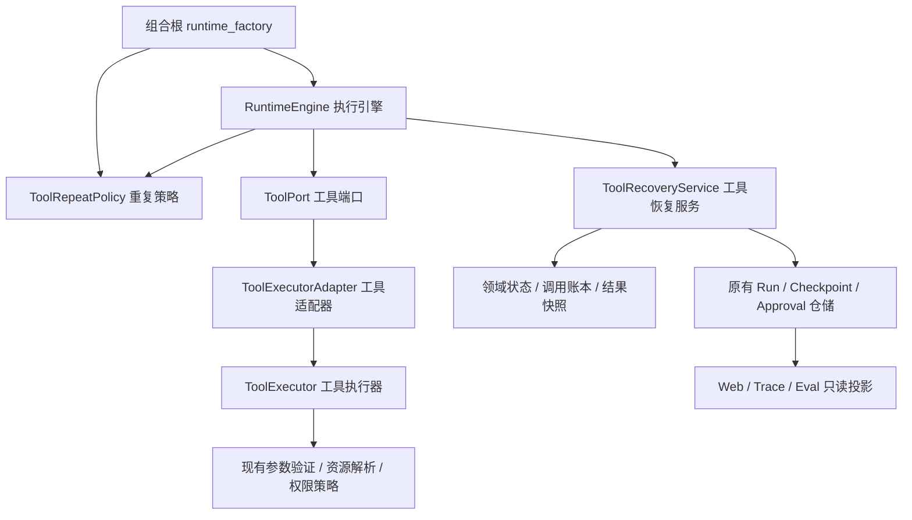

# 工具失败回灌纠错：技术规格

状态：实现已交付并完成静态验收；动态行为未验证。代码基线：`feat/toolCorrection` / `0749b78e65529d656445705d981a7067c28e9400`。

本文按“总体架构 → 文件、类、字段和方法 → 调用流程 → 异常及兼容”组织。范围、一个 PR 的五阶段 commit 顺序、测试断言见 [plan.md](plan.md)。不再按开发阶段重复描述技术规格。

标为新增/修改的内容均是目标实现；未列出的原有字段和参数保持。签名片段是接口契约，不是完整实现代码。

## 1. 总体架构

目标：工具失败形成可靠结果回灌模型；模型继续决策，运行时强制执行审批拒绝、重复失败、未知副作用工具封禁和可选总轮数上限。



| 模块 | 职责 | 禁止职责 |
| --- | --- | --- |
| 执行引擎 | 准入检查、模型/工具编排、结果分类、控制异常 | 共享可变计数、解析具体工具资源、绕过状态机 |
| 重复策略 | 从限制视图判断重复失败阈值 | 执行或持久化、放行审批拒绝和未知工具 |
| 工具执行器 | 参数/资源/权限校验、审批需求、执行及证据 | 保存 Run 级拒绝名单、决定整个任务终止 |
| 恢复服务 | 调用账本、审批/结果提交、补偿恢复、批次完成 | 调用模型、外部副作用确认 |
| 观察层 | 投影已提交事实 | 改变执行状态或触发重试 |

保留硬规则：`AgentRun`（运行实体）的 state 为唯一运行控制状态；迁移经过 transition；Runtime 通过 Port 调能力；MCP 使用普通工具链；同 Session 串行；取消与资源收尾优先；完整提交结果后才能继续外部调用。限制仅当前 Run 生效，恢复保留，不传播到独立子 Run。

## 2. 目标目录与文件职责

路径相对仓库根。标记为保留、修改、新增；没有整文件删除。

```text
src/dotclaw/
├── agent/identity.py                         [修改] 加载预算与重复失败阈值
├── bootstrap/runtime_factory.py             [修改] 装配默认策略
├── tools/
│   ├── base.py                              [修改] 返回值增加审批操作键
│   ├── executor.py                          [修改] 从已解析资源生成操作键
│   ├── capability.py                        [保留] 规范化资源解析
│   └── policy.py                            [保留] 全局/Agent 权限上限
├── runtime/
│   ├── domain/
│   │   ├── facts.py                         [修改] 预算错误码
│   │   ├── events.py                        [修改] 预算事件及事件联合
│   │   ├── state.py                         [修改] 拒绝后继续、预算终止迁移
│   │   └── tool_recovery.py                 [修改] 结果来源、未知快照、账本 v2
│   ├── application/
│   │   ├── dto.py                           [修改] 工具返回值扩展
│   │   ├── tool_correction.py               [新增] 限制视图、重复策略、反馈格式
│   │   ├── engine.py                        [修改] 准入、回灌、预算编排
│   │   ├── tool_recovery.py                 [修改] 结果、审批及未知提交
│   │   ├── execution.py                     [修改] 删除旧执行支路标志
│   │   ├── ports.py                         [保留] ToolPort 方法签名
│   │   └── cancellation_service.py          [保留] 取消 gate 与资源收尾
│   └── adapters/
│       ├── agent_policy_resolver.py          [修改] 冻结配置和模型行为规则
│       ├── tool_executor_adapter.py          [修改] 预检/执行字段透传
│       └── run_repository.py                [保留] 现有 CAS 和领域序列化委托
├── trace/assembler.py                        [修改] 未启动/未知结果投影
└── channel/web/
    ├── app.py                               [修改] 工具与任务状态独立投影
    └── schemas.py                           [保留] 已支持 uncertain
frontend/src/
├── ToolPresentation.tsx                      [修改] 错误跳过成功内容解析
├── ToolPresentation.test.tsx                 [修改] 失败和未知结果展示断言
└── RunObservation.test.tsx                   [修改] 拒绝后任务继续的断言
tests/runtime_v2/
├── test_tool_correction_policy.py            [新增] 纯策略及视图
├── test_tool_correction_engine.py            [新增] 回灌/准入/预算
└── test_tool_correction_recovery.py          [新增] 恢复及投影故障
```

其他既有测试及 README/Wiki 更新位置见 plan。账本版本兼容放在领域反序列化和恢复服务，不在文件仓储增加第二套迁移器。

| 删除位置 | 删除内容 | 替代关系 |
| --- | --- | --- |
| engine.py | `_after_tool_failure()` | 已提交普通失败由 `_resume_tool_batch()` 继续 |
| engine.py | 两处审批拒绝调用 `_request_cancel_locked()` | 原子提交拒绝结果，恢复原批次 |
| engine.py | `legacy_tool_recovery` 控制的旧执行循环 | 旧数据导入后统一账本链 |
| execution.py | `RunExecution`（运行现场）的 `legacy_tool_recovery` 字段 | 构造现场前完成旧数据导入 |

保留 import_legacy 和仍有调用方的 `_calls_from_checkpoint()`；不删除用户主动取消、委派和资源收尾路径。

## 3. 文件、类、字段与方法规格

### 3.1 配置与装配

#### `agent/identity.py` — `AgentIdentity`（Agent 身份配置）

| 字段 | 类型/默认值 | 规则 |
| --- | --- | --- |
| `max_loop_steps`，已有 | `int = 10` | 0 关闭；正数限制逻辑模型轮次 |
| `tool_repeat_failure_limit`，新增 | `int = 3` | >=1；达到阈值后阻止下一次匹配调用 |

`load_agent_config()` 保留签名。加载这两个字段时只接受整数，拒绝 bool、负数、浮点和字符串，错误指出字段名；不得继续用 int(raw) 静默截断。其他配置不变，不新增热更新。

#### `runtime/adapters/agent_policy_resolver.py` — `AgentPolicyResolver`（运行策略解析器）

保留 `async resolve(self, request: RunRequest) -> AgentPolicySnapshot`。`RunRequest`（运行请求）和 `AgentPolicySnapshot`（冻结策略快照）复用现有类型。

| 输出字段 | 内容 |
| --- | --- |
| `max_iterations: int` | identity.max_loop_steps，类型不改 |
| `policy_data["tool_correction"]` | `{"version": 1, "repeat_failure_limit": identity.tool_repeat_failure_limit}` |
| `policy_data["system_prompt"]` | 原提示词追加固定纠错规则 |

规则正文表达：工具失败不等于任务失败；读取错误码、执行证据和限制后调整方案；不得重复申请或绕过审批拒绝；UNKNOWN 不代表未生效；是否能执行由系统决定。恢复使用冻结提示词，不重复追加。`_identity_version()` 已基于身份 repr，新字段自然参与。

历史快照无 tool_correction 时使用 version=1、limit=3；存在但非法则报错，不默认覆盖。子 Run 使用已有独立 Identity，不共享父 Run 限制。

#### `bootstrap/runtime_factory.py`

创建 `ConsecutiveFailurePolicy`（连续失败策略）并注入 Engine，不增加策略注册表或插件配置。其他服务装配保持。

### 3.2 领域模型与状态机

#### `runtime/domain/tool_recovery.py` — 枚举

| 类型 | 定义/修改 |
| --- | --- |
| `ToolOutcomeStatus`（结果状态） | 增加 `UNCERTAIN="uncertain"`：调度已收口，外部效果未知 |
| `ToolOutcomeOrigin`（结果来源，新增） | PREFLIGHT / EXECUTION / APPROVAL / GUARD / RECOVERY / LEGACY，序列化为小写 |
| `ToolCallState`（调用状态） | 保留枚举，增加未启动失败迁移、允许未知结果快照 |

#### `ToolOutcomeSnapshot`（工具结果快照）

| 字段 | 类型 | 约束 |
| --- | --- | --- |
| status | ToolOutcomeStatus | completed/failed/cancelled/uncertain |
| output | str | 原安全输出，不保存格式化反馈 JSON |
| error | `RunError \| None` | 失败/未知必有，成功为空；RunError 为运行错误 |
| message_id | `str \| None` | 成功/失败/未知必须是稳定 ID |
| observed_at | str | 保留 UTC 格式 |
| effect_certainty | ToolEffectCertainty（副作用确定性） | known/unknown |
| message_kind / child_outcome | 保留原类型 | 保留普通调用/委派结果区分 |
| tool_error_code / tool_error_type | `str \| None` | 具体错误信息 |
| origin，新增 | `ToolOutcomeOrigin = LEGACY` | 新普通结果必须明确来源 |
| execution_evidence，新增 | `ToolExecutionEvidence \| None = None` | 复用执行证据枚举；旧记录允许缺失 |

新增字段放在现有默认字段之后。方法规格：

- `__post_init__()`：UNCERTAIN 必须 error/message_id 非空、certainty/evidence 均 UNKNOWN、origin 为 EXECUTION/RECOVERY；FAILED 必须 error/message_id；COMPLETED 不得含 error。新未启动失败为 NOT_STARTED，来源 PREFLIGHT/APPROVAL/GUARD。
- `to_dict() -> JSONMap`：序列化新字段；JSONMap 为现有 JSON 字典别名。
- `from_dict(data: JSONMap) -> ToolOutcomeSnapshot`：旧缺字段读为 LEGACY/None；未知字段和非法枚举报错，不从旧 attempt 猜证据。

#### `ToolCallRecord`（调用记录）

原调用、attempt、retry_count、幂等键、恢复契约、审批、结果和原因字段保持。新增：

| 字段/属性 | 类型/默认值 | 规则 |
| --- | --- | --- |
| approval_operation_keys | `tuple[str, ...] = ()` | 等待审批时冻结；JSON 数组读回 tuple |
| is_settled | 只读 bool 属性 | SUCCEEDED/FAILED/CANCELLED 为真；UNCERTAIN 仅有 result 时为真 |

`validate_transition(target)` 增加 PENDING→FAILED、WAITING_APPROVAL→FAILED；保留 STARTED→UNCERTAIN，允许旧 UNCERTAIN 自迁移补结果。`__post_init__()` 允许 UNCERTAIN 携未知快照，也允许读入旧无快照记录；新写约束在提交入口检查，记录本身不猜账本版本。

is_settled 替换旧 `_TERMINAL` 的批次追加检查、pending 计算、取消未完成调用、恢复批次选择。批次完成另作严格判断：取消不算正常结果，未知有结果才可回灌。

#### `ToolCallLedger`（调用账本）

schema_version 新建默认2，读取只接受1/2。revision、calls、pending_projection 及归属/唯一 call_id/ordinal/CAS 约束保持。不新增计数或封禁字段，限制从 calls 派生。

`from_dict()` 负责格式兼容；`to_dict()` 保留实例版本。v1 未完成投影先原样重放；下一次业务事实提交由恢复服务显式升级v2，不在读取时偷偷写盘。

#### `runtime/domain/{facts,events,state}.py`

| 类/函数 | 修改 |
| --- | --- |
| RunErrorCode（运行错误码） | 增加 ITERATION_LIMIT="iteration_limit" |
| IterationLimitReached（预算事件，新增） | 字段 `limit: int`、`iteration: int`；加入事件联合 |
| transition(state,event) | 预算事件仅 CALLING_LLM 且 iteration>limit>0 合法；转 Ended(FAILED)/FINALIZE |
| _on_suspended() | ApprovalRejected（审批拒绝事件）匹配ID后转 Running(EXECUTING_TOOLS)/EXECUTE_TOOLS，iteration 不变 |

ToolBatchCompleted（批次完成事件）保留 iteration+1；CancelRequested（取消事件）保留整个任务取消。Engine 不直接拼接运行终态替代迁移。

### 3.3 重复策略与限制视图

文件：新增 `runtime/application/tool_correction.py`。只依赖 runtime 模型和标准库，无 I/O。

#### 3.3.1 数据类

`ToolCorrectionContext`（当前调用限制视图）：

```python
@dataclass(frozen=True)
class ToolCorrectionContext:
    call: ToolCall
    consecutive_failures: int
    failure_limit: int
    blocked_tool_names: frozenset[str]
    rejected_call_keys: frozenset[str]
    rejected_operation_keys: frozenset[str]
```

ToolCall（模型工具调用）复用现有类型。视图从账本派生，不持久化、不存共享缓存。

`ToolGuardDecision`（准入决定）：

```python
@dataclass(frozen=True)
class ToolGuardDecision:
    allowed: bool
    error_code: str | None = None
    message: str = ""
```

允许时 code=None；拒绝时 code/message 明确，不用 retryable 代替执行证据。

#### 3.3.2 策略类

```python
class ToolRepeatPolicy(Protocol):
    def evaluate(self, context: ToolCorrectionContext) -> ToolGuardDecision: ...

class ConsecutiveFailurePolicy:
    def evaluate(self, context: ToolCorrectionContext) -> ToolGuardDecision: ...
```

ToolRepeatPolicy（重复策略接口）只判断重复失败；ConsecutiveFailurePolicy（默认连续失败策略）在 count>=limit 时拒绝，错误码 REPEAT_FAILURE_LIMIT，否则允许。默认第4次匹配调用被阻断。强制封禁先由 Engine 检查，策略无法覆盖。

#### 3.3.3 函数

| 签名 | 调用方 | 行为 |
| --- | --- | --- |
| `canonical_call_key(call: ToolCall) -> str` | 视图构建/准入 | `json.dumps([call.name, call.arguments], sort_keys=True, ensure_ascii=False, separators=(",", ":"), allow_nan=False)` |
| `build_correction_context(ledger: ToolCallLedger, call: ToolCall, failure_limit: int) -> ToolCorrectionContext` | Engine | 按账本追加顺序折叠限制，不写计数文件 |
| `format_tool_feedback(call: ToolCall, outcome: ToolOutcomeSnapshot) -> str` | 恢复服务构建消息 | 成功原样返回 output；失败/未知构造固定 JSON |

规范键只消除对象键顺序，不补默认值、不重排数组、不裁剪字符串、不合并1与1.0；不 hash、不额外持久化完整参数键。

折叠规则：

1. approval_decision=False 记录精确调用键与冻结资源键，旧半提交也生效。
2. 普通调用 UNCERTAIN，或结果 evidence=UNKNOWN 且 side_effect!=NONE，记录工具名封禁。
3. 当前组合明确成功清零；FAILED 且 origin=EXECUTION 累加一次；预检、审批、GUARD、RECOVERY、取消、等待均不改变。LEGACY 失败不计，明确成功可清零。
4. 每个逻辑 call_id 只贡献一次结果，不按内部 attempt/retry_count 累计；不同组合不相互清零；重复读取不会重复计数。

反馈 JSON 固定字段：status、tool_name、error_code、error_type（未知为null）、message、execution_evidence、effect_certainty、constraint。message 优先安全 output，空则 error.message。constraint 为 none/approval_denied/repeat_failure_limit/tool_blocked_uncertain；最后一种附 blocked_tool_name，并说明其他工具可用。

原错误码保留；运行时新增 REPEAT_FAILURE_LIMIT、TOOL_BLOCKED_UNCERTAIN、TOOL_OUTCOME_UNCERTAIN，存快照 tool_error_code 字符串，不扩展 tools 错误枚举承担运行时职责；审批沿用 APPROVAL_DENIED。不附原参数、资源键、认证头、traceback。只在构建持久化消息时格式化一次，重放 intent 不改正文。

### 3.4 工具端口、执行器与适配器

#### `runtime/application/dto.py`、`tools/base.py` — 两层 `ToolResult`（工具返回值）

各自在默认字段尾部增加 `approval_operation_keys: tuple[str, ...] = ()`；保留各自原有字段，不合并两层 DTO。

#### `runtime/application/ports.py` — `ToolPort`（工具端口）

签名保持：

```python
async def preflight(self, invocation: ToolInvocation, execution: RunExecutionView) -> ToolResult: ...
async def execute(self, invocation: ToolInvocation, execution: RunExecutionView) -> ToolResult: ...
async def describe_recovery(self, call: ToolCall, execution: RunExecutionView) -> ToolRecoveryContract: ...
```

ToolInvocation（调用请求）、RunExecutionView（只读执行现场）、ToolRecoveryContract（恢复契约）复用现有类型。preflight 不执行 handler。

#### `tools/executor.py` — `ToolExecutor`（工具执行器）

| 方法 | 修改 |
| --- | --- |
| `_run_chain()` | 保留查找→参数→资源→策略→审批→执行顺序；资源解析后生成操作键；预检成功、预检ASK、执行入口要求审批时携带键 |
| `_approval_operation_keys(self, requests: list[CapabilityRequest]) -> tuple[str, ...]`，新增 | 转换资源键，去重排序 |
| preflight_for_runtime / execute_for_runtime | 保留签名，复用执行链 |
| _execute_handler | 保留业务/网络/超时归一化和资源清理异常上抛 |

CapabilityRequest（资源请求）来自现有 CapabilityBroker（资源解析器）。仅 FILE_READ/FILE_WRITE 生成键：`json.dumps([kind.value, path], ensure_ascii=False, separators=(",", ":"))`；path 使用已解析 absolute_path，Windows 用 normcase，不使用原始路径。读写键不同，不包含工具名/profile，支持已声明同资源同操作的跨工具匹配。

进程/MCP/网络只做同工具同参数匹配，不拿脱敏命令、host、server 推测精确操作身份。任意 shell 等价操作不在本阶段语义识别能力内，原权限规则继续生效。

#### `runtime/adapters/tool_executor_adapter.py` — `ToolExecutorAdapter`（工具适配器）

| 方法 | 调用与返回 |
| --- | --- |
| preflight | executor.preflight_for_runtime；透传 keys/code/type/evidence，失败补 RunError(TOOL_FAILURE,output) |
| execute | executor.execute_for_runtime；完整透传同上信息 |
| _context | 保留 run/agent/call身份、attempt、幂等键 |
| describe_recovery | 保留声明与冻结契约映射 |

不保存拒绝列表，不决定任务终止，不靠提示词代替权限检查。

### 3.5 运行编排模块

文件：`runtime/application/engine.py`；类：`RuntimeEngine`（运行执行引擎）。

新增字段 `_repeat_policy: ToolRepeatPolicy`，无 Run 可变状态。构造函数现有 keyword-only 参数尾部增加 `repeat_policy: ToolRepeatPolicy | None = None`，None 使用默认策略兼容原调用方；组合根显式注入。

#### 3.5.1 准入方法（新增）

```python
async def _check_tool_admission(
    self, run: AgentRun, record: ToolCallRecord,
    operation_keys: tuple[str, ...] = (),
) -> ToolGuardDecision: ...
```

前置：调用方已补偿 pending projection。读取最新账本与冻结阈值，构建限制视图，依次判断未知工具名→精确审批拒绝→资源键交集→重复策略。只返回决定，不写结果或执行工具。

调用点：首次预检前（空keys）、预检后（带keys）、begin_attempt前取消gate内重读、恢复RETRY前。判断不消费计数，不缓存整批决定；已有结果直接复用，不对复用结果做准入。

#### 3.5.2 现有方法

| 方法 | 目标调用顺序/职责 |
| --- | --- |
| _execute_tools_action | describe_recovery→plan_batch→reconcile→_resume_tool_batch；删除旧执行支路 |
| _resume_tool_batch | 按原批次顺序；FAILED/UNCERTAIN结果直接复用；普通失败继续；每次提交后重读；结果齐全再complete_batch |
| _execute_one_tool | 准入→预检→资源拒绝检查→等待/未执行提交/开始执行→分类提交 |
| _commit_observed_tool_result | 保留gate及等待完整提交，不先单独写消息 |
| resolve_approval | 决议提交后恢复同Run；删除拒绝触发取消；已有取消仍收尾 |
| resume_run及恢复入口 | 先补偿/导入/补旧拒绝结果，再构造现场；不复活已结束Run |
| _reload_tool_execution | 重读消息、状态、检查点，供后续工具及模型使用 |

已批准调用恢复也重新预检和强制准入。新记录操作键与冻结键不同，返回 APPROVAL_DENIED/GUARD；相同且decision=True不重复ASK。键检查不能替代冻结恢复契约检查。

begin_attempt之后再次验证若返回NOT_STARTED，保留已写attempt/TOOL_STARTED，结果来源PREFLIGHT，不计连续执行失败。attempt表示启动尝试，不保证handler已运行；不得回减历史次数。

#### 3.5.3 总预算方法

`_drive()` 在 INVOKE_LLM 前检查 `limit != 0 and execution.state.iteration > limit`。iteration从1开始，每批完成加1；0关闭。最后允许模型轮产生的工具批次先处理、保存，再阻止下一轮模型。

```python
async def _finish_iteration_limit(
    self, execution: RunExecution, run: AgentRun,
) -> RunResult: ...
```

RunMessage（运行消息）、RunResult（运行返回结果）复用现有类型。取消优先；读取checkpoint，调用恢复服务commit_iteration_limit，再读终态返回。错误说明达到N轮、任务未完成，附最近失败工具名/错误码，不附参数，不额外调用模型，不提交成功会话。

审批和工具安全恢复重试不增加模型轮数；恢复沿用iteration和冻结上限。未持久化模型结果的崩溃重发仍属于原逻辑轮，不保证HTTP次数严格等于轮数。

### 3.6 调用事实与恢复模块

文件：`runtime/application/tool_recovery.py`；类：`ToolRecoveryService`（工具恢复服务）。

字段保留原Run/Checkpoint/Approval仓储依赖，不注入模型或策略，不新增计数存储。

#### 公开方法签名

```python
# 新增：提交未启动失败。
async def commit_not_started(self, run: AgentRun, call_id: str,
    outcome: ToolOutcomeSnapshot, checkpoint: RunCheckpoint) -> ToolCallLedger: ...

# 已有：提交实际执行或委派返回结果。
async def commit_outcome(self, run: AgentRun, call_id: str,
    outcome: ToolOutcomeSnapshot, checkpoint: RunCheckpoint) -> ToolCallLedger: ...

# 修改：等待审批同时冻结操作键。
async def wait_approval(self, run: AgentRun, call_id: str, approval_id: str,
    checkpoint: RunCheckpoint, *, operation_keys: tuple[str, ...] = ()) -> ToolCallLedger: ...

async def decide_approval(self, run: AgentRun, approval_id: str, approved: bool,
    checkpoint: RunCheckpoint | None) -> ToolCallLedger: ...

# 签名保留，改为调用级未知收口。
async def block_uncertain(self, run: AgentRun, call_id: str, reason: str,
    checkpoint: RunCheckpoint, *, outcome: ToolOutcomeSnapshot | None = None) -> ToolCallLedger: ...

async def complete_batch(self, run: AgentRun, batch_id: str,
    checkpoint: RunCheckpoint) -> ToolCallLedger: ...

# 新增：补齐旧拒绝半提交。
async def materialize_rejected_approval(self, run: AgentRun, call_id: str,
    checkpoint: RunCheckpoint) -> ToolCallLedger: ...

# 新增：预算事件对应的终态提交。
async def commit_iteration_limit(self, run: AgentRun, checkpoint: RunCheckpoint,
    limit: int, iteration: int) -> ToolCallLedger: ...
```

RunCheckpoint（运行检查点）复用已有类型。写方法由Engine持取消gate调用，服务不再次获取同一非重入锁。

#### 方法契约

| 方法 | 允许输入 | 写入/输出及异常 |
| --- | --- | --- |
| commit_not_started | PENDING或已批准WAITING_APPROVAL；FAILED/NOT_STARTED | 结果、消息、事件、移除pending；不begin_attempt |
| commit_outcome | STARTED或原WAITING_CHILD | 明确结果；相同已存结果幂等，不同结果冲突报错 |
| wait_approval | 原PENDING/允许的STARTED | 冻结keys/approval_id、等待状态和checkpoint；不生成结果 |
| decide_approval | 审批唯一归属、决议不可翻转 | 同意沿原路径；拒绝原子提交决议、APPROVAL/NOT_STARTED结果、状态恢复和两类事件 |
| block_uncertain | 普通STARTED或旧UNCERTAIN无结果 | 未知快照、reason、TOOL_RECOVERY_BLOCKED与TOOL_COMPLETED；不写RUN_FAILED、不删checkpoint |
| complete_batch | 每项都有COMPLETED/FAILED/UNCERTAIN结果及已投影消息 | 原序结果IDs→ToolBatchCompleted→CALLING_LLM；等待/取消/缺结果拒绝 |
| materialize_rejected_approval | 活动旧等待记录decision=False、无结果 | 复用拒绝提交；不重新审批、不翻转；取消优先 |
| commit_iteration_limit | CALLING_LLM且iteration>limit>0 | 新预算事件→FAILED、RUN_FAILED、移除checkpoint；无账本沿原空账本机制 |

拒绝必须一次提交审批consumed/decision=False、账本decision=False/FAILED、消息、APPROVAL_RESOLVED与TOOL_COMPLETED、Running(EXECUTING_TOOLS)、checkpoint。不得先恢复运行后补结果；同决议幂等，相反决议失败。

#### 内部结果提交方法（新增）

```python
async def _commit_result(
    self, run: AgentRun, ledger: ToolCallLedger, record: ToolCallRecord,
    outcome: ToolOutcomeSnapshot, checkpoint: RunCheckpoint, *,
    approval: ApprovalRecord | None = None,
    target_state: AgentRunState | None = None,
) -> ToolCallLedger: ...
```

ApprovalRecord（审批记录）、AgentRunState（运行状态）复用现有类型。调用方先检查状态，传入已更新审批决议/未知原因的record；helper安装结果和调用终态、构造消息/必要审批或未知事件/TOOL_COMPLETED、更新pending与统计，委托_commit_fact。target_state只能是transition的结果，None保持原状态。helper不猜审批决定、不执行工具。

稳定消息ID沿用 `tool-result-`＋UUID5(run_id:call_id)。成功/失败/未知每个逻辑调用计tool_call_count一次，含未执行失败；实际启动看attempt及执行证据；幂等重放不重复累计。

#### 恢复方法

保留 `async reconcile(self, run: AgentRun, checkpoint: RunCheckpoint, contracts: Mapping[str, ToolRecoveryContract]) -> ToolRecoveryPlan`；ToolRecoveryPlan（工具恢复计划）复用已有结构。

顺序固定：已存FAILED/UNCERTAIN结果REUSE→旧UNCERTAIN无结果补齐→冻结契约/scope检查→STARTED分类→等待审批/子任务原路径。

- STARTED且side_effect!=NONE：未知收口并封禁同名工具，幂等键不能绕过。
- 只有side_effect=NONE的安全恢复重试沿用退避、attempt、retry_count及预算；耗尽提交FAILED/RECOVERY回灌。
- BLOCK原因recovery_contract_changed/recovery_scope_missing是控制失败；started_outcome_unknown/uncertain_outcome走普通未知收口；retry_budget_exhausted走无副作用恢复失败。其他新原因快速报内部错误。
- 旧UNCERTAIN先按状态处理，旧reason（如legacy_execution_unproven）原样保留，不要求属于新原因集合。
- 委派保留原子任务恢复语义，不纳入普通工具策略；其未知情况保留原控制失败。

recover_projection、_commit_fact、_commit_projection、_apply_projection保留原职责，顺序见§4.4。cancel_unfinished使用is_settled，不覆盖已收口未知结果。import_legacy是旧格式唯一导入入口。

### 3.7 观察与前端模块

| 文件/方法 | 修改规格 |
| --- | --- |
| trace/assembler.py::assemble_trace | 新协议未启动结束没有TOOL_STARTED时，根据原调用和结果建结束span，不伪造耗时；其他缺配对仍报错 |
| 同上事件分支 | 新协议APPROVAL_RESOLVED只记审批属性，TOOL_COMPLETED收口；RECOVERY_BLOCKED不吞结果引用；未知映射已有INCOMPLETE而非成功 |
| channel/web/app.py::_run_activity | 按call_id关联未启动/未知结果，不从工具失败推断任务失败 |
| channel/web/app.py::_run_steps | uncertain不被完成事件覆盖为interrupted；单调用单步骤；未启动started_at为空 |
| channel/web/schemas.py | 现有status字段已支持uncertain，保持 |
| frontend/src/ToolPresentation.tsx::ToolResultView | 非completed跳过搜索源/文件成功解析，展示错误文本及现有状态标签 |

无启动结果的宽容仅限protocol>=2、origin为PREFLIGHT/APPROVAL/GUARD、evidence=NOT_STARTED，不能放宽所有历史事件。Eval保持冻结策略/事件字段，未知结果不得计成功；成功正文不变。不新增设置页、自动重试或解封API。

## 4. 数据流与方法执行顺序

### 4.1 普通批次

```text
_execute_tools_action
  → describe_recovery → plan_batch → reconcile → _resume_tool_batch
  → 已有结果：复用
  → 待执行：_execute_one_tool
      → _check_tool_admission（工具名/精确拒绝/重复策略）
      → preflight（参数/资源/权限）
      → _check_tool_admission（增加资源键）
      → 失败：commit_not_started
      → 审批：wait_approval，挂起原批次
      → 允许：gate内确认取消与最新限制 → begin_attempt
              → execute → 分类 → commit_outcome/block_uncertain
  → _reload_tool_execution → 下一调用
  → complete_batch → _drive预算检查 → _invoke_llm_action
```

普通失败不停止剩余工具；结果齐全后模型统一读取。取消/控制故障立即停止后续执行，未执行项留pending或由取消收口，不能伪造业务失败继续模型。

### 4.2 审批恢复

`resolve_approval → gate内补偿projection/检查取消 → decide_approval → resume_run`。

拒绝直接复用已提交结果并继续剩余调用；同意重新预检/准入后执行原call_id。命中拒绝资源即阻断整次调用，不做部分执行。更换call_id或字段顺序不能绕过，文件路径别名按已解析路径匹配；不宣称识别任意shell语义。

### 4.3 执行结果分类

| 事实 | 结果与后续 |
| --- | --- |
| NOT_STARTED校验/权限/审批/限制失败 | FAILED，来源PREFLIGHT/APPROVAL/GUARD；继续 |
| RETURNED明确成功/失败 | COMPLETED/FAILED；继续 |
| UNKNOWN/缺证据，side_effect=NONE | FAILED，evidence=UNKNOWN、certainty=KNOWN；live来源EXECUTION，恢复来源RECOVERY；不封禁 |
| UNKNOWN/缺证据，side_effect!=NONE | UNCERTAIN/UNKNOWN；封禁当前Run完整工具名，其他工具继续 |
| 取消/资源收尾未完成 | 原控制流程，不继续普通链 |
| 状态、存储、恢复契约错误 | 控制失败/停止，不伪装可纠错错误 |

未知原调用为UNKNOWN；后来同名被封禁调用为NOT_STARTED/GUARD。封禁与参数无关，本阶段不查询外部状态或解封。

### 4.4 持久化顺序

1. Engine持取消gate；补偿旧intent，读Run/checkpoint/ledger，检查归属和允许状态。
2. 构造record、稳定消息、事件、目标Run/checkpoint；移除已收口pending，序号从持久末尾连续追加。
3. `_commit_fact → _commit_projection`：CAS原子写账本，结果与pending_projection同时落盘，revision+1，作为事实提交点。
4. `_apply_projection`：ensure approval（有则写）→messages→events→checkpoint→run。
5. CAS清pending_projection，revision+1；Engine重读后才继续下一次外部调用。

失败停止驱动，恢复通过稳定ID/commit_id幂等补齐；不新增计数文件或跨文件事务承诺。新事件保留tool_event_semantics=2，tool_protocol_version=2，增加origin/execution_evidence/effect_certainty；原status/attempt/result_message_id/tool_error_code/type保留。首次预检失败不写TOOL_STARTED。

## 5. 异常、兼容与禁止行为

### 5.1 异常及特殊场景

- tools层归一化业务、网络、超时错误；ResourceCleanupError（资源收尾异常）走原取消服务。
- Engine不把端口任意Exception伪装普通工具失败；非契约异常保留STARTED和诊断、停止驱动，交给安全恢复。
- 状态、存储、策略代码错误快速失败；不吞异常，不让模型修复账本。
- 取消与审批同gate排序；先受理取消则后到审批不能复活或执行；重复同决议幂等，反向决议报错。
- 反复预检错误不计连续执行失败；关闭总预算不承诺自动终止这类循环。
- 同名工具封禁会连带阻止该工具提供的查询操作，这是已接受粒度；其他工具仍可用，#52再扩展确认/解封。

### 5.2 历史兼容与迁移

| 历史情况 | 处理 |
| --- | --- |
| v1未完成projection | 原消息/事件原样ensure，清intent再做新提交；不重新格式化 |
| v1正常账本 | 缺字段LEGACY/None/空keys；下一次业务CAS显式写v2；不猜旧执行证据 |
| 活动旧等待记录decision=False且无结果 | materialize_rejected_approval补齐拒绝结果/状态；不翻转，取消优先 |
| 旧审批缺keys | 精确调用键仍有效；不补猜旧批准资源身份；旧批准沿原安全策略/契约恢复，新资源键一致性检查只对已有冻结键记录执行 |
| 旧STARTED/UNCERTAIN无快照 | 按§3.6分类，旧原因保留 |
| 无账本旧checkpoint | import_legacy后走统一链；缺源调用/审批冲突/损坏拒绝恢复 |
| 旧已结束Run | 只读，不复活、不补执行、不重标成功 |

新增DTO字段尾部默认兼容；ToolPort签名、原成功正文、委派、取消及成功会话投影保留。旧writer不能写v2，禁止混跑；回滚使用升级前备份或隔离目录，不做降级转换、不删用户数据。

### 5.3 禁止行为和删除条件

禁止仅靠提示词防重试；通过新call_id/参数/幂等键绕过未知工具封禁；审批拒绝取消任务；普通失败终止整批；伪造TOOL_STARTED；跨Run共享限制；新建纠错Agent、外部副作用查询/解封；改写历史终态。

旧执行支路只能在旧数据可导入统一链、调用方迁移、历史测试通过后删除。最终检查_after_tool_failure、legacy_tool_recovery无生产引用；所有启动及恢复RETRY都有准入。实施顺序与测试矩阵统一见plan。
