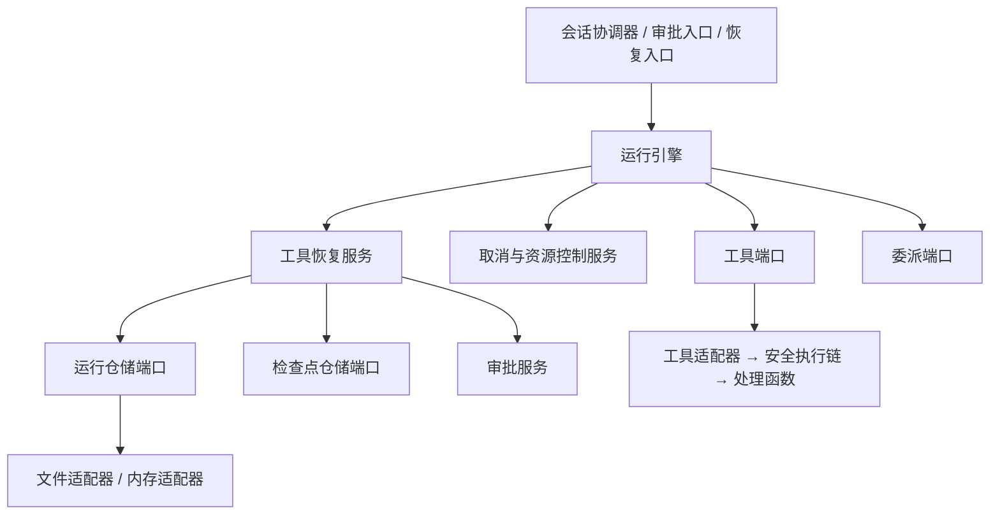
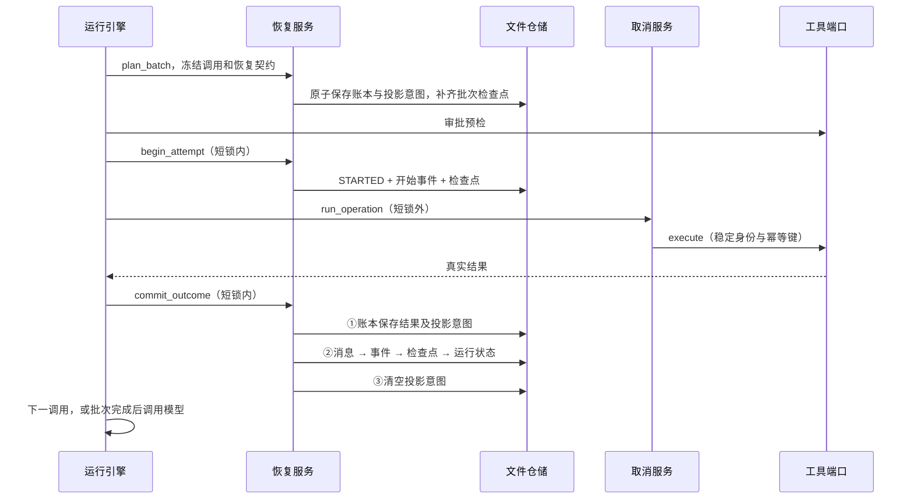

# 工具调用可靠恢复：总设计与统一契约

版本：v0.4，2026-11-11。状态：已完成开工前源码对照与协议审查，尚未开始实现；正确性仍须通过阶段验收。用户已确定交付组织：**一个 PR，先 #51 后 #41，按阶段分 commit**；已确认方向与设计方具体选择分别标注，不代表实现已经完成。

执行状态更新（2026-11-12）：已按阶段开始实现。用户本轮明确禁止动态测试与应用运行，覆盖本文测试执行要求；只做静态检查与代码审查，动态场景保留为未执行的验证规格，不能据静态验收声称运行时可靠性已经验证。具体提交与交接记录见本地 docs/changes/tool-reliable-recovery。

## 开发阅读入口：先总设计，再按阶段执行

### 本轮讨论状态（2026-11-11）

- 已确认：审批与取消需要可靠提交，具体时序由设计方负责；委派保留混合批次及稳定子运行边界，本轮不扩展复杂委派调度。
- 已确认的后续方向：普通工具可处理错误回灌模型，由模型选择修正参数或换工具；行为调整留到后续工具并发阶段。本轮必须将“保存调用失败事实”和“结束整个运行的策略”分离，保留结构化错误及来源调用，不能在结果仓储内自动结束运行。
- 本轮采用的范围：统一本地文件载体，不引入 SQLite，也不同时维护两套生产存储。继续通过现有仓储协议访问，不让引擎直接操作路径；未来真实需要第二种载体时再定义跨载体提交契约。独立 tool_calls.json 仍为文件布局建议，不能把文件载体的选择当作用户已确认其所有内部结构。
- 已确认：外部副作用操作默认禁止自动重试；注册声明、安全执行资格与恢复预算分别校验，配置次数不能授权不安全重放。
- 外部查询的目标已澄清；设计方本轮收敛选择：**外部状态查询及自动对账后置**，不增加查询端口、轮询或查询布尔字段。保留稳定幂等键机制及模拟提供方验证，不宣称现有外部工具已经具备恢复查询能力。未知副作用默认阻断。
- 已确认扩展工具注册元数据：按工具声明恢复预算和退避参数，默认预算为零；具体字段见分阶段计划 C10a。是否安全和允许重试多少次是两个独立判断，默认数值属于设计选择。
- 已确认参数声明改造：业务参数直接写在函数形参上，用 Annotated/Field 描述类型、说明与约束，由发现器生成内部校验模型和 schema；不再要求内置工具作者手写顶层 Args 包装类。现有校验和业务参数契约必须保留。
- 已确认错误处理职责拆分：保存工具失败事实与整次运行的停止策略分开；本次保留失败停止行为，错误回灌模型的行为改变后置。

已确认本轮兜底：副作用结果无法确认时结束本次运行并提示核对，不提供人工确认后续跑；让 Agent 调查外部效果的长期方向由 [Issue #52](https://github.com/aandbcct/dotClaw/issues/52) 后续实现。文件内部布局和幂等补写由设计方承担，不要求用户审核每个字段。新形参声明沿用旧注册入口兼容已有自定义工具，内置工具统一迁移，此为设计方兼容策略。

本文件负责“总”：目标、全局边界、统一模型和跨模块协议。配套 [分阶段开发执行计划](工具调用可靠恢复-分阶段开发执行计划.md) 负责“分”：每个阶段的责任包、类/方法/字段变更、内部执行步骤、失败行为与验收。开发人员必须按阶段文档执行，不能仅据本文件的模块总表自行规划。

```text
一个 PR：工具调用可靠恢复
├─ 阶段一 #51：C01 执行/取消语义 → C02 Trace/活动消费者
├─ 阶段二 #41：C03 模型、字段和接口
├─ 阶段三：C04 仓储原语 → C05 可补写投影
├─ 阶段四：C06 普通工具执行与恢复
├─ 阶段五：C07 审批持久决定 → C08 取消与结果提交
├─ 阶段六：C09 委派和混合批次
├─ 阶段七：C10a 安全重试与执行证据 → C10b 形参声明与发现器迁移
└─ 阶段八：C11 历史兼容/展示 → C12 跨阶段故障验收
```

每个 commit 包含对应测试；阶段一完成语义前置，审批崩溃、取消竞争等跨 Issue 保证在后续阶段合流验证。中间 commit 不单独发布。下文第 4—8 节是公共契约参考，不代替上述执行分工。

## 1. 目标、依据与范围

唯一目标：同一运行中，以单个工具调用为单位可靠保存执行事实；重启后复用已确认结果，仅在明确安全时重试，无法确认副作用时停止自动执行。

依据：

- [前次讨论](chatgpt-conversation://6af1297a-fb94-83ec-b387-d643cde9dfa4)。沿用方向：审批不算工具终态；取消机制保留；委派纳入兼容；并发调度后置。
- [Issue #51](https://github.com/aandbcct/dotClaw/issues/51)：审批与终态事件语义；[Issue #41](https://github.com/aandbcct/dotClaw/issues/41)：调用级恢复与副作用控制。读取时两者均为 open。
- 本地代码基线：`master`，`61ad81f7ccad310464d736c2dad39ed8c34a9d35`。工作区检查时干净。本文源码路径均相对于仓库根目录。

本版覆盖：普通工具执行、审批、取消与工具提交竞争、委派混合批次、恢复事实校验、历史读取、Trace/活动展示兼容、故障验收。

本版不建设：批次并发调度、启动时自动恢复所有运行、数据库迁移、通用工作流事务框架、人工对账后台、任意外部服务的幂等实现、模型响应可靠落盘改造。

外部状态查询/自动对账明确列为后续，不作为本 PR 的未完成验收项。当前一 PR 八阶段共十三个 commit（C10 拆为 C10a/C10b）。

## 2. 已确认的代码事实

| 位置 | 当前行为 | 本次直接影响 |
|---|---|---|
| `runtime/application/engine.py::_execute_tools_action` | 普通调用串行；执行前保存剩余列表；结果消息和完成事件后，没有立即收缩检查点 | 结果已保存仍可能重放 |
| 同方法 | 审批结果先生成工具消息和 `TOOL_COMPLETED`，再挂起 | 审批被误当成终态 |
| `engine.py::resume_run` | 从检查点还原待执行列表，用检查点旧事件序号写恢复事件 | 已保存事实落后校验不足，可能序号冲突 |
| `runtime/adapters/tool_executor_adapter.py::execute` | 用 `_executed_calls` 去重；`_waiting_calls` 命中时即使 `approved=False` 也可能继续执行 | 进程缓存不能作为审批授权或恢复事实 |
| `engine.py::resolve_approval` | 先消费审批，再写决议事件、继续运行 | 消费后崩溃会丢失“通过还是拒绝”的可靠恢复依据 |
| `engine.py::complete_cancellation`、`recover_cancellations` | 从开始/完成事件匹配未收尾工具 | 审批语义修改必须同步取消扫描 |
| `engine.py::_execute_tools_action`、`resume_delegation` | 预扫描委派并提前转交；子运行结束后直接回到模型 | 混合批次的前后普通工具不能照现有方式恢复 |
| `orchestration/runtime_delegation_adapter.py::prepare` | 已用父运行与工具调用标识生成稳定子运行 ID，验证重复准备参数 | 复用该协议，不能另建普通工具重试替代它 |
| `tools/executor.py::_build_context` | 重建工具上下文时只复制部分字段 | 新执行键需要明确贯穿这里 |
| `trace/assembler.py` | 审批决议会闭合关联工具记录，之后完成事件可被当成重复 | 新语义下会丢失真正执行结果 |

这些是静态源码事实；本文没有执行故障实验，不声称已验证改造收益。v0.2 再次核对代码提交未变，工作区已有 v0.1 设计文档。

## 3. 核心决定

1. 单调用事实采用 `ToolCallRecord`（工具调用持久记录）；不把状态塞进可被裁剪的剩余列表。
2. 新增运行目录内的 `tool_calls.json`，保存调用账本和一个未完成投影意图。账本是新格式工具执行事实的权威来源；消息、事件、检查点仍保留各自职责。
3. 工具结果先进入账本，再幂等写入既有消息、事件和检查点。投影完成前禁止执行下一个工具或调用模型。
4. `TOOL_COMPLETED` 仅对应成功、失败、取消；审批继续使用 `WAITING_APPROVAL`。调用状态与审计状态用途不同，采用显式映射。
5. 继续沿用 `CancellationService`（取消与资源控制服务）的短锁和能力任务监管，外部调用不持提交锁。
6. 使用现有 `(run_id, call_id)` 作为执行身份；同一运行中重复调用 ID 即使参数相同也拒绝进入新批次。真实新动作必须有新调用 ID。
7. 本版遇到不可安全重试的不确定结果，工具记为 `UNCERTAIN`，运行以现有失败终态结束，错误码为 `TOOL_OUTCOME_UNCERTAIN`。不新增运行终态，不提供本次运行的强制重放入口。
8. 本版仍串行；逐调用账本为以后乱序完成提供基础，但不提前引入调度器、资源冲突图。

### 3.1 分层



领域模型不依赖文件、工具执行器或入口。恢复服务不执行外部工具、不调用模型、不创建子运行；引擎根据恢复决策调度现有端口。仓储只校验和保存事实，不决定是否重试业务。

## 4. 类与字段设计

### 4.1 新增领域文件 `runtime/domain/tool_recovery.py`

采用不可变数据对象和严格反序列化。以下字段均必须由运行时生成或校验；模型参数不能覆盖控制字段。

**`ToolCallState`（工具调用状态枚举）**

`PENDING / STARTED / WAITING_APPROVAL / WAITING_CHILD / SUCCEEDED / FAILED / CANCELLED / UNCERTAIN`。

- `STARTED`：本次尝试已持久化并获准进入执行链；不保证处理函数已开始或副作用已发生。
- `WAITING_APPROVAL`、`WAITING_CHILD`：非终态，禁止当作工具结果回灌。
- `UNCERTAIN`：执行效果缺少可靠证据；不是成功，也不是已证实无副作用的失败。
- `SUCCEEDED / FAILED / CANCELLED` 为已裁定的调用终态；`CANCELLED` 只说明调用停止，不承诺回滚外部副作用。

**`ToolReplayPolicy`（工具恢复重试策略枚举）**定义在新增中立文件 `common/tool_replay.py`，由 `tools/base.py` 与恢复领域模型共同导入，禁止领域层依赖执行器。

`SAFE_RETRY / KEYED_IDEMPOTENT / NO_AUTO_RETRY`，默认 `NO_AUTO_RETRY`。

新增 `ToolSideEffect`（工具副作用声明枚举），同置 `common/tool_replay.py`：`NONE / PRESENT / UNKNOWN`，默认 UNKNOWN。表示对业务/外部环境的影响，不将运行日志写入算作业务副作用。工具装饰器显式声明 side_effect，发现器、定义、恢复契约及调用记录完整传递；不能根据 policy、needs_approval 或名称自动推导。SAFE_RETRY 仅允许已审核 NONE，PRESENT/UNKNOWN 默认 NO_AUTO_RETRY；PRESENT 的 keyed 例外需具体提供方保证，不能通过填写次数获得授权。

**`ToolCallRecord`（工具调用持久记录）**

| 字段 | 类型 / 默认值 | 含义与约束 |
|---|---|---|
| `run_id` | `str` | 所属运行，必须等于容器运行 |
| `call` | `ToolCall`（工具调用参数对象） | 冻结 `call_id/name/arguments`；恢复不得重新向模型索取参数 |
| `source_message_id` | `str` | 原始助手消息 ID，同时作为批次 ID |
| `ordinal` | `int` | 调用在助手消息中的位置，从 0 开始；同批不重复 |
| `kind` | `ordinary / delegation` | 普通执行或委派路径，恢复不可互换 |
| `state` | 调用状态枚举 | 当前持久状态 |
| `attempt` | `int = 0` | 每次真正进入工具端口前加一；审批预检不增加 |
| `replay_policy` | 三种策略之一 | 首次计划冻结；恢复时还要核对当前工具契约 |
| `side_effect` | `ToolSideEffect = UNKNOWN` | 首次计划冻结；恢复若当前声明改变则停止，不能自行把历史调用升级为安全 |
| `replay_contract_version` | `str = ""` | 支持安全重试的具体工具契约版本；变化禁止盲重放 |
| `execution_scope` | `str = ""` | 首次冻结的规范化作用域编码：绝对 workspace 根目录、全局/Agent 权限规则、禁止路径、MCP 与网络服务范围；安全恢复要求与当前严格相等，旧空值不授予安全重放 |
| `idempotency_key` | `str | None` | keyed 策略必填；同调用所有尝试不变，不含 attempt |
| `key_valid_until` | UTC ISO 字符串或 null | 首次调用时冻结的下游去重保证截止时间；null 仅用于明确保证无期限的契约，恢复不得延长 |
| `retry_count` | `int = 0` | 跨重启累计额外恢复尝试次数，受该调用冻结的工具恢复预算约束 |
| 四个 `recovery_*` 配置字段 | 与工具注册字段同名同类型 | 冻结最大恢复次数、初始退避、倍率、最大退避；见 C10a；字段和序列化在 C03 完成 |
| `recovery_retry_not_before` | `str | None` | UTC 最早允许重试时间；首次生成后持久化，重启不得重置 |
| `last_execution_evidence` | `ToolExecutionEvidence | None`（执行证据枚举） | 无终态结果时仍保存 NOT_STARTED / RETURNED / UNKNOWN 证据 |
| `last_error` | `RunError | None`（运行错误对象） | 中断诊断，不冒充可靠业务结果 |
| `last_tool_error_code`、`last_tool_error_type` | 各为 `str | None` | 原执行端错误分类，供后续失败回灌使用 |
| `attempt_started_at` | `str | None` | 最近尝试的 UTC 开始时间 |
| `approval_id` | `str | None` | 关联审批，不等同于已批准 |
| `approval_decision` | `bool | None` | null 未决、true 通过、false 拒绝；与调用参数绑定 |
| `child_run_id` | `str | None` | 委派准备后关联的稳定子运行 ID |
| `result` | `ToolOutcomeSnapshot | None` | 完整可重建结果；成功/失败必须存在 |
| `uncertainty_reason` | `str | None` | 无结果、契约变化、超时等固定诊断码 |
| `updated_at` | UTC ISO 字符串 | 展示审计，不能用时间戳裁定提交先后 |

`ToolOutcomeSnapshot`（工具结果快照）：`status: completed|failed|cancelled`、`output: str`、`error: RunError | None`（运行错误对象）、`message_id: str | None`、`observed_at: str`、`effect_certainty: known|unknown`；另含 `message_kind: RunMessageKind`（消息类别，普通 TOOL_RESULT、委派 DELEGATION_RESULT）、`child_outcome: RunOutcome | None`（子运行结局，普通为 null）。成功/失败正常返回必须有稳定消息 ID；取消未执行的调用可没有消息。取消不确定外部效果时为 unknown。结果禁止被取消覆盖。

`ToolCallLedger`（运行工具调用账本）：`schema_version: int = 1`、`session_id: str`、`run_id: str`、`revision: int`、`calls: tuple[ToolCallRecord, ...]`、`pending_projection: ToolProjectionIntent | None`。存储为有序数组，内存可按调用 ID 建索引。保留所有批次已完成记录，不因检查点推进删除。

`ToolProjectionIntent`（工具事实投影意图）：

| 字段 | 类型 | 用途 |
|---|---|---|
| `commit_id` | `str` | 稳定提交身份，由 run_id 与账本 revision 确定 |
| `ledger_revision` | `int` | 对应已写入账本的版本 |
| `messages` | `tuple[RunMessage, ...]`（运行消息对象） | 本次新增或需确保存在的消息，通常 0 或 1 条 |
| `events` | `tuple[RunEvent, ...]`（运行审计事件） | 已分配序号与时间戳的事件，恢复不重新生成 |
| `checkpoint` | `RunCheckpoint | None`（运行检查点） | 投影目标，包含当前批次及剩余调用引用；None 表示幂等删除检查点 |
| `run` | `AgentRun`（持久运行对象） | 与检查点一致的目标控制状态、统计值 |
| `base_run` | `AgentRun`（投影前运行对象） | 当前仅可等于 base 或 target，防止覆盖不相容新状态 |
| `base_checkpoint` | `RunCheckpoint | None` | 投影前检查点；仓储据此拒绝覆盖更先进进度 |
| `approval` | `ApprovalRecord | None`（审批关联记录） | 审批创建/决议需投影的目标记录 |

投影意图是工具生命周期专用的短期补写记录，不是新增业务状态机。保存完整目标对象是为了崩溃后不再依赖已丢失的内存；只允许在同一运行没有其他未完成提交时生成。成功补写后清空，结果快照保留。

### 4.2 修改现有模型

| 类型 | 具体修改 |
|---|---|
| `RunCheckpoint`（运行检查点） | 新增可选 `tool_ledger_revision: int | None = None`、`replay_context: bool | None = None`；真实已冻结模型请求为 true，工具批次完成后的下一次模型准备为 false，旧 None 按历史规则解释；`pending` 新格式含 `tool_batch_id`、`pending_call_ids`、按需 `approval_id/child_run_id`；不再复制工具参数。旧 `tool_calls` 仅供兼容读取 |
| `ToolDefinition`（工具定义） | 新增 `replay_policy`（默认禁止自动重试）、`replay_contract_version`（默认空）；不暴露为模型参数 |
| `ToolMeta`（装饰器元数据）及工具定义 | 增 side_effect（默认 UNKNOWN）及恢复预算/退避字段；复制元数据用 dataclasses.replace，避免发现器重建时遗漏 path_param 或新字段 |
| `ToolInvocation`（工具端口调用输入） | 新增 `attempt: int = 1`、`idempotency_key: str | None = None`；保留 approved，仅由引擎根据持久决议设置 |
| `ToolExecutionContext`（工具执行上下文） | 新增 `tool_call_id: str = ""`、`attempt: int = 1`、`idempotency_key: str | None = None`；原 session_id 必须一并透传 |
| 两层 `ToolResult`（底层工具结果及运行时工具端口结果） | 增加 `execution_evidence: ToolExecutionEvidence`（执行证据枚举），NOT_STARTED / RETURNED / UNKNOWN；适配器必须透传，超时归一化不能丢失未知效果信息 |
| 底层 `ToolResult`（底层工具结果） | 增加 `approval_required: bool = False`；运行时安全链发现 ASK 时不执行处理函数，返回 NOT_STARTED 与审批需求 |
| `RunResult`（运行入口返回结果） | 增加 `control_status: Literal["cancelling", "recoverable"] | None`，只用于非终态；不能被 Web/CLI 当作失败 |
| `RunErrorCode`（运行错误码枚举） | 增加 `TOOL_OUTCOME_UNCERTAIN`、`TOOL_RECOVERY_RETRY_EXHAUSTED`；存储冲突继续用 `PERSISTENCE_FAILURE` |
| `RunEventType`（审计事件类型枚举） | 增加 `TOOL_RECOVERY_BLOCKED`；携带 call_id、reason、attempt，不伪造完成事件 |
| `ApprovalRecord`（审批关联记录） | 新增 `call_id: str | None`、`decision: bool | None`、`resolved_at: str | None`；旧记录缺字段可读，但 consumed 且 decision 为空不能推断通过 |

`ToolAuditStatus`（工具审计结果枚举）保留旧 `APPROVAL_REQUIRED` 值用于读取；新写入拒绝它与 `TOOL_COMPLETED` 组合。C01 起新事件携带 `tool_event_semantics=2`；C05 后账本投影事件另外携带 `tool_protocol_version=1`、`attempt`、`commit_id`。语义版本与账本协议版本不能混为一个字段；历史事件缺字段走旧解释路径。

`ToolRecoveryPlan`（恢复决策结果，内存对象）：`run`、`messages`、`checkpoint`、`ledger`、`next_event_sequence`、`next_message_sequence`、`decisions`。两个序号字段均为下一可用序号；decisions 为 `ToolRecoveryDecision`（单调用恢复决策对象）元组，字段 call_id/action/reason，action 使用 `ToolRecoveryAction`（恢复动作枚举）：EXECUTE/RETRY/REUSE/WAIT_APPROVAL/RESUME_CHILD/BLOCK。不新增这些对象的存储文件。

### 4.3 标识、字段不变量

- 普通结果消息 ID 由执行身份确定，例如 UUIDv5 编码后的 `tool-result-{id}`；尝试重试不新增第二条逻辑结果。消息序号仍在提交时分配。
- 幂等键使用带版本前缀的 JSON 数组编码 `["dotclaw-tool-v1", run_id, call_id]` 生成 UUIDv5；不通过含歧义的字符串拼接生成。
- 参数完整值在账本中比较，不额外增加参数哈希。相同身份出现不同工具名、参数、来源消息视为损坏，禁止执行。
- 重放策略声明不等于下游保证。keyed 工具必须在实际请求中使用该键，并保证在本次恢复时间范围内去重；有保留期限的提供方必须由具体适配器校验，过期转 BLOCK。
- 工具调用次数按已提交逻辑调用计算，恢复重试另记 attempt/retry_count；补投影不能再次累加运行统计。

## 5. 类、方法及职责契约

### 5.1 `ToolRecoveryService`（工具恢复与提交协调服务，新文件 `runtime/application/tool_recovery.py`）

构造依赖：运行仓储端口、检查点仓储端口、审批服务。无外部执行器依赖。所有写方法由引擎在运行短锁内调用，方法自身不重复获取该非重入锁。

| 方法签名 | 输入、输出与职责 |
|---|---|
| `async plan_batch(run, source_message, contracts, checkpoint) -> ToolCallLedger` | 校验原始助手消息及调用身份，创建 PENDING 记录并提交批次检查点；同批重复调用幂等，不允许把新批次重复 ID 当重试 |
| `async recover_projection(session_id, run_id) -> None` | 仅读账本并补写未完成投影；不产生外部副作用，不恢复业务执行 |
| `async reconcile(run, checkpoint, contracts) -> ToolRecoveryPlan` | 补投影后校验账本、消息、事件、上下文与审批/子运行关联；生成决策及真实序号，不修改外部系统 |
| `async begin_attempt(run, call_id, checkpoint) -> ToolCallRecord` | 允许 PENDING 或已批准的安全 RETRY；先提交 STARTED、attempt 和开始事件，再由引擎调外部端口 |
| `async commit_outcome(run, call_id, outcome, checkpoint) -> ToolCallLedger` | 将终态、完整结果及投影意图先保存；补消息、事件、检查点和运行状态；相同结果可重复提交，冲突结果拒绝 |
| `async commit_run_failure(run, error, checkpoint) -> ToolCallLedger` | 提交 RUN_FAILED、失败运行和 checkpoint=None；不重复工具结果。工具 FAILED 后崩溃必须先完成该策略，不能执行剩余调用 |
| `async record_interruption(run, call_id, evidence, error, checkpoint) -> ToolCallLedger` | 保存 STARTED 的诊断和首次确定的重试截止时间，不伪造终态；引擎返回 recoverable，等待显式恢复 |
| `async complete_batch(run, batch_id, checkpoint) -> ToolCallLedger` | 所有调用成功取得结果后，将批次完成迁移、iteration 增量及下一模型检查点纳入同一个投影意图；重复恢复不重复迁移 |
| `async wait_approval(run, call_id, approval_id, checkpoint) -> ToolCallLedger` | 提交 WAITING_APPROVAL、稳定审批关联及挂起投影；无假工具结果 |
| `async decide_approval(run, approval_id, approved, checkpoint) -> ToolCallLedger` | 校验身份后先记录不可变决议，再投影审批消费、事件与运行状态；相同决议重入幂等，反向决议拒绝 |
| `async attach_child(run, call_id, child_run_id, checkpoint) -> ToolCallLedger` | 保存父调用与子运行关联、WAITING_CHILD 和挂起投影；先于子运行 start |
| `async block_uncertain(run, call_id, reason, checkpoint) -> ToolCallLedger` | 保存 UNCERTAIN、TOOL_RECOVERY_BLOCKED 及现有失败迁移产生的运行目标，三者同一投影提交；不能依赖后续单独 `_fail` 才收口 |

公开方法参数在实现时使用上述已定义类型，禁止以无约束字典代替模型。`contracts` 为从工具端口取得的调用 ID 到已解析恢复契约的映射；委派使用固定专用路径，不伪装成 keyed 普通工具。

内部拆分：`_build_projection(...)` 分配稳定消息/事件并生成目标快照；`_commit_projection(ledger, intent, expected_revision)` 先保存带意图账本；`_apply_projection(ledger)` 幂等补写；`_classify_call(record, contract)` 纯函数判定恢复动作；`_import_legacy(...)` 读取历史格式。各方法的具体步骤见分阶段计划 C05、C10、C11，不建立通用事务管理层。

### 5.2 仓储接口

扩展 `RunRepository`（运行仓储协议），由 `RunRepositoryAdapter`（文件运行仓储适配器）及 `InMemoryRunRepository`（内存运行仓储）同步实现：

```python
# 读取工具账本；旧运行不存在文件时返回 None，损坏时抛错。
async def load_tool_ledger(self, session_id: str, run_id: str) -> ToolCallLedger | None: ...

# 仅支持宿主单进程写入；调用方必须持运行短锁。
async def save_tool_ledger(self, ledger: ToolCallLedger, *, expected_revision: int) -> None: ...

# 仅追加缺失消息；相同 ID 内容必须完全相同，序号冲突拒绝。
async def ensure_tool_messages(self, session_id: str, run_id: str, messages: tuple[RunMessage, ...]) -> None: ...

# 已有同序号同内容视为成功；跳号、同序号异内容拒绝。
async def ensure_tool_events(self, session_id: str, events: tuple[RunEvent, ...]) -> None: ...

# 目标已存在则成功，仅当前等于投影前状态时才写入。
async def ensure_tool_run(self, base_run: AgentRun, target_run: AgentRun) -> None: ...
```

检查点仓储新增 `ensure_tool_checkpoint(base: RunCheckpoint | None, target: RunCheckpoint | None) -> None`，采用相同 base/target 比对；target=None 表示删除，已不存在视为成功。禁止用无条件 save 覆盖已被其他提交推进的状态。

新增账本时 expected_revision 为 0、初始 revision 为 1；后续每次保存加一，包括清空投影意图。检查点记录的是最近业务投影对应版本，不要求等于清理意图后的版本。恢复校验它不得超前，落后时根据最新事实重建。

消息幂等追加基于仓储最新完整列表合并，不能用重启前旧 messages 快照覆盖新消息。工具事件严格读取完整连续前缀，验证已有同序号同内容，在内存合并缺失事件后整体原子替换 JSONL；不得直接复用现有 `_ensure_event_sync` 的追加写法，否则半行写入崩溃会使恢复无法读取。新增 `_file_support.write_text_atomic(path, text)`，采用同目录临时文件、flush/fsync、replace。旧事件文件已有损坏时拒绝执行，不擅自截断。新增文件名枚举 `TOOL_CALLS`。

投影 base 必须来自短锁内最新持久对象，不能取已在内存修改的运行统计。任何同运行事件、成功/失败/取消/放弃写入前先补完工具意图；取消请求仍可立即写独立 cancellation.json 并发信号。所有受保护提交等待底层文件任务结束才释放锁及驱动，不能取消 await 后让后台文件线程继续无锁写入。

扩展 `ApprovalRepository`（审批仓储协议）：`ensure(record) -> None`，允许相同未决记录重复创建、允许未决到同一决议、禁止不同归属/参数关联或决议翻转；已决记录不能退回未决。新增 `ApprovalService.ensure_projection(record)` 和 `find(approval_id)`（审批服务方法），持久决定只能由恢复服务 decide_approval 作出，不另增第二个 resolve 写入者。恢复入口不能仅用 find_pending 查找，否则已落盘决议无法继续。旧 consume 接口暂供旧取消协议使用，不能用于新审批决议入口。

### 5.3 工具适配与安全链

扩展 `ToolPort`（工具执行端口）：

- `describe_recovery(call, execution) -> ToolRecoveryContract`（恢复契约对象，定义于 application/dto.py：policy、version、side_effect、全部四个 recovery_* 配置、key_valid_until 可选）。只读取本地注册定义；不产生业务副作用。可用键有效期为空表示无期限，未保证期限不得宣称 keyed。首次计划冻结有效期，恢复使用冻结值与当前契约的更严格限制，不能重新计算并延长过去的去重保证。
- `requires_approval(call, execution) -> bool`：运行前只读预检。批准只绕过 ASK，不绕过拒绝规则、参数校验和能力校验。
- `execute(invocation, execution) -> ToolResult`（工具端口结果对象）：保留现有执行接口；策略变化导致需要审批时仍允许返回 APPROVAL_REQUIRED，引擎必须处理该分支。

`ToolExecutorAdapter`（工具执行适配器）删除 `_waiting_calls/_executed_calls` 的授权和持久去重职责。每次 requires_approval 且没有 approved 都返回审批需求；禁止“第二次调用自动批准”。持久去重由账本负责，活任务重复驱动由现有运行登记负责。

`ToolExecutor`（工具安全执行器）增加只读 `describe_recovery(name)` 和 `execute_for_runtime(name, arguments, context, *, approved)`；后者复用 `_run_chain` 的参数校验、能力解析、实际策略、超时与资源清理。粗预检不需要审批不等于 approved=true；实际 ASK 且未批准时返回审批需求，不调用交互 Channel 或处理函数；DENY 始终拒绝。Runtime 不再无条件调用旧 execute_approved。`_build_context` 复制全部执行身份、session_id 与幂等键。此基础执行证据与安全链在 C06 可用，C10a 才启用具体安全重试配置。

`tool` 装饰器增加声明式 replay_policy/replay_contract_version 参数并传给定义。`FunctionToolHandler`（函数工具处理器）沿现有上下文注入，不向业务参数 JSON 添加保留字段。`McpToolAdapter`（MCP 工具适配器）默认禁止自动重试；MCP 的只读提示本身不足以建立可靠幂等保证。

首版明确审核后才标 SAFE_RETRY：纯数学计算、确认无写入的本地读取。命令执行、文件修改、记忆写入、未知 MCP/自定义工具保持 NO_AUTO_RETRY。搜索/网络读取要按提供方契约决定，不能仅凭 HTTP GET 判安全。KEYED_IDEMPOTENT 机制用具有持久去重行为的测试工具验证；不虚构现有外部服务已经支持。

现有 policy_profile 是资源权限声明，needs_approval 是审批需求，两者都不是副作用标志。代码核对发现 memory.read 调用的 `_get_memory_path` 会 mkdir，首版按 PRESENT 保守声明，不为了贴只读标签顺手改业务行为。具体声明清单及参数迁移契约见执行计划 C10a/C10b。

### 5.4 函数形参作为业务参数的唯一声明入口

工具作者在普通命名参数或 keyword-only 参数上使用 `Annotated[T, Field(description=..., ge=..., min_length=...)]`。无默认值为必填，有函数默认值为可省略；可空类型与可省略分别处理。发现器用 `get_type_hints(include_extras=True)` 保留约束，通过 `create_model` 生成内部模型，再复用既有 schema 和参数校验链。内部模型仍存在，但工具作者不手写顶层包装类。

上下文及恢复配置不进入模型业务参数 schema。内置工具统一迁移；旧 args_model 参数保留兼容自定义工具，不对新内置代码继续使用。枚举、字面量、容器及可空类型的支持范围、原有 field_validator 迁移和调用拆包规则固定于 C10b，开发不能删除原校验以换取迁移通过。

## 6. 持久化与调用链路

### 6.1 物理布局与唯一写入者

```text
data/sessions/{session_id}/agent_runs/{run_id}/
├── run.json
├── messages.json
├── events.jsonl
├── checkpoint.json
├── tool_calls.json          # 新增：账本、结果快照、待补写意图
├── success_commit.json      # 现有：成功提交中临时存在
└── cancel_commit.json       # 现有：取消提交中临时存在
```

账本由恢复服务经运行仓储写入；文件适配器负责物理文件。审批文件继续由审批仓储负责。读取者包括恢复服务、诊断投影；模型上下文只消费已投影的真实消息。事件不存完整结果正文；检查点只保存进度引用；账本保存结果用于补消息。

账本随运行历史保留，删除 Session 时随运行目录清理。每个运行最多一个 pending_projection；提交串行，本版不引入多个并行提交槽。敏感结果沿用消息存储的访问边界，不额外复制到日志。

### 6.2 普通调用



第①步成功就是本地工具结果的可靠提交点；第②③步失败只能补投影，绝不能重执行。文件写失败向上返回 PERSISTENCE_FAILURE 并停止驱动，不把已成功工具改记业务失败。

每次补写后引擎 `_reload_tool_execution` 从持久事实同步运行状态、预算、消息列表及事件/消息序号，避免后续 `_save_messages` 用旧内存覆盖结果。批次完成后的下一次模型准备必须关闭 replay_active_context，重新构建包含全部真实结果的上下文；只有重试同一已冻结模型请求时才复用旧上下文。模型响应产生后、plan_batch 意图落盘前的崩溃仍可能重新请求模型，此时尚未执行该批工具；通用模型响应可靠提交不属于本 PR。

`ToolStepResult`（单工具步骤结果）定义在 dto.py：kind 为 completed / suspended / blocked / cancel_pending，outcome 与 run_result 均可空但有互斥约束。completed 必须有 outcome；其余必须有 run_result。suspended 包括等待审批及 control_status=recoverable，blocked 表示明确阻断，cancel_pending 表示取消清理中；不得用同一个 None 混淆这些控制流。

批次初始化必须先于任何普通/委派副作用。最后一个调用完成也先把空 pending 投影到 EXECUTE_TOOLS，再通过 complete_batch 将现有批次完成迁移及 INVOKE_LLM 检查点作为同一投影提交；恢复遇到空 pending 且本批所有结果完备时执行该迁移，不能报“缺少调用”，也不能从旧运行 iteration 重复加一。若存在批次完成意图则先补齐；新检查点已是 INVOKE_LLM 时不再次发送批次完成。

### 6.3 崩溃恢复

入口次序：取得现有 Session 租约 → 在运行短锁内 reserve_driver 预留唯一恢复权 → 补未完成工具投影 → 优先收口已有成功/取消提交 → 校验是否终态或取消请求 → 读取最新消息、连续事件、检查点与账本 → 恢复判定 → bind_driver 绑定重建现场 → 才写 RUN_RESUMED 并执行。预留失败时不得先写 run、resume_count 或事件；退出用 finally 注销。取消收尾前先释放本次恢复预留，避免自阻塞。

未完成工具投影只补事实，不启动工具；因此即使已有取消请求，也先保留已返回的结果，再完成取消。工具投影和运行终态意图不允许被新代码同时创建；发现历史不相容目标不能用旧快照覆盖终态，应报持久化冲突。

| 事实 | 决策 |
|---|---|
| SUCCEEDED + 完整结果快照 | 补投影并复用；工具执行次数不变 |
| FAILED + 完整错误结果 | 补投影并按现有失败策略结束，不自动重试失败调用 |
| CANCELLED | 不执行；按运行取消事实收口 |
| PENDING，无任何相冲突开始事实 | 正常执行，但重新验证当前安全策略 |
| WAITING_APPROVAL | 无决议继续等待；有持久通过决议再执行；拒绝走原取消语义 |
| WAITING_CHILD | 按稳定子 ID 查询/启动已准备子运行/恢复子运行，禁止创建另一个子运行 |
| STARTED，无结果，SAFE_RETRY | 契约仍有效且重试预算未用尽时重试 |
| STARTED，无结果，KEYED_IDEMPOTENT | 有效期与契约有效时使用同一键重试 |
| STARTED，无结果，NO_AUTO_RETRY | UNCERTAIN，运行失败，不调下一个工具或模型 |
| UNCERTAIN / 契约失效 / 自动恢复预算耗尽 | BLOCK；明确错误返回，禁止人工点击恢复绕过 |
| 文件损坏、身份冲突、序号跳号、缺失所需上下文 | PERSISTENCE_FAILURE；不进行“猜测修复后执行” |

新事件序号取实际已验证连续事件末尾 + 1，消息序号取实际消息末尾 + 1；不能简单用 max 掩盖中间缺口。检查点序号允许落后、不允许引用不存在的未来事实；补投影完成后再读取水位。新恢复重试产生同调用的新 attempt 开始事件，但仍只有一条逻辑结果消息。

恢复须检查本批所有 FAILED 快照，不能只检查 pending：失败调用可能已经移出剩余列表但运行尚未失败。先补工具意图及成功/取消意图，再重新读取终态，最后才决定是否执行。预留/绑定驱动仍保留原资源已收尾校验；bind 时重读取消请求并传递信号，finally 只能注销自己拥有的预留。

### 6.4 审批

优先在 begin_attempt 前预检并挂起，避免将“仅等待审批”描述为执行中。动态策略变化时执行端口返回 APPROVAL_REQUIRED，同样转 WAITING_APPROVAL，不写工具完成/结果消息。

挂起顺序：账本保存审批关联和投影意图 → ensure 审批记录 → WAITING_APPROVAL 事件 → 检查点 → 挂起运行 → 清意图。事件引用原助手消息或空引用，不能引用不存在的假工具消息。

决议顺序：校验当前运行、call_id、approval_id、冻结参数 → 账本持久化 decision 与投影意图 → 审批记录记 consumed + decision → APPROVAL_RESOLVED → 下一检查点/运行状态 → 才进入执行。中间重启从同一意图补齐，不再依赖调用栈中的 approved 布尔值。

重复同一决议返回现有状态；相反决议报冲突。恢复普通运行不能替代审批入口作出决定。批准后的自动安全重试仅复用这一个已批准调用，不授权新调用或不同参数；当前安全规则改为 DENY 时仍拒绝。

拒绝时先持久决议与决议事件，运行仍挂起；清完工具投影后再走既有取消请求和资源收尾，不能直接写取消终态。恢复发现 decision=false 但没有取消请求时补发请求。decision=true 的 WAITING_APPROVAL 判为 EXECUTE，不得永久停留等待。

### 6.5 取消与异常

- 运行短锁复用 `CancellationService.gate(run_id)`；固定顺序是 Session 租约 → 运行短锁，不反向获取。恢复服务不嵌套获取锁。
- 工具执行仍经 `run_operation`；用户取消请求受理后，其内部启动门禁阻止新能力任务。begin_attempt 与实际注册之间收到取消时允许留下 STARTED，再由取消收尾记录“未实际启动/已停止”的事实。
- 真实结果已返回但尚未提交时，驱动必须在短锁内提交结果；取消终态等待驱动把已观察结果提交完毕。不能仅因能力任务已退出、句柄已删除就抢先提交运行终态。
- 将“提交已观察结果并退出驱动”加入取消完成条件；`complete_cancellation` 在其他活驱动持有未收口执行时返回清理中；驱动自身在 finally 注销后由协调器完成取消。不得等待自己注销造成死锁。
- `recover_cancellations` 与 `complete_cancellation` 使用账本解释待审批/执行/终态，不仅用开始与完成事件配对。已成功结果保持成功，运行整体仍可被取消。
- 取消未开始/待审批调用可标 CANCELLED，不生成虚假执行结果；真正启动后取消可保存 effect_certainty=unknown，绝不声称撤销外部效果。现有孤儿资源清理确认仍独立生效。
- 工具明确返回业务错误：FAILED，保存实际错误结果；超时、连接中断、处理函数异常若没有可靠完成证据：按 STARTED 无结果处理，非幂等调用进入 UNCERTAIN。不可将 TIMEOUT 等一概当成可重试且未执行。
- 执行证据通过底层和运行时结果的 execution_evidence 贯穿，不依赖上层捕获已被底层吞掉的异常。可安全重试的 UNKNOWN 返回时本次驱动先停止，保留 STARTED，下一次显式恢复再判定，不在工具处理函数内部隐式循环重试。
- `_fail` 的写入异常不能被外层捕获成工具执行异常后二次写 FAILED。执行异常和持久化异常必须用不同 try 边界。
- 工具失败策略通过 commit_run_failure 提交失败事件、失败运行及检查点删除，不沿用 `_fail_locked` 的分步裸写；block_uncertain 同样包含检查点删除。所有取消来源复用协调器去重清理任务，驱动注销后才最终收尾。
- 重试先判安全资格，再判预算；NO_AUTO_RETRY 的未知效果报告不确定，不能误报“次数耗尽”。退避时间持久化，硬崩溃未留下时间时首次恢复生成一次；睡眠不持锁也不扣次数，到期后重查取消与契约再持久增加 attempt/retry_count。契约版本涵盖默认值、校验和资源解析，恢复不得把旧相对路径指向新的工作区。

### 6.6 委派和混合批次

移除“预扫描委派并提前跳转”，按 ordinal 消费调用。普通 A → 委派 B → 普通 C：完成并提交 A → 准备 B 子运行 → 保存父调用 child_run_id 与挂起检查点 → start 子运行 → 子终态回填 B → 执行 C → 整批结束后调用模型。

复用 `RuntimeDelegationAdapter.prepare`（委派适配器准备方法）的稳定 ID 与输入验证。准备前已保存 B 的记录；prepare 后、父关联前崩溃时，再次 prepare 返回同一子运行。子运行 created 时启动；子运行未终态且无活驱动时通过现有协调器恢复；子运行在等审批则保持等待，不反复 start。

`resume_delegation` 通过统一 commit_outcome 保存父调用结果及 DELEGATION_COMPLETED，再继续剩余调用。子运行失败/取消仍按现有语义生成委派结果交给父模型理解；调用记录表示“委派结果已成功取得”，子业务 outcome 单独保存在结果内容/事件中，不误当普通工具失败中断父批次。

必要的状态机修改：`DelegationCompleted`（委派完成领域事件）处理后回到 EXECUTING_TOOLS，iteration 不增加；所有调用已完毕后再发送 `ToolBatchCompleted`（工具批次完成领域事件）统一进入模型并递增一次。`DelegationSubmitted`（委派已提交领域事件）对应挂起恢复阶段也改为 EXECUTING_TOOLS。纯委派批次走空剩余列表的同一收口逻辑。

不把父子 Run 合成一个文件事务；子结果读取继续要求子运行终态提交完整。父取消继续等待子运行资源和终态收口。现有 prepare 创建临时 Session/Task 后、子运行创建前的进程硬崩溃可能留下孤儿投影，本版保证恢复复用已创建子运行与不重复启动业务，不声称彻底解决所有孤儿 Session/Task 清扫。

父短锁只覆盖本地 prepare/attach，遵守既有父→子锁顺序，不能通过公开 prepare 入口重新获取父锁；子运行执行、等待及 Session 租约获取不持父锁。取消已请求时禁止新 prepare/start；prepare 异常但稳定子 ID 已存在时校验并关联该子运行，不能转普通重试另建业务。

## 7. 历史兼容和上层消费者

旧运行没有账本时按需导入，不批量重写历史文件：

1. 从原助手消息恢复完整批次身份，旧 pending 仅提供进度提示。事件按真实序列读取。
2. 旧 `TOOL_COMPLETED(status=approval_required)` 识别为审批阶段；它关联的假工具消息在构建恢复上下文时排除，保留原磁盘审计，不删除历史事实。
3. completed/failed 事件与匹配的工具结果、call_id、来源参数一致时可导入终态；只有消息或只有成功事件都不足以宣称成功。取消旧记录只证明停止，不能证明副作用没有发生。
4. 有 started 无可确认结果按未知执行处理；不能因为旧 pending 已裁剪而假定成功。没有开始事件的旧调用也只有在格式契约能证明尚未进入执行时才转 PENDING，否则保守 BLOCK。
5. 旧审批 consumed 且找不到 approved 决议证据时禁止执行，报告历史审批证据不足。不能把“已消费”解释为“已批准”。
6. 导入账本与检查点通过同一投影协议提交。已终态旧运行保持只读，无须创建新账本。

过滤假审批消息只影响模型上下文，不得将过滤后的列表覆盖磁盘，也不得以过滤后数量分配消息序号。进入下一模型请求前校验助手调用与真实结果的协议配对；无法证明完整的历史记录拒绝自动执行，不补造工具结果。

新格式运行不允许静默回退旧程序；发布需停旧宿主后切换，回滚需先处理新格式未结束运行或从部署前备份恢复，不允许旧执行器忽略新账本直接重放。

`trace/assembler.py`：审批决议只关闭审批等待段，不能关闭逻辑工具调用；最终执行结果关闭工具段。按 attempt 区分重复开始，旧协议保持兼容分支。委派完成与工具完成并存时按 commit_id/call_id 关联，不能生成双结果；只为新协议修正旧的“后续结果是良性重复”规则。

`channel/web/app.py`、`schemas.py`、`frontend/src/types.ts`、`api.ts`、`RunActivityPanel.tsx`：WAITING_APPROVAL 独立投影为等待审批；TOOL_RECOVERY_BLOCKED 投影为结果待确认，增加 activity step 的 `uncertain` 值及校验。运行仍显示失败，并说明“外部操作可能已生效，请先核对”；不提供一键强制重试。SSE 通知在投影完成后发送；部分写入期间读取只能称诊断快照，不保证跨文件原子视图。

`eval/draft.py` 等 Trace 消费者同步更新：审批通过后的真实结果不能被丢弃；不修改评分指标定义，不把恢复尝试算成多个业务调用。

`_result_event` 对 control_status=cancelling/recoverable 返回既有 run.suspended 事件及对应状态；前端分别进入 stopping/recoverable 并保持既有观察入口，CLI 同步明确提示。不能落入默认 RUN_FAILED 分支。这里复用现有状态，不增加自动恢复功能。

## 8. 文件与方法改动清单

路径以 `src/dotclaw/` 为前缀，frontend 和 tests 除外。

| 文件 | 变更与直接调用方 |
|---|---|
| 新 `common/tool_replay.py` | 仅包含共享恢复策略枚举；工具定义和运行领域共同引用 |
| 新 `runtime/domain/tool_recovery.py` | 账本、记录、结果、意图及严格解析；恢复服务/仓储使用 |
| 新 `runtime/application/tool_recovery.py` | 第 5.1 节服务、分类与历史导入；引擎调用 |
| `runtime/domain/facts.py`、`events.py` | 检查点/审批字段、错误码/事件；解析与序列化同步 |
| `runtime/domain/state.py` | 委派完成返回工具阶段；维持其余运行状态分类 |
| `runtime/application/engine.py` | 修改 `_execute_tools_action/_suspend_action/resume_run/resolve_approval/_handoff_target_action/resume_delegation/recover_cancellations/complete_cancellation`；新私有 `_resume_tool_batch` 统一按恢复决策调度；不另建第二个驱动循环 |
| `runtime/application/dto.py`、`ports.py` | 执行键、恢复契约 DTO、仓储与工具端口扩展；所有测试替身同步 |
| `runtime/adapters/run_repository.py`、`in_memory_run_repository.py`、`_file_support.py` | 账本读写、投影幂等、文件名；遵守单进程短锁契约 |
| `runtime/adapters/checkpoint_repository.py` | 严格解析新版本/字段；旧 pending 只读兼容；不在仓储决定重试 |
| `runtime/application/approval_service.py`、`adapters/approval_repository.py` | 幂等创建、持久决议与已消费恢复 |
| `runtime/adapters/tool_executor_adapter.py` | 审批预检/恢复契约、执行上下文；移除内存授权与持久去重 |
| `tools/base.py`、`decorator.py`、`executor.py` | 恢复策略、版本、幂等键贯穿；保留安全执行链 |
| `tools/discovery.py`、`schema.py`、`function_handler.py`、`tools/builtin/*.py` | C10b 扩展形参推导、保留 Annotated 校验、逐参数调用；内置 Args 包装迁移，旧外部注册兼容 |
| `tools/builtin/math_tool.py`、`file_tool.py` | 只给审核通过的具体只读工具声明安全重试，不按模块整体放行 |
| `orchestration/runtime_delegation_adapter.py` | 复用稳定准备；配合父批次恢复校验，必要时补子状态分流 |
| `runtime/application/session_run_coordinator.py` | 恢复唯一驱动登记时序、取消等待结果提交、委派唤醒；不改 Session 隔离原则 |
| `bootstrap/runtime_factory.py` | 装配恢复服务并注入引擎；不让引擎依赖具体文件适配器 |
| `bootstrap/session_interaction.py`、`channel/web/app.py` | 同步已有审批/恢复入口行为，复用既有路由，无新增人工恢复 API |
| `trace/assembler.py`、`eval/draft.py`、`eval/environment.py`、`eval/fixtures.py` | 新事件、审批段语义、测试运行装配与替身端口 |
| `channel/web/schemas.py`、上述 frontend 文件 | 不确定结果与审批活动展示 |

不删除历史数据，不新增数据库依赖，不整体重构已有成功/取消提交协议。取消终态提交前必须先清空工具投影；旧的 open_tools 扫描仅留作历史兼容，不能再担当新协议事实源。

## 9. 跨阶段验收总表

实施切分以 [分阶段开发执行计划](工具调用可靠恢复-分阶段开发执行计划.md) 的八阶段、十三个 commit 为唯一执行顺序（C10a/C10b）；本节仅汇总最终验收，不再按多个 PR 划分。

| 故障点 / 场景 | 必须成立的断言 |
|---|---|
| 批次账本保存前后、STARTED 写入前后 | 未持久计划不得执行；无结果的已开始调用按策略分类 |
| 处理函数已完成、本地结果未保存 | 非幂等调用进入 UNCERTAIN；模拟外部副作用计数不增加 |
| 结果快照写入后、消息前 | 重启后恢复同一结果，处理函数不再调用 |
| 消息后、事件前；事件后、检查点前；检查点后、run 前 | 补投影，消息/事件各一次；序号连续；不覆盖新事实 |
| 清意图前后重复恢复 | 无重复结果、统计不重增；下一工具最多启动一次 |
| 第 1/2/N 个工具与最后工具完成后崩溃 | 从正确调用继续；最后一个不触发空批次失败或重复递增 iteration |
| 审批创建、决议落账本、审批消费、执行前分别崩溃 | 不丢批准/拒绝决定，不绕过审批，不重新执行已完成调用 |
| 未批准时连续两次调用适配器 | 两次均返回需要审批，执行器调用次数为 0 |
| 取消与结果同时返回、结果落盘失败 | 成功结果不被改成取消；取消不能越过未完成投影；资源不提前宣称收尾 |
| 双恢复、恢复与审批同时到达 | 一个驱动，失败争用者不能提前写恢复事件 |
| A 普通 / B 委派 / C 普通 | 严格 A→B→C，B 回调重复不复制结果；纯委派批次也完成 |
| 子运行准备后父关联前、关联后 start 前、子终态后父结果前 | 复用一个稳定子 ID，父恢复不重复启动业务 |
| keyed 重复恢复与进程重启 | 稳定键一致，外部模拟服务独立持久去重，副作用一次 |
| 策略版本变化、键过期、重试预算耗尽 | 阻断，不用新契约推断过去执行安全 |
| 旧假审批结果、缺失完成事件、旧 consumed 无决议 | 分别过滤、保守处理、拒绝擅自批准 |
| 账本损坏、重复 ID、异参数、事件缺号 | 返回存储错误，外部工具调用数为 0 |

新测试建议：`tests/runtime_v2/test_tool_call_recovery.py`、`test_tool_projection_recovery.py`、`test_tool_approval_recovery.py`；扩展现有 `test_recovery_boundary.py`、`test_tool_executor_adapter.py`、`test_tool_executor_adapter_policy.py`、`test_delegation_lifecycle.py`、`test_cancellation_persistence.py`、`test_session_cancel.py`，以及 Trace/Web/前端相关测试。

至少包含子进程硬退出再启的测试，不能只用正常异常退出代替崩溃。外部计数器必须在被杀运行进程外独立保存；断言业务副作用次数、调用身份、结果内容和事件顺序，而非仅断言“恢复返回成功”。文件替换能力仅按当前本地文件系统进程崩溃契约验收，不宣称断电、磁盘故障或多宿主写入下的事务保证。

执行 Python 测试前必须运行：

```powershell
.venv\Scripts\python.exe -c "import sys; print(sys.executable)"
.venv\Scripts\python.exe -m pytest tests/runtime_v2 tests/tools
```

随后按改动范围运行 Trace、Web、Eval 及前端已有测试命令；不是要求本设计阶段运行实现测试。

## 10. 决策状态与仍需把控的边界

已确认：一 PR 分阶段提交；统一本地文件载体；副作用默认不重试；审批/取消可靠性；最小委派兼容；按工具注册恢复信息；内置函数形参直接声明参数；失败事实与运行策略拆分。它们不再作为重复确认问题。

设计方当前选择：独立持久调用记录、单一事实来源及补写投影；外部结果查询后置；旧自定义 args_model 注册保留兼容、内置工具迁移到新声明。用户无需逐项决定字段和私有方法，设计方负责保证它们一致。

已确认本轮产品取舍：副作用不确定时结束本次运行并提示外部核对，不提供人工确认后继续同一次运行。长期方向是让 Agent 在受限工具与证据约束下调查效果，无法确认再失败或提出处理建议，见 [Issue #52](https://github.com/aandbcct/dotClaw/issues/52)。本轮保留 call_id、冻结参数、幂等键（如有）、尝试及错误证据；UNCERTAIN 不能改成已证实失败。“运行失败”不表示“外部操作没有成功”。后续补偿必须独立核验与授权，不能通过猜测最坏情况自动执行。

恢复预算默认数值、具体文件布局与迁移细节均是设计方提案，不把用户对方向的同意冒充逐字段批准。后续确认在原位修订，避免维护第二份冲突方案。

## 11. v0.4 开工审查结论与阶段关口

静态审查结论：可以按修订版开始开发，不能将设计闭环等同于实现已可靠。v0.3 存在以下阻断缺口，已同步修订总设计和执行计划：

| 已补齐的缺口 | 落地阶段 | 开发验收关口 |
|---|---|---|
| 失败终态与检查点删除未一起补写 | C04–C06 | 任一步崩溃后完成失败收尾，后续工具不启动 |
| JSONL 半行写入会破坏后续恢复 | C04 | 工具事件原子替换硬退出测试；旧损坏拒绝猜测修复 |
| 磁盘结果与内存/模型上下文可能不同步 | C06 | 重启后下一模型请求确实含全部真实工具结果 |
| 粗预检被错误当作实际审批授权 | C06–C07 | 实际 ASK 与预检不一致时处理函数执行数为零 |
| 审批拒绝与取消、预留与绑定存在竞争窗口 | C07–C08 | 决议后崩溃、绑定前取消均可靠收尾且只有一个驱动 |
| 委派锁重入、重试预算/时间重置 | C09–C10a | 混合批次按序、稳定子 ID、跨重启预算及退避不重置 |
| 非终态被 UI 当失败、历史过滤可能损坏消息序号 | C08、C11 | SSE/CLI 状态正确；历史消息不回写、不复用序号 |
| 阶段提前使用后阶段方法、参数迁移可能丢校验 | C03–C06、C10b | 基础契约先落地；原验证器行为及真实调用均回归 |

C01/C02 先完成 #51 语义和消费者；C03–C05 完成存储协议后才接普通执行；C06 基础链路可运行再进入审批/取消/委派；C10a/C10b 分开验收；C12 汇总故障注入和子进程硬退出。中间 commit 不独立部署。测试未通过不得以“文档已覆盖”代替交付证据。

本轮仍不承诺断电/磁盘损坏、多宿主并写、模型响应提交、外部对账及所有委派孤儿清扫；这些边界必须在 PR 说明保留。本审查未运行实现测试，未修改应用代码。
